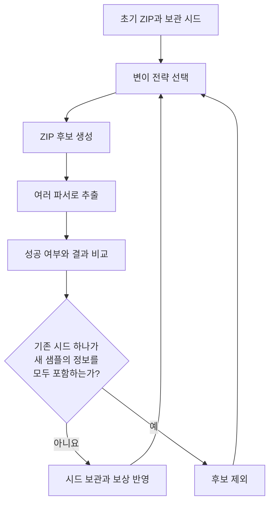

> ZipDiff로 살펴보는 파서 해석 차이와 보안 우회

보안 프로그램이 검사한 파일과 사용자가 실제로 연 파일이 같다면, 검사한 내용도 같을 것이라고 생각하기 쉽다. 그런데 **파일의 바이트가 같다는 사실만으로, 두 프로그램이 그 안에서 같은 내용을 읽었다고 보장할 수 있을까?**

이번에 살펴본 논문은 이 질문을 ZIP 파일에 적용한다. 취약점 분석에서 관심을 둘 대상을 개별 프로그램의 오류에서 **검사하는 구성 요소와 사용하는 구성 요소 사이의 해석 차이**까지 넓혀 주는 연구다.

## 논문 정보와 선정 이유

| 항목 | 내용 |
| --- | --- |
| 논문 | My ZIP isn’t your ZIP: Identifying and Exploiting Semantic Gaps Between ZIP Parsers |
| 저자 | Yufan You, Jianjun Chen, Qi Wang, Haixin Duan |
| 학회와 연도 | 34th USENIX Security Symposium, 2025 |
| 논문집 페이지 | 431–450 |
| 연구 도구 | ZipDiff |
| 수상 | Distinguished Paper Award |

[학회 공식 페이지](https://www.usenix.org/conference/usenixsecurity25/presentation/you) · [논문 PDF](https://www.usenix.org/system/files/usenixsecurity25-you.pdf) · [저자 공개 PDF](https://www.jianjunchen.com/p/zipdiff.USESEC25.pdf) · [공개 코드](https://github.com/ouuan/ZipDiff) · [아티팩트 보관본](https://doi.org/10.5281/zenodo.15526863)

이 논문을 고른 이유는 오펜시브 보안에서 활용할 수 있는 **취약점 탐색의 질문**이 분명하기 때문이다. 어떤 바이트를 바꾸면 프로그램이 죽는지를 넘어, 같은 입력을 여러 구성 요소가 어떻게 다르게 받아들이는지 추적한다. 공격자가 그 차이를 만들 수 있고, 차이가 보안 판단에 영향을 주면 우회 경로가 생길 수 있다.

ZIP이라는 익숙한 형식에서 출발하면서도 문서 처리, 서명 검증, 확장 프로그램 배포까지 연결된다는 점도 흥미롭다. 파일 포맷을 공부하는 일이 실제 공격 표면 분석과 어떻게 이어지는지 살펴보기 좋다. 게재 학회와 연도는 이번 미션 조건에 해당한다. [1]

### 읽기 전 문제 정리

| 질문 | 리뷰의 출발점 |
| --- | --- |
| 무엇을 해결하려는가 | 같은 ZIP을 처리하는 구현들이 서로 다른 내용을 선택하는 상황을 체계적으로 찾는 문제다. |
| 왜 중요한가 | 앞단에서 허용한 대상과 뒷단에서 사용한 대상이 달라지면 검사 결과의 의미가 달라질 수 있다. |
| 기존 접근의 빈틈은 무엇인가 | 개별 구현의 크래시나 이미 알려진 우회 사례를 확인하는 것만으로는 여러 구현 사이의 해석 차이를 충분히 설명하기 어렵다. |

이 리뷰에서는 **해석 차이가 존재하는가**, **그 차이를 자동으로 찾을 수 있는가**, **실제 제품에서 보안 문제가 되는가**를 차례로 확인한다. 세 질문의 답은 서로 연결되지만 같은 의미는 아니다. [1, 2]

본문은 논문의 문제의식과 방법론, 저자들의 평가 결과, 두 방향의 로컬 실험, 이후 연구 계획 순서로 구성했다. 5절과 6절의 실험은 논문의 C1을 축소해 확인한 결과이며, 상용 제품의 서명 검증이나 백신을 대상으로 한 실험은 아니다.

## 1. 같은 파일이 같은 내용을 뜻하지 않는 이유

### 먼저 알아둘 개념

| 용어 | 이 글에서의 의미 |
| --- | --- |
| 파서(Parser) | 파일의 바이트를 읽어 파일명, 내용, 구조 같은 의미 있는 정보로 해석하는 구현 |
| 의미 차이(Semantic gap) | 같은 입력을 처리한 구성 요소들이 서로 다른 의미나 결과를 얻는 상황 |
| 퍼징(Fuzzing) | 입력을 생성하거나 변형하면서 프로그램의 동작을 반복해서 관찰하는 시험 방식 |
| 차등 테스트(Differential testing) | 동일한 입력에 대한 여러 구현의 결과를 비교하는 시험 방식 |
| 시드와 코퍼스 | 다음 입력을 만들 때 출발점으로 사용하는 샘플과 그 집합 |
| 오라클(Oracle) | 시험 결과에서 어떤 현상을 관심 대상으로 판단할지 정한 기준 |

### ZIP에는 파일을 설명하는 정보가 여러 곳에 있다

ZIP의 구조를 이해할 때 우선 볼 부분은 다음 세 가지다. [3, §§4.3.6–4.3.16]

| 구조 | 역할 |
| --- | --- |
| LFH(Local File Header) | 각 파일 데이터 앞에 있으며 파일명, 압축 방법, 크기 등의 정보를 담는다. 일부 정보는 ZIP 기능과 플래그에 따라 다른 구조에 기록된다. |
| CDH(Central Directory Header) | 중앙 디렉터리에서 각 파일의 메타데이터와 해당 LFH의 위치를 알려 준다. |
| EOCDR(End of Central Directory Record) | 중앙 디렉터리의 위치와 크기, 엔트리 수 등을 찾는 데 쓰인다. |

초보자 관점에서는 LFH를 **개별 파일에 붙은 설명표**, CDH를 **전체 파일 목록의 항목**으로 생각하면 된다. 정상적인 입력이라면 같은 파일을 설명하는 정보가 일관되어야 한다.

그러나 설명표와 목록에 적힌 값이 다르면 문제가 생긴다. 예를 들어 파일의 이름이나 크기에 대해 둘 이상의 후보가 있을 때, 어느 정보를 믿을지 결정해야 한다. 엄격하게 오류를 반환하는 구현도 있을 수 있고, 호환성이나 손상 파일 복구를 위해 가능한 정보를 선택하는 구현도 있을 수 있다.

또한 중앙 디렉터리에서 파일을 찾는 방식과 앞에서부터 로컬 헤더를 따라 읽는 스트리밍 방식이 같은 엔트리 집합을 발견하는지도 확인해야 한다. 두 방식이 서로 다른 엔트리를 선택한다면 파일명 하나의 차이를 넘어 **어떤 파일이 존재한다고 보는지**부터 달라질 수 있다. [2, §2]

### 보안 문제가 되려면 검사와 사용이 연결되어야 한다

해석 차이 자체를 발견했다고 바로 취약점이 되는 것은 아니다. 다음은 실제 공격 가능성을 검토하기 위한 사고 실험이다.

한 서비스가 업로드된 압축 파일을 먼저 검사하고, 통과한 파일을 다른 라이브러리로 읽는다고 가정하자. 검사기는 허용된 내용만 확인했는데, 이후 처리기는 검사하지 않은 다른 엔트리를 선택한다면 검사 결과가 실제 사용 내용을 보증하지 못한다.

이때 확인할 조건은 네 가지다.

1. 공격자가 ZIP 내부의 바이트나 메타데이터를 조작할 수 있는가.
2. 같은 입력이 둘 이상의 해석 경로를 통과하는가.
3. 그 경로들이 파일 내용, 파일명, 식별자 등을 다르게 선택하는가.
4. 그 차이가 차단 정책, 서명 신뢰, 게시자 식별 같은 보안 결정을 바꾸는가.

논문의 위협 모델은 공격자가 ZIP의 바이트를 자유롭게 조작할 수 있다고 가정한다. 따라서 일반 압축 프로그램으로 생성할 수 있는 정상 파일에만 탐색 범위를 한정하지 않는다. [2, §3.1]

오펜시브 보안 관점에서 이 부분이 중요하다. 서비스가 받는 입력의 규격과, 공격자가 실제로 보낼 수 있는 입력의 범위는 구분해야 한다. 구현이 예상하지 않은 형태를 받아들인다면 그 처리 방식도 분석 대상이다.

## 2. ZipDiff는 해석 차이를 어떻게 찾는가

### 핵심은 여러 파서의 결과를 비교하는 것이다

ZipDiff는 ZIP을 생성하고 변형한 뒤 여러 파서에 같은 샘플을 전달하는 **블랙박스 차등 퍼저**다. 각 구현의 내부 코드 커버리지 대신 외부에서 관찰한 처리 결과를 이용한다. [2, §4]

이를 이해하기 쉽게 재구성하면 다음 흐름이다. 그림은 원문의 도식을 옮긴 것이 아니라, 탐색과 피드백의 관계를 요약한 것이다.



### 구조를 아는 변이와 바이트 변이를 함께 쓴다

복잡한 파일을 무작정 바꾸면 대부분의 입력이 파싱 초기에 거부될 수 있다. 예를 들어 어떤 필드를 바꾸면서 그 필드가 가리키는 위치를 그대로 두면, 관심 있는 처리 로직에 도달하기 전에 입력이 깨질 수 있다.

ZipDiff는 이런 문제를 줄이기 위해 ZIP 필드를 고려한 변이를 사용한다. 논문에 제시된 **ZIP 구조 수준의 변이 전략은 46개**다. 이와 함께 삽입, 삭제, 비트 반전 같은 바이트 수준 변이도 적용한다. 일부 구조 변이는 크기나 오프셋의 관계를 보정해 파서가 입력을 더 깊이 처리할 가능성을 높인다. [2, §4.2]

두 접근을 함께 쓰는 이유를 나는 다음처럼 이해했다. 구조를 유지하는 변이는 파서가 의미 있는 처리를 계속하도록 돕고, 거친 바이트 변이는 설계자가 예상하지 않은 경계 조건을 탐색하게 한다. 어느 하나만 사용하기보다 두 방식이 제공하는 탐색 범위의 차이를 이용하는 것이다.

### 무엇을 불일치로 세는지부터 정한다

이 논문에서 가장 주의해서 읽을 부분은 결과를 비교하는 기준이다. **두 파서가 모두 추출에 성공하고, 추출 결과의 해시가 달라야 불일치로 센다.** 한쪽은 성공하고 다른 쪽은 오류를 반환한 경우는 이 지표에 포함하지 않는다. [2, §4.3]

비교하는 해시는 입력 ZIP 자체의 해시가 아니라 **추출된 결과 디렉터리**에 대한 해시다. 또한 빈 디렉터리나 특정 파일명 차이 등 연구가 관심 대상으로 보지 않는 차이를 정규화한다. 따라서 이 결과는 파서의 모든 내부 동작이 같은지를 검사한 것이 아니라, 연구진이 정한 관찰 기준에서 출력이 같은지를 검사한 것이다. [2, §4.3, 부록 A]

나는 이 오라클의 장점과 제한을 함께 봐야 한다고 생각한다. 여러 언어와 구현을 같은 방식으로 비교하기 쉬운 기준인 동시에, 비교 기준 밖의 차이는 놓칠 수 있다. 실제 서비스가 파일을 디스크에 쓰지 않고 이름으로 직접 조회한다면, 그 서비스가 선택한 엔트리도 따로 관찰해야 한다.

### 발견한 정보를 다음 탐색에 반영한다

ZipDiff는 각 샘플에서 성공한 파서 집합과 서로 다른 결과를 낸 파서 쌍 집합을 관리한다. 기존 샘플 하나가 새 샘플의 두 집합을 모두 포함한다면 새 샘플을 보관할 필요가 작다고 판단한다. 새로운 정보를 담은 샘플은 후속 변이의 출발점이 된다. [2, §4.3]

변이 전략을 선택할 때는 UCB(Upper Confidence Bounds)에 기반한 점수를 사용한다. 이미 좋은 결과를 낸 전략을 활용하면서 덜 시도한 전략에도 기회를 주는 방식이다. ZipDiff는 가장 높은 점수 하나만 고르는 대신 softmax를 이용한 확률적 선택을 하고, 오래된 성과의 영향도 줄인다. [2, §4.4]

여기서 배울 점은 자동화 도구의 핵심이 입력을 많이 만드는 데만 있지 않다는 것이다. **어떤 결과를 새로운 정보로 볼 것인지**, 그리고 그 정보를 다음 입력 생성에 어떻게 반영할지가 탐색 효율을 결정한다.

### 모호성은 세 범주로 정리된다

연구진은 발견한 모호성을 **중복 메타데이터, 파일 경로 처리, ZIP 구조 위치**의 세 범주와 14개 유형으로 정리했다. [2, §5.2]

| 범주 | 이해를 위한 대표 질문 |
| --- | --- |
| 중복 메타데이터 | 같은 파일의 이름, 크기, 압축 방법이 여러 곳에서 다르게 기록되면 무엇을 믿는가. |
| 파일 경로 처리 | 같은 이름이 여러 번 나오거나 경로 표현이 달라질 때 어떤 엔트리를 선택하는가. |
| ZIP 구조 위치 | 중앙 디렉터리나 종료 레코드의 후보가 여럿이면 어디를 기준으로 읽는가. |

내가 취약점 분석에 가져가고 싶은 질문은 **하나의 의미를 결정하는 정보가 여러 군데 있는가**이다. 중복 정보가 항상 잘못된 설계인 것은 아니다. 다만 서로 충돌할 때 우선순위와 거부 조건이 명확하지 않으면 구현마다 다른 선택이 생길 수 있다.

또한 초록의 ‘새로운 모호성 10개’라는 표현은 본문의 Table 2와 함께 읽을 필요가 있다. 그 수에는 완전히 새로운 유형뿐 아니라 **기존 유형의 새로운 변형과 구성 기법**도 포함된다. [2, §8.2, Table 2]

## 3. 논문의 평가 결과를 어떻게 읽을 것인가

### 실험 규모와 수치의 의미

논문은 19개 언어에 걸친 50개 파서를 평가했다. 여기서 파서는 독립 제품 수와 정확히 같은 개념이 아니다. 같은 라이브러리의 일반 API와 스트리밍 API 등을 별도 대상으로 다룬 경우가 포함된다. [2, §5.1]

| 항목 | 논문이 보고한 값 | 읽을 때 주의할 점 |
| --- | --- | --- |
| 대상 파서 | 50개 | 버전, API, 실행 방식이 정해진 평가 대상이다. |
| 전체 파서 쌍 | 1,225쌍 | 50 × 49 ÷ 2로 계산한 조합 수다. |
| 불일치가 확인된 쌍 | 1,221쌍 | 시험 샘플에서 적어도 한 종류의 차이가 관측된 쌍이다. |
| 모호성 분류 | 3개 범주, 14개 유형 | 취약 제품 수나 CVE 수가 아니다. |
| 실제 적용 사례 | 5가지 시나리오 | 모든 ZIP 사용 환경의 공격 가능성을 입증한 것은 아니다. |
| 관련 CVE | 3건 | Go, LibreOffice, Spring Boot에 연결되는 신고 사례다. |

출처: [2, §§5–7, 부록 B·C].

1,221을 1,225로 나누면 약 99.67%다. 그러나 이 비율의 분모는 **시험한 파서 쌍**이다. 실제 서비스에 대한 공격 시도 횟수나 공격 성공 횟수가 아니므로 공격 성공률로 해석할 수 없다.

또한 1,221쌍은 퍼징 결과를 분석한 뒤 유형별로 구성한 샘플을 시험해 집계한 값이다. 아래의 24시간 퍼징 성능 비교에서 나오는 1,197쌍과는 집계 조건이 다르다. [2, §§5.2–5.3]

### 구성 요소를 제거하거나 바꾸면 성능이 달라지는가

저자들은 세 가지 구성을 각각 24시간씩 다섯 번 실행하고, 발견한 불일치 파서 쌍 수의 중앙값을 비교했다. [2, §5.3, Figure 4]

| 구성 | 달라진 조건 | 24시간 후 중앙값 |
| --- | --- | ---: |
| Full Setup | 논문이 제안한 전체 구성 | 1,197쌍 |
| Argmax-Based UCB | softmax 선택을 최고 점수 선택으로 교체 | 1,183쌍 |
| Byte Mutation Only | ZIP 구조 수준 변이를 제외 | 1,055쌍 |

이 조건에서 전체 구성은 바이트 변이만 사용한 구성보다 142쌍을 더 발견했다. 최고 점수만 고르는 구성과의 차이는 14쌍이다. 이 숫자를 보면 최종 발견량에서는 구조를 고려한 변이의 효과가 더 크게 드러난다. 다만 두 구성 요소의 일반적 중요도를 이 차이만으로 확정해서는 안 된다. 입력 집합, 실행 예산, 탐색 과정에 따라 효과가 달라질 수 있기 때문이다.

Figure 4에는 시간에 따른 추이도 있으므로 최종값뿐 아니라 차이를 얼마나 빨리 찾았는지도 함께 읽어야 한다. 그래프의 세로축에는 단절이 있어 선의 시각적 간격만으로 배율을 추정하지 않는 편이 좋다.

## 4. 실제 제품에서는 어떤 신뢰 판단이 달라졌는가

논문은 파서 차이의 존재를 확인한 뒤, 그 차이가 실제 제품의 신뢰 판단에 영향을 주는 사례를 제시한다. [2, §6]

| 시나리오 | 서로 달라지는 판단 | 공격 성립을 볼 때 필요한 조건 |
| --- | --- | --- |
| 이메일 첨부 검사 우회 | 게이트웨이가 검사한 내용과 사용자 압축 해제기가 추출한 내용 | 해당 파서 조합과 후속 처리, 단말의 추가 검사 여부를 함께 봐야 한다. |
| 오피스 문서 내용 혼동 | 문서 뷰어가 표시한 내용과 외부 검사기가 읽은 내용 | 서로 다른 엔트리를 선택하는 실제 문서 처리 경로가 있어야 한다. |
| LibreOffice 서명 상태 혼동 | 서명을 확인한 내용과 복구 모드에서 표시한 내용 | 유효하게 서명된 원본과 다른 내용을 보게 되는 복구 경로가 전제된다. |
| Spring Boot 중첩 JAR 서명 혼동 | 서명 검증 대상과 실제로 읽는 내용 | Loader 사용과 중첩 JAR 서명 검증 사용자 정의 코드라는 조건이 있다. |
| VS Code 확장 ID 사칭 | 게시 서버와 클라이언트가 읽는 확장 식별자 | 피해자가 조작된 확장을 설치하는 조건을 포함한다. |

이 표는 논문이 조사한 당시의 사례를 요약한 것이다. 현재 제품의 취약 여부는 각 수정 버전과 실제 구성을 기준으로 판단해야 한다.

### 가장 인상적인 사례는 LibreOffice의 복구 모드였다

여러 제품이 서로 다른 파서를 사용한다면 결과가 달라질 수 있다는 점은 비교적 쉽게 예상할 수 있다. 그런데 **같은 프로그램의 정상 모드와 복구 모드도 다를 수 있다**는 사례는 검사 범위를 넓혀 준다.

LibreOffice의 공식 공지는 손상된 ZIP 중앙 디렉터리를 복구할 때 로컬 파일 헤더를 찾아 문서를 재구성한다고 설명한다. 취약했던 버전에서는 복구된 파일에 맞지 않는 서명 상태가 보고될 수 있었다. 수정 후에는 복구 모드의 서명을 유효하지 않은 것으로 취급한다. [6]

내가 여기서 얻은 교훈은 검증 결과에 적용 범위가 있다는 것이다. 정상 경로에서 얻은 신뢰 판단을, 내용을 다시 선택하거나 재구성한 경로에 그대로 넘겨도 되는지 확인해야 한다. 오류 복구와 호환성 처리는 기능을 유지하는 데 도움이 되지만, 그 과정에서 이전의 보안 판단을 계속 사용할 수 있는지는 별도의 문제다.

따라서 분석할 때 라이브러리 이름과 버전만 적는 것으로는 부족하다. 호출한 API, 옵션, 실패 시 대체 경로, 복구 모드 진입 여부까지 기록해야 실제 동작을 설명할 수 있다.

### 관련 CVE와 수정 이력

세 CVE는 공식 자료로도 연결을 확인할 수 있다. 아래는 해당 문제가 처음 수정된 버전의 예시이며, 현재 설치할 최신 버전을 추천하는 목록은 아니다. [5–7]

| CVE | 공식 자료에서 확인되는 문제 | 당시 수정 버전 |
| --- | --- | --- |
| CVE-2024-24789 | Go `archive/zip`이 일부 잘못된 ZIP을 다른 구현과 다르게 처리 | Go 1.21.11, 1.22.4 |
| CVE-2024-7788 | LibreOffice 복구 모드에서 복구된 내용에 맞지 않는 서명 상태 | LibreOffice 24.2.5, 24.8.0 |
| CVE-2024-38807 | Spring Boot Loader를 통한 중첩 JAR 서명 검증의 신뢰 문제 | OSS 계열 3.2.9, 3.3.3 등 |

특히 Spring Boot의 공식 공지는 `spring-boot-loader` 또는 `spring-boot-loader-classic`을 사용하고, 중첩 JAR의 서명을 검사하는 사용자 정의 코드가 있는 애플리케이션이라는 조건을 명시한다. 이를 모든 Spring Boot 서버의 원격 코드 실행 취약점으로 확대하면 정확하지 않다. [7]

CVE 번호가 2024로 시작해도 논문 게재 연도는 2025년이다. 연구 과정의 발견·신고·수정과 학회 발표 시점은 다를 수 있으므로, 이번 미션에서는 논문의 게재 연도를 확인하면 된다.

이 가운데 Spring Boot 사례는 뒤의 로컬 실험과 직접 연결된다. 다만 검사와 사용의 방향을 구분해야 한다. 5절에서는 중앙 디렉터리 기반 파서를 검사 역할로 사용하고, 6절에서는 Spring Boot 사례처럼 스트리밍 파서를 검사 역할로 사용한다.

## 5. 실험 A: 중앙 디렉터리를 읽는 검사기와 스트리밍 후단
{: #5-추가-실험-python과-java가-같은-zip을-다르게-읽는-경우 }

**검사기는 `safe.txt`만 읽고 통과시키지만, 뒷단은 검사에 보이지 않은 `marker.txt`까지 꺼낸다.** 이 상황을 무해한 텍스트로 확인하는 것이 첫 번째 실험의 목표다.

논문 §5.2.3의 C1에는 여러 구성법이 있다. 여기서는 첫 번째 구성인 **LFH는 있지만 대응하는 CDH가 없는 경우**를 사용한다. Python의 `zipfile.ZipFile`에 검사 역할을, Java의 `ZipInputStream`에 후단 추출 역할을 맡긴다. [2, §5.2.3; 11]

### 실험용 파일과 검사 규칙

두 파일의 내용은 모두 ASCII 텍스트다.

| 파일 | 내용 | 역할 |
| --- | --- | --- |
| `safe.txt` | `This is harmless classroom text.`와 줄바꿈 | 허용할 파일 |
| `marker.txt` | `MARKER_BLOCK`과 안내 문장 | 모의 검사에서 차단할 파일 |

검사 규칙은 다음과 같다.

> 검사 역할의 파서가 읽은 파일 중 `MARKER_BLOCK` 바이트열을 포함한 파일이 있으면 `BLOCK`, 없으면 `PASS`로 판정한다. 파서 실행이 실패하면 `ERROR`로 기록하며 통과로 취급하지 않는다.

`MARKER_BLOCK`은 파일이 검사 범위에 들어왔는지 확인하기 위한 표식이다. 위험한 기능이나 실행 코드는 없다. **후단에는 이 검사 규칙을 적용하지 않고, 어떤 파일이 추출됐는지만 기록한다.** 따라서 후단의 결과는 `PASS`나 `BLOCK`이 아니라 `marker.txt 추출됨`처럼 표현한다.

### 실험 환경과 재현 파일

아래 표와 로그는 표식을 `MARKER_BLOCK`으로 고정한 코드를 다음 환경에서 실행해 얻은 결과다.

| 항목 | 검증 환경 |
| --- | --- |
| 운영체제 | Linux x86-64 |
| Python | 3.12.14 |
| Java | OpenJDK 21.0.13 |
| ZIP 압축 방식 | `ZIP_STORED`, 실제 압축 없음 |
| 입력 범위 | 고정된 텍스트 두 파일, ZIP32, 단일 디스크, 주석 없음 |
| 읽기 완료 조건 | 각 엔트리의 내용을 끝까지 읽고 CRC를 확인한 뒤 실제 파일로 저장 |

[실험 코드와 검증 기록 내려받기]({{ '/assets/files/zipdiff-review-v2/zipdiff_review_v2_lab.zip' | relative_url }})

패키지에는 `make_fixtures.py`, `run_lab.py`, `ArchiveReader.java`, 한국어 실행 설명서와 `observed_run` 검증 기록이 들어 있다. Ubuntu에서는 Python 3와 JDK 21을 준비한 뒤 압축을 풀고 실행한다.

```bash
sudo apt update
sudo apt install -y python3 openjdk-21-jdk-headless unzip
unzip zipdiff_review_v2_lab.zip
cd zipdiff_review_v2
python3 run_lab.py
```

Windows에서 Python과 JDK 21이 이미 설치돼 있다면 같은 폴더에서 `py -3 run_lab.py`로 실행할 수 있다. 실제 사용한 버전은 `python3 --version` 또는 `py -3 --version`, `java -version`으로 기록한다. 여기의 결과표는 위 Linux 환경에서 확인한 값이다.

### ZIP 생성 코드

다음은 실험 A와 실험 B에 사용하는 ZIP 생성 코드 전체다. 파일 내용과 날짜를 고정해 입력을 다시 생성할 수 있도록 했다. 정상 ZIP 두 개를 만든 뒤, 동일한 정상 대조군에서 두 가지 변형을 각각 생성한다.

`make_fixtures.py`로 저장하고 `python3 make_fixtures.py`를 실행하면 `fixtures` 폴더가 생긴다. 이 폴더가 이미 있으면 덮어쓰지 않는다. 다른 경로는 `python3 make_fixtures.py fixtures-second`처럼 지정한다. 전체 실험을 실행하는 `run_lab.py`는 매번 새로운 실행 폴더를 만든다.

```python
"""Generate four fixed, harmless text fixtures for a ZIP parser comparison."""

import io
import struct
import sys
import zipfile
from pathlib import Path

MARKER = b"MARKER_BLOCK"
SAFE = b"This is harmless classroom text.\n"
MARKED = b"MARKER_BLOCK\nThis is harmless marker text.\n"
GAP = b"LFH_STREAM_STOP".ljust(32, b"_")


def ordinary_zip(with_marker):
    buffer = io.BytesIO()
    entries = [("safe.txt", SAFE)]
    if with_marker:
        entries.append(("marker.txt", MARKED))
    with zipfile.ZipFile(buffer, "w", compression=zipfile.ZIP_STORED) as archive:
        for name, data in entries:
            info = zipfile.ZipInfo(name, date_time=(2025, 1, 1, 0, 0, 0))
            info.compress_type = zipfile.ZIP_STORED
            info.create_system = 3
            info.external_attr = 0o100644 << 16
            archive.writestr(info, data)
    return buffer.getvalue()


def directory_records(raw):
    # This helper accepts only the small ZIP32 fixture created above.
    eocd = len(raw) - 22
    fields = struct.unpack_from("<4s4H2IH", raw, eocd)
    sig, disk, cd_disk, n_disk, n_total, cd_size, cd_start, comment = fields
    if (sig, disk, cd_disk, n_disk, n_total, comment) != (
        b"PK\x05\x06", 0, 0, 2, 2, 0
    ) or cd_start + cd_size != eocd:
        raise ValueError("Unexpected fixed fixture")
    records = []
    cursor = cd_start
    while cursor < eocd:
        if raw[cursor:cursor + 4] != b"PK\x01\x02":
            raise ValueError("CDH signature missing")
        n, x, c = struct.unpack_from("<HHH", raw, cursor + 28)
        length = 46 + n + x + c
        name = raw[cursor + 46:cursor + 46 + n].decode("ascii")
        record = raw[cursor:cursor + length]
        records.append((name, record))
        cursor += length
    if cursor != eocd or [name for name, _ in records] != ["safe.txt", "marker.txt"]:
        raise ValueError("Unexpected central directory entries")
    return cd_start, raw[eocd:], records


def remove_marker_cdh(raw):
    """C1 construction 1: leave marker LFH/data, remove its CDH."""
    cd_start, footer, records = directory_records(raw)
    directory = b"".join(record for name, record in records if name == "safe.txt")
    footer = bytearray(footer)
    struct.pack_into("<H", footer, 8, 1)               # entries on this disk
    struct.pack_into("<H", footer, 10, 1)              # total entries
    struct.pack_into("<I", footer, 12, len(directory)) # central directory size
    # EOCD +16 remains unchanged: the local-data area did not move.
    return raw[:cd_start] + directory + footer


def interrupt_lfh_stream(raw):
    """C1 construction 2: insert non-LFH bytes before marker's LFH."""
    cd_start, footer, records = directory_records(raw)
    marker_record = next(record for name, record in records if name == "marker.txt")
    insertion = struct.unpack_from("<I", marker_record, 42)[0]
    if raw[insertion:insertion + 4] != b"PK\x03\x04":
        raise ValueError("marker LFH not found")
    directory = bytearray()
    for _, record in records:
        record = bytearray(record)
        local_offset = struct.unpack_from("<I", record, 42)[0]
        if local_offset >= insertion:
            struct.pack_into("<I", record, 42, local_offset + len(GAP))
        directory.extend(record)
    footer = bytearray(footer)
    struct.pack_into("<I", footer, 16, cd_start + len(GAP))
    # Counts (+8/+10) and directory size (+12) remain unchanged.
    return raw[:insertion] + GAP + raw[insertion:cd_start] + directory + footer


def make_fixtures(destination):
    destination = Path(destination)
    destination.mkdir(parents=True, exist_ok=False)
    normal = ordinary_zip(True)
    fixtures = {
        "safe_control": ordinary_zip(False),
        "normal_marker_control": normal,
        "c1_missing_cdh": remove_marker_cdh(normal),
        "c1_interrupted_stream": interrupt_lfh_stream(normal),
    }
    for name, data in fixtures.items():
        (destination / (name + ".zip")).write_bytes(data)
    return fixtures


if __name__ == "__main__":
    destination = Path(sys.argv[1]) if len(sys.argv) == 2 else Path("fixtures")
    for name, data in make_fixtures(destination).items():
        print(name + ".zip", len(data), "bytes")
```

이 코드는 자신이 생성한 작은 실험 파일의 구조를 전제로 한다. ZIP64, 분할 ZIP, 임의의 주석과 확장 필드 등을 처리하는 일반 ZIP 편집기는 아니다.

### 실험 A에서 실제로 바꾼 필드

`remove_marker_cdh()`는 `marker.txt`의 **중앙 디렉터리 항목 전체**를 제거한다. 파일 수 필드만 줄이는 방식이 아니다. `marker.txt`의 LFH와 데이터는 원래 위치에 남겨 둔다.

오프셋은 해당 구조의 시작점을 0으로 한 바이트 위치다. 다중 바이트 정수는 little-endian으로 기록한다. 필드 정의는 PKWARE APPNOTE §§4.3.12, 4.3.16을 따른다. [3]

| 수정 대상 | 오프셋과 크기 | 정상 대조군 | 실험 A |
| --- | --- | ---: | ---: |
| EOCD의 현재 디스크 엔트리 수 | `+8`, 2바이트 | 2 | 1 |
| EOCD의 전체 엔트리 수 | `+10`, 2바이트 | 2 | 1 |
| EOCD의 중앙 디렉터리 크기 | `+12`, 4바이트 | 110 | 54 |
| EOCD의 중앙 디렉터리 시작 위치 | `+16`, 4바이트 | 154 | 154, 유지 |
| `marker.txt`의 CDH | 해당 항목 전체 | 56바이트 | 제거 |
| 두 파일의 LFH와 데이터 | 중앙 디렉터리 앞부분 | 존재 | 그대로 유지 |

중앙 디렉터리 앞의 바이트는 바꾸지 않았으므로 중앙 디렉터리 시작 위치는 유지된다. 반면 중앙 디렉터리가 짧아졌기 때문에 새 EOCD 자체의 파일 내 위치는 264에서 208로 이동한다. **EOCD의 위치와 EOCD에 기록된 중앙 디렉터리 위치는 다른 값**이다.

생성된 `c1_missing_cdh.zip`에는 다음과 같은 차이가 생긴다.

| 관찰할 구조 | 들어 있는 파일 |
| --- | --- |
| LFH와 파일 데이터 | `safe.txt`, `marker.txt` |
| 중앙 디렉터리 | `safe.txt` |

PKWARE APPNOTE §4.3.2는 각 LFH에 대응하는 CDH가 있어야 한다고 규정한다. 실험 A는 이 조건을 의도적으로 어긴 입력이다. 파서가 성공했다고 해서 입력이 ZIP 명세를 만족한다는 뜻은 아니다. [3]

### 대조군과 실제 결과

검사 규칙이 제대로 작동하는지 확인하기 위해 두 정상 ZIP을 대조군으로 사용했다. 파서 자체의 결과를 비교하려고 **검사 판정과 무관하게 후단도 별도로 실행**했다. 따라서 아래의 정상 표시 파일 행은 차단된 파일을 실제 서비스에 넘겼다는 뜻이 아니라, 그 ZIP을 후단만 단독 실행했을 때의 관측값이다.

| 입력 | Python 검사기가 읽은 파일 | 검사 판정 | Java 후단 단독 실행 결과 |
| --- | --- | --- | --- |
| `safe_control.zip` | `safe.txt` | `PASS` | `safe.txt` 추출됨 |
| `normal_marker_control.zip` | `safe.txt`, `marker.txt` | `BLOCK` | 두 파일 추출됨 |
| `c1_missing_cdh.zip` | `safe.txt` | **`PASS`** | **`marker.txt`를 포함한 두 파일 추출됨** |

정상 표시 파일 대조군에서 Python은 `MARKER_BLOCK`을 찾아 차단했다. 검사 규칙은 동작한다. 변형 ZIP에서는 중앙 디렉터리에 `marker.txt`가 없어서 파일 자체가 검사 범위에서 빠졌다.

**Python은 `PASS`를 줬는데, Java는 검사받지 않은 `marker.txt`를 꺼냈다.** 여기서 Java가 공격을 탐지한 것은 아니다. 후단은 자신이 읽을 수 있는 엔트리를 추출했을 뿐이다.

실행 로그에서 실험 A에 해당하는 부분을 발췌하면 다음과 같다.

```text
[c1_missing_cdh]
  input_same_and_unchanged=True
  python-central: exit=0 entries=['safe.txt']
  java-zip-stream: exit=0 entries=['safe.txt', 'marker.txt']
  A_central_to_stream: scanner=PASS consumer_marker_extracted=True trees_equal=False marker_reachable_after_pass=True
```

`marker_reachable_after_pass=True`는 검사 결과가 `PASS`이고 후단의 별도 추출 결과에 표시 파일이 있다는 뜻이다. 실제 네트워크 서비스나 운영체제 실행 여부를 나타내는 값은 아니다.

### 입력 해시와 추출 결과 해시

각 파서가 읽은 입력의 SHA-256과 실행 전후 입력 파일의 해시를 함께 기록했다. Python과 스트리밍 Java API는 해시를 계산한 바이트 배열을 그대로 파싱했다. 파일 경로를 요구하는 Java `ZipFile`은 같은 바이트로 만든 전용 임시 복사본을 읽고, 처리 후에도 복사본이 같은지 확인했다.

출력은 파일별 상대 경로, 크기, 내용의 SHA-256을 경로순으로 정렬한 JSON으로 표현하고, 그 JSON의 SHA-256을 계산했다. 이 실험의 파일은 평면 디렉터리의 일반 텍스트 파일뿐이며, 이 방식이 임의의 ZIP을 위한 완전한 정규화 규칙이라는 뜻은 아니다.

| 비교 대상 | 실험 A의 결과 | 의미 |
| --- | --- | --- |
| 두 파서가 받은 동일 ZIP의 해시 | 같음 | 입력 바이트가 같음 |
| 파서 실행 전후 입력 ZIP의 해시 | 같음 | 실험 도중 입력이 바뀌지 않음 |
| 실제 추출한 파일 트리의 해시 | 다름 | 만들어진 파일 집합이 다름 |

정상 대조군과 변형 ZIP은 서로 다른 파일이므로 둘의 ZIP 해시도 다르다. 확인한 것은 **하나의 변형 ZIP을 두 파서에 동일하게 전달해도 추출 결과가 달라진다**는 점이다.

두 프로그램은 모두 종료 코드 0으로 완료됐고 표준 오류 출력도 없었다. 이 실험은 두 파서가 성공하면서 최종 추출 결과가 다른 경우를 직접 보여 준다.

## 6. 실험 B: Spring Boot 사례와 같은 방향으로 역할 바꾸기

### Spring Boot 사례는 검사와 사용의 방향이 반대다

논문 §6.4의 Spring Boot 사례에서는 `NestedJarFile`이 서명 확인에 Java의 `JarInputStream`을 사용하고, 실제 내용 읽기에 Spring Boot의 `ZipContent`를 사용한다. 전자는 스트리밍 방식이고 후자는 중앙 디렉터리 기반 방식이다. [2, §6.4]

| 구분 | 검사 또는 검증 역할 | 후단의 내용 읽기 |
| --- | --- | --- |
| 실험 A | Python `zipfile.ZipFile`, 중앙 디렉터리 | Java `ZipInputStream`, 스트리밍 |
| 논문 속 Spring Boot 사례 | Java `JarInputStream`, 스트리밍 서명 확인 | Spring Boot `ZipContent`, 중앙 디렉터리 |
| 실험 B | Java `JarInputStream`이 읽은 내용에 표시 문자열 검사 | JDK `ZipFile`, 중앙 디렉터리 |

따라서 실험 A만으로 Spring Boot 사례와 같은 검사·사용 방향을 확인했다고 쓰면 정확하지 않다. 방향을 바꾸려면 스트리밍 검사기가 뒤쪽 파일을 발견하지 못하고, 중앙 디렉터리 기반 후단은 그 파일을 찾는 입력이 필요하다.

실험 B에서는 논문의 C1 두 번째 구성인 **LFH 스트림 끊기**를 사용한다. 여기서 끊는 것은 연속된 로컬 항목을 읽는 흐름이다. ZIP 파일 자체의 뒷부분을 잘라내는 것은 아니다. [2, §5.2.3]

### LFH 사이에 32바이트를 넣기

앞에서 공개한 `interrupt_lfh_stream()`은 정상 대조군의 `safe.txt` 데이터가 끝난 뒤, `marker.txt` LFH가 시작하기 전에 32바이트를 넣는다. 삽입한 값은 `LFH_STREAM_STOP` 뒤를 밑줄로 채운 ASCII 바이트열이다. 이 문자열에 특별한 명령 의미는 없으며, LFH 시그니처로 시작하지 않는다는 점만 이용한다.

실험에 사용한 스트리밍 API는 첫 파일을 읽은 뒤 이 위치에서 다음 LFH를 찾지 못하고 엔트리 열거를 끝냈다. 중앙 디렉터리 기반 파서는 목록에 기록된 위치를 따라 뒤쪽 `marker.txt`에 접근했다.

| 파일 내 순서 | 내용 |
| --- | --- |
| 1 | `safe.txt`의 LFH와 데이터 |
| 2 | LFH로 해석되지 않는 32바이트 |
| 3 | `marker.txt`의 LFH와 데이터 |
| 4 | 두 파일을 모두 가리키는 중앙 디렉터리 |
| 5 | 실제 중앙 디렉터리 위치가 기록된 EOCD |

삽입 지점 뒤쪽의 구조가 32바이트씩 이동하므로 참조하는 위치도 수정해야 한다. 단순히 중간에 바이트만 넣으면 중앙 디렉터리가 잘못된 위치를 가리킬 수 있다.

| 수정 대상 | 오프셋과 크기 | 정상 대조군 | 실험 B |
| --- | --- | ---: | ---: |
| `marker.txt` CDH의 LFH 상대 위치 | CDH `+42`, 4바이트 | 71 | 103 |
| EOCD의 중앙 디렉터리 시작 위치 | EOCD `+16`, 4바이트 | 154 | 186 |
| `safe.txt` CDH의 LFH 상대 위치 | CDH `+42`, 4바이트 | 0 | 0, 유지 |
| EOCD의 두 엔트리 수 필드 | EOCD `+8`, `+10` | 각각 2 | 각각 2, 유지 |
| EOCD의 중앙 디렉터리 크기 | EOCD `+12`, 4바이트 | 110 | 110, 유지 |

파일 항목이나 CDH를 삭제하지 않았으므로 엔트리 수와 중앙 디렉터리 크기는 바꾸지 않는다. 두 파일의 내용과 CRC도 그대로다. 원본과 변형 파일의 실제 필드 값은 패키지의 `observed_run/structure.json`에 기록했다.

### 역방향 대조군과 결과

검사 역할은 `JarInputStream`이 읽은 파일에 `MARKER_BLOCK` 규칙을 적용한다. 후단인 `ZipFile`에는 검사 판정을 붙이지 않는다. 실험 A와 마찬가지로 후단은 대조 관측을 위해 모든 입력을 독립적으로 읽는다.

| 입력 | `JarInputStream` 검사 역할이 읽은 파일 | 검사 판정 | `ZipFile` 후단 단독 실행 결과 |
| --- | --- | --- | --- |
| `safe_control.zip` | `safe.txt` | `PASS` | `safe.txt` 추출됨 |
| `normal_marker_control.zip` | `safe.txt`, `marker.txt` | `BLOCK` | 두 파일 추출됨 |
| `c1_interrupted_stream.zip` | `safe.txt` | **`PASS`** | **`marker.txt`를 포함한 두 파일 추출됨** |

실행 로그에서 실험 B에 해당하는 부분은 다음과 같다.

```text
[c1_interrupted_stream]
  input_same_and_unchanged=True
  java-jar-stream: exit=0 entries=['safe.txt']
  java-central: exit=0 entries=['safe.txt', 'marker.txt']
  B_stream_to_central: scanner=PASS consumer_marker_extracted=True trees_equal=False marker_reachable_after_pass=True
```

이번에도 두 파서는 같은 ZIP을 읽었고 모두 정상 종료했다. 그러나 검사 역할은 `safe.txt`까지만 읽었고, 후단은 중앙 디렉터리를 따라 `marker.txt`까지 추출했다.

반대 방향의 결과도 함께 확인했다. 실험 A의 ZIP을 `JarInputStream` 검사 역할에 넣으면 표식이 보여 `BLOCK`이 됐다. 실험 B의 ZIP을 Python 중앙 디렉터리 검사 역할에 넣어도 `BLOCK`이 됐다. **모호한 ZIP 하나가 모든 조합을 통과하는 것이 아니라, 검사와 사용이 어떤 방향으로 연결되는지가 중요하다.**

### 실제 CVE와 연결되는 부분과 남은 차이

Spring의 공식 공지는 CVE-2024-38807의 영향 조건을 `spring-boot-loader` 또는 `spring-boot-loader-classic`을 사용하면서, 중첩 JAR의 서명을 검증하는 사용자 정의 코드가 있는 애플리케이션으로 설명한다. [7]

실험 B는 **스트리밍 검사 역할이 보지 못한 파일을 중앙 디렉터리 기반 후단이 읽는 방향**을 확인했다. 그러나 JDK `ZipFile`은 Spring Boot의 `ZipContent`와 다른 구현이다. 또한 이 실험에는 중첩 JAR, 전자서명, 서명자 확인이 없다. Java 코드도 `JarInputStream(..., false)`를 사용해 서명 검증을 실험 대상으로 삼지 않는다.

따라서 이 결과의 정확한 범위는 **Spring Boot 사례와 같은 검사·사용 방향을 가진 C1 파서 차이의 축소 재현**이다. CVE-2024-38807의 서명 위조를 재현한 결과로 해석할 수는 없다. 논문 §6.4도 C1을 사용했다고 설명할 뿐, 공개된 그 문단만으로 실제 CVE의 구체적인 구성법을 하나로 확정할 수는 없다.

Oracle 문서에서 `JarInputStream`의 서명 검증은 manifest와 서명 관련 엔트리의 배치, 엔트리를 끝까지 읽는 조건을 포함한다. 서명 없는 자료에서 예외가 발생하지 않았다는 사실만으로 서명 검증 성공을 주장해서는 안 된다. [12]

## 7. 논문과 로컬 실험의 한계

### 저자가 밝힌 한계

논문의 제한점 중 특히 중요한 것은 두 가지다. 첫째, 블랙박스 방식이라 내부 코드 커버리지를 활용하지 않는다. 둘째, 최종 추출 디렉터리가 파서 내부 상태를 모두 보여 주지는 않는다. 중복 파일이 처리되는 도중 서로 다른 엔트리가 선택되더라도 마지막에 덮어써지면 결과에서 차이가 사라질 수 있다. [2, §7.3]

이는 방법론의 장점과 직접 연결된다. 외부 출력만 비교하면 여러 언어의 구현을 통합하기 쉬워진다. 반면 실제 애플리케이션이 내부에서 어떤 엔트리를 참조했는지까지는 알기 어렵다. 더 정밀한 관찰을 추가할수록 구현마다 별도의 계측이 필요해지고, 도구 통합 비용이 늘어날 수 있다.

### 이번 로컬 실험이 다룬 범위

이번에는 정상 대조군과 C1의 두 구성만 확인했다. 50개 파서 전체를 실행하거나 14개 모호성 유형을 모두 재현하지는 않았다. 실험에서 사용한 파서 버전과 고정된 입력에서 나온 관측을 다른 제품과 모든 버전에 그대로 적용할 수는 없다.

검사 규칙도 특정 ASCII 표식을 찾는 모의 규칙이다. 상용 백신의 탐지 성능, 메일 서비스의 전달 정책, 운영체제의 실행 시점 검사까지 측정한 실험은 아니다. 파일이 추출됐다는 사실과 실제로 실행됐다는 사실도 구분해야 한다.

실행기는 오류를 `ERROR`로 기록하고 통과로 취급하지 않는다. 이번 네 입력에서는 네 읽기 방식이 모두 종료 코드 0으로 완료됐고 표준 오류가 비어 있었다. 총 16회의 읽기 결과에서 관심 있는 두 조합의 추출 파일 집합이 실제로 달랐다.

### 결과 비교는 관찰 기준까지 함께 설명해야 한다

실행기에는 선택한 두 파서의 추출 결과가 다르면 차단하는 비교 규칙도 넣었다. 두 관심 사례는 이 규칙에서 모두 차단됐다. 이는 **이 표본에서 불일치를 발견할 수 있었다**는 관측이며, 모든 ZIP에 대한 완전한 방어를 입증한 것은 아니다.

또한 지금의 비교는 경로, 크기, 파일 내용만 다룬다. 중복 이름의 중간 선택, 파일 권한, 심볼릭 링크, 플랫폼별 경로 처리 등은 별도 관찰이 필요하다. 비교 도구를 확장한다면 무엇을 결과에 포함하고 무엇을 제외했는지부터 명시해야 한다.

## 8. 배운 점과 앞으로 할 일

### 취약점 분석의 단위를 처리 경로까지 넓히기

이 논문을 읽고 실험하면서 가장 크게 바뀐 관점은 **검사한 내용과 실제로 사용하는 내용을 각각 기록해야 한다**는 점이다.

처음에는 입력 ZIP의 해시가 같으면 같은 파일을 검사한 것이라고 생각하기 쉬웠다. 그러나 실험에서 입력 바이트는 그대로였고, 두 파서도 오류 없이 종료했다. 달랐던 것은 각자가 선택한 엔트리 집합이었다. 보안 판단이 어느 해석 결과에 붙어 있는지까지 따라가야 전체 동작을 설명할 수 있었다.

앞으로 업로드 기능을 분석할 때는 검사기, 미리보기, 변환기, 저장소, 실제 사용 단계가 입력을 어디에서 다시 읽는지 표시하고 싶다. 라이브러리 이름뿐 아니라 API, 옵션, 복구 경로, 이름으로 조회하는 방식까지 함께 기록할 것이다.

### 다음에 읽을 논문

| 논문 | 이어서 확인할 질문 |
| --- | --- |
| **The Silent Danger in HTTP: Identifying HTTP Desync Vulnerabilities with Gray-box Testing**, USENIX Security 2025 | 내부 상태와 커버리지를 관찰하면 외부 결과만 비교하는 방식의 한계를 얼마나 줄일 수 있는가. [8] |
| **T-Reqs: HTTP Request Smuggling with Differential Fuzzing**, ACM CCS 2021 | 파서 간 차이를 발견한 뒤 실제 프록시와 서버의 처리 경로에서 어떻게 검증하는가. [9] |

두 번째 논문은 후속 독서 대상이다. 이번 미션의 제출 대상은 2025년에 게재된 ZipDiff 한 편이며, 추가로 읽을 논문의 연도와 혼동하지 않는다.

### 직접 구현하고 비교할 부분

다음 프로젝트는 이번 비교 실행기에 **실제로 연결된 로컬 검사·사용 경로**를 추가하는 방향으로 잡고 싶다. 현재는 파서별 결과를 독립 측정하고, 검사 통과 시 후단에서 무엇을 보게 되는지 비교했다. 다음 단계에서는 `PASS`인 입력만 후단으로 전달하고, 그 전달과 사용을 로그로 남기겠다.

| 단계 | 구현할 내용 | 확인할 지표 |
| --- | --- | --- |
| 1 | 업로드, 검사, 후단 읽기를 잇는 작은 로컬 서비스 | 검사한 파일 집합과 실제 사용한 파일 집합 |
| 2 | 버전과 API를 고정한 추가 파서 연결 | 조합별 성공·오류·추출 차이 |
| 3 | 모호한 구조 거부, 추출 결과 재사용, 결과 비교 규칙 적용 | 검사 누락 감소와 정상 파일 거부 여부 |
| 4 | 정상 ZIP과 경계 조건 샘플로 반복 측정 | 처리 시간, 메모리, 허용률, 정책 위반 사례 |

먼저 적용해 볼 분야는 문서 업로드 서비스다. 검사기와 텍스트 추출기, 미리보기 생성기가 같은 문서에서 어떤 내용을 선택하는지 비교하면 된다. 그다음에는 HTTP 프록시와 백엔드로 질문을 확장할 수 있다. 다만 파일의 엔트리 집합과 HTTP 메시지 경계는 다른 관찰 대상이므로, 형식별로 비교 기준을 다시 설계해야 한다.

방어를 설계한다면 실제 사용한 해석 결과에 보안 판단을 연결하는 방향을 우선 검토하겠다. 검사한 추출 결과를 후단이 그대로 사용하거나, 복구·변환으로 내용이 바뀌면 다시 검사하는 방식이다. 재포장으로 정규화할 때는 서명과 원본 보존 요구가 달라질 수 있으므로 효과와 비용을 함께 측정해야 한다. [2, §7.2]

전체 ZipDiff 퍼징은 별도 과제로 두겠다. 저자 아티팩트는 RAM 128GB와 디스크 300GB 이상을 권장하며, 구성 비교 실험은 3개 설정을 각각 24시간씩 다섯 번 실행한다. 우선 작은 처리 경로를 정확히 설명할 수 있는 도구를 만들고, 이후 실험 규모를 넓히는 편이 현실적이다. [4, 10]

**같은 파일을 전달했다는 사실만으로 같은 내용을 검사했다고 볼 수는 없다.** 두 방향의 실험을 통해 이 차이가 파일 목록과 실제 추출 결과에 나타나는 것을 확인했다. 앞으로는 그 차이가 실제 애플리케이션의 허용 판단과 사용 결과를 바꾸는 지점까지 추적해 보고 싶다.

## 참고 자료

1. [USENIX Security 2025 공식 발표 페이지](https://www.usenix.org/conference/usenixsecurity25/presentation/you) — 서지, 발표 연도, 수상 정보.
2. [You et al., My ZIP isn’t your ZIP, 논문 원문](https://www.usenix.org/system/files/usenixsecurity25-you.pdf) — 방법론 §4, 평가 §5, 적용 사례 §6, 논의 §7, 신규성 Table 2. [저자 공개본](https://www.jianjunchen.com/p/zipdiff.USESEC25.pdf).
3. [PKWARE APPNOTE 6.3.10](https://pkware.cachefly.net/webdocs/casestudies/APPNOTE.TXT) — ZIP 구조와 필드 정의.
4. [ZipDiff 공식 저장소](https://github.com/ouuan/ZipDiff) — 공개 코드, 실행 요구사항, 실험 절차.
5. [Go 공식 취약점 데이터베이스 GO-2024-2888](https://pkg.go.dev/vuln/GO-2024-2888) — CVE-2024-24789.
6. [LibreOffice 공식 보안 공지](https://www.libreoffice.org/security/#cve-2024-7788) — CVE-2024-7788의 영향과 수정 내용.
7. [Spring 공식 보안 공지 CVE-2024-38807](https://spring.io/security/cve-2024-38807/) — 영향 조건과 수정 버전.
8. [The Silent Danger in HTTP, USENIX Security 2025](https://www.usenix.org/conference/usenixsecurity25/presentation/mu) — [저자 공개 원문](https://jianjunchen.com/p/http-desync.USESEC25.pdf).
9. [T-Reqs, ACM CCS 2021](https://doi.org/10.1145/3460120.3485384) — [저자 연구실 공개 원문](https://seclab.nu/static/publications/ccs2021treqs.pdf).
10. [USENIX Security 2025 ZipDiff 아티팩트 부록](https://secartifacts.github.io/usenixsec2025/appendix-files/sec25cycle2ae-final28.pdf) — 재현 환경과 평가 절차.
11. [Java 21 ZipInputStream 공식 문서](https://docs.oracle.com/en/java/javase/21/docs/api/java.base/java/util/zip/ZipInputStream.html) — 로컬 파일 헤더를 순서대로 읽는 스트리밍 API의 동작.
12. [Java 21 JarInputStream 공식 문서](https://docs.oracle.com/en/java/javase/21/docs/api/java.base/java/util/jar/JarInputStream.html) — manifest 처리와 서명 검증의 조건.
13. [Java 21 ZipFile 공식 문서](https://docs.oracle.com/en/java/javase/21/docs/api/java.base/java/util/zip/ZipFile.html) — 중앙 디렉터리 기반 후단에 사용한 JDK API.
14. [Python 3.12 zipfile 공식 문서](https://docs.python.org/3.12/library/zipfile.html) — 엔트리 열거, 읽기와 CRC 검사.
