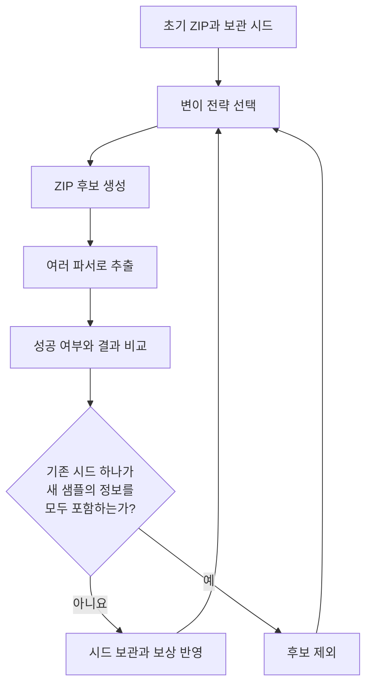

> ZipDiff로 살펴보는 파서 해석 차이와 보안 우회

보안 프로그램이 검사한 파일과 사용자가 실제로 연 파일이 같다면, 검사한 내용도 같을 것이라고 생각하기 쉽다. 그런데 **파일의 바이트가 같다는 사실만으로, 두 프로그램이 그 안에서 같은 내용을 읽었다고 보장할 수 있을까?**

이번에 살펴본 논문은 이 질문을 ZIP 파일에 적용한다. 취약점 분석에서 관심을 둘 대상을 개별 프로그램의 오류에서 **검사하는 구성 요소와 사용하는 구성 요소 사이의 해석 차이**까지 넓혀 주는 연구다.

## 논문 정보와 선정 이유

| 항목 | 내용 |
| --- | --- |
| 논문 | My ZIP isn’t your ZIP: Identifying and Exploiting Semantic Gaps Between ZIP Parsers |
| 저자 | Yufan You, Jianjun Chen, Qi Wang, Haixin Duan |
| 학회와 연도 | 34th USENIX Security Symposium, 2025 |
| 논문집 페이지 | 431–450 |
| 연구 도구 | ZipDiff |
| 수상 | Distinguished Paper Award |

[학회 공식 페이지](https://www.usenix.org/conference/usenixsecurity25/presentation/you) · [논문 PDF](https://www.usenix.org/system/files/usenixsecurity25-you.pdf) · [저자 공개 PDF](https://www.jianjunchen.com/p/zipdiff.USESEC25.pdf) · [공개 코드](https://github.com/ouuan/ZipDiff) · [아티팩트 보관본](https://doi.org/10.5281/zenodo.15526863)

이 논문을 고른 이유는 오펜시브 보안에서 활용할 수 있는 **취약점 탐색의 질문**이 분명하기 때문이다. 어떤 바이트를 바꾸면 프로그램이 죽는지를 넘어, 같은 입력을 여러 구성 요소가 어떻게 다르게 받아들이는지 추적한다. 공격자가 그 차이를 만들 수 있고, 차이가 보안 판단에 영향을 주면 우회 경로가 생길 수 있다.

ZIP이라는 익숙한 형식에서 출발하면서도 문서 처리, 서명 검증, 확장 프로그램 배포까지 연결된다는 점도 흥미롭다. 파일 포맷을 공부하는 일이 실제 공격 표면 분석과 어떻게 이어지는지 살펴보기 좋다. 게재 학회와 연도는 이번 미션 조건에 해당한다. [1]

### 읽기 전 문제 정리

| 질문 | 리뷰의 출발점 |
| --- | --- |
| 무엇을 해결하려는가 | 같은 ZIP을 처리하는 구현들이 서로 다른 내용을 선택하는 상황을 체계적으로 찾는 문제다. |
| 왜 중요한가 | 앞단에서 허용한 대상과 뒷단에서 사용한 대상이 달라지면 검사 결과의 의미가 달라질 수 있다. |
| 기존 접근의 빈틈은 무엇인가 | 개별 구현의 크래시나 이미 알려진 우회 사례를 확인하는 것만으로는 여러 구현 사이의 해석 차이를 충분히 설명하기 어렵다. |

이 리뷰에서는 **해석 차이가 존재하는가**, **그 차이를 자동으로 찾을 수 있는가**, **실제 제품에서 보안 문제가 되는가**를 차례로 확인한다. 세 질문의 답은 서로 연결되지만 같은 의미는 아니다. [1, 2]

## 1. 기(起): 같은 파일이 같은 내용을 뜻하지 않는 이유

### 먼저 알아둘 개념

| 용어 | 이 글에서의 의미 |
| --- | --- |
| 파서(Parser) | 파일의 바이트를 읽어 파일명, 내용, 구조 같은 의미 있는 정보로 해석하는 구현 |
| 의미 차이(Semantic gap) | 같은 입력을 처리한 구성 요소들이 서로 다른 의미나 결과를 얻는 상황 |
| 퍼징(Fuzzing) | 입력을 생성하거나 변형하면서 프로그램의 동작을 반복해서 관찰하는 시험 방식 |
| 차등 테스트(Differential testing) | 동일한 입력에 대한 여러 구현의 결과를 비교하는 시험 방식 |
| 시드와 코퍼스 | 다음 입력을 만들 때 출발점으로 사용하는 샘플과 그 집합 |
| 오라클(Oracle) | 시험 결과에서 어떤 현상을 관심 대상으로 판단할지 정한 기준 |

### ZIP에는 파일을 설명하는 정보가 여러 곳에 있다

ZIP의 구조를 이해할 때 우선 볼 부분은 다음 세 가지다. [3, §§4.3.6–4.3.16]

| 구조 | 역할 |
| --- | --- |
| LFH(Local File Header) | 각 파일 데이터 앞에 있으며 파일명, 압축 방법, 크기 등의 정보를 담는다. 일부 정보는 ZIP 기능과 플래그에 따라 다른 구조에 기록된다. |
| CDH(Central Directory Header) | 중앙 디렉터리에서 각 파일의 메타데이터와 해당 LFH의 위치를 알려 준다. |
| EOCDR(End of Central Directory Record) | 중앙 디렉터리의 위치와 크기, 엔트리 수 등을 찾는 데 쓰인다. |

초보자 관점에서는 LFH를 **개별 파일에 붙은 설명표**, CDH를 **전체 파일 목록의 항목**으로 생각하면 된다. 정상적인 입력이라면 같은 파일을 설명하는 정보가 일관되어야 한다.

그러나 설명표와 목록에 적힌 값이 다르면 문제가 생긴다. 예를 들어 파일의 이름이나 크기에 대해 둘 이상의 후보가 있을 때, 어느 정보를 믿을지 결정해야 한다. 엄격하게 오류를 반환하는 구현도 있을 수 있고, 호환성이나 손상 파일 복구를 위해 가능한 정보를 선택하는 구현도 있을 수 있다.

또한 중앙 디렉터리에서 파일을 찾는 방식과 앞에서부터 로컬 헤더를 따라 읽는 스트리밍 방식이 같은 엔트리 집합을 발견하는지도 확인해야 한다. 두 방식이 서로 다른 엔트리를 선택한다면 파일명 하나의 차이를 넘어 **어떤 파일이 존재한다고 보는지**부터 달라질 수 있다. [2, §2]

### 보안 문제가 되려면 검사와 사용이 연결되어야 한다

해석 차이 자체를 발견했다고 바로 취약점이 되는 것은 아니다. 다음은 실제 공격 가능성을 검토하기 위한 사고 실험이다.

한 서비스가 업로드된 압축 파일을 먼저 검사하고, 통과한 파일을 다른 라이브러리로 읽는다고 가정하자. 검사기는 허용된 내용만 확인했는데, 이후 처리기는 검사하지 않은 다른 엔트리를 선택한다면 검사 결과가 실제 사용 내용을 보증하지 못한다.

이때 확인할 조건은 네 가지다.

1. 공격자가 ZIP 내부의 바이트나 메타데이터를 조작할 수 있는가.
2. 같은 입력이 둘 이상의 해석 경로를 통과하는가.
3. 그 경로들이 파일 내용, 파일명, 식별자 등을 다르게 선택하는가.
4. 그 차이가 차단 정책, 서명 신뢰, 게시자 식별 같은 보안 결정을 바꾸는가.

논문의 위협 모델은 공격자가 ZIP의 바이트를 자유롭게 조작할 수 있다고 가정한다. 따라서 일반 압축 프로그램으로 생성할 수 있는 정상 파일에만 탐색 범위를 한정하지 않는다. [2, §3.1]

오펜시브 보안 관점에서 이 부분이 중요하다. 서비스가 받는 입력의 규격과, 공격자가 실제로 보낼 수 있는 입력의 범위는 구분해야 한다. 구현이 예상하지 않은 형태를 받아들인다면 그 처리 방식도 분석 대상이다.

## 2. 승(承): ZipDiff는 해석 차이를 어떻게 찾는가

### 핵심은 여러 파서의 결과를 비교하는 것이다

ZipDiff는 ZIP을 생성하고 변형한 뒤 여러 파서에 같은 샘플을 전달하는 **블랙박스 차등 퍼저**다. 각 구현의 내부 코드 커버리지 대신 외부에서 관찰한 처리 결과를 이용한다. [2, §4]

이를 이해하기 쉽게 재구성하면 다음 흐름이다. 그림은 원문의 도식을 옮긴 것이 아니라, 탐색과 피드백의 관계를 요약한 것이다.



### 구조를 아는 변이와 바이트 변이를 함께 쓴다

복잡한 파일을 무작정 바꾸면 대부분의 입력이 파싱 초기에 거부될 수 있다. 예를 들어 어떤 필드를 바꾸면서 그 필드가 가리키는 위치를 그대로 두면, 관심 있는 처리 로직에 도달하기 전에 입력이 깨질 수 있다.

ZipDiff는 이런 문제를 줄이기 위해 ZIP 필드를 고려한 변이를 사용한다. 논문에 제시된 **ZIP 구조 수준의 변이 전략은 46개**다. 이와 함께 삽입, 삭제, 비트 반전 같은 바이트 수준 변이도 적용한다. 일부 구조 변이는 크기나 오프셋의 관계를 보정해 파서가 입력을 더 깊이 처리할 가능성을 높인다. [2, §4.2]

두 접근을 함께 쓰는 이유를 나는 다음처럼 이해했다. 구조를 유지하는 변이는 파서가 의미 있는 처리를 계속하도록 돕고, 거친 바이트 변이는 설계자가 예상하지 않은 경계 조건을 탐색하게 한다. 어느 하나만 사용하기보다 두 방식이 제공하는 탐색 범위의 차이를 이용하는 것이다.

### 무엇을 불일치로 세는지부터 정한다

이 논문에서 가장 주의해서 읽을 부분은 결과를 비교하는 기준이다. **두 파서가 모두 추출에 성공하고, 추출 결과의 해시가 달라야 불일치로 센다.** 한쪽은 성공하고 다른 쪽은 오류를 반환한 경우는 이 지표에 포함하지 않는다. [2, §4.3]

비교하는 해시는 입력 ZIP 자체의 해시가 아니라 **추출된 결과 디렉터리**에 대한 해시다. 또한 빈 디렉터리나 특정 파일명 차이 등 연구가 관심 대상으로 보지 않는 차이를 정규화한다. 따라서 이 결과는 파서의 모든 내부 동작이 같은지를 검사한 것이 아니라, 연구진이 정한 관찰 기준에서 출력이 같은지를 검사한 것이다. [2, §4.3, 부록 A]

나는 이 오라클의 장점과 제한을 함께 봐야 한다고 생각한다. 여러 언어와 구현을 같은 방식으로 비교하기 쉬운 기준인 동시에, 비교 기준 밖의 차이는 놓칠 수 있다. 실제 서비스가 파일을 디스크에 쓰지 않고 이름으로 직접 조회한다면, 그 서비스가 선택한 엔트리도 따로 관찰해야 한다.

### 발견한 정보를 다음 탐색에 반영한다

ZipDiff는 각 샘플에서 성공한 파서 집합과 서로 다른 결과를 낸 파서 쌍 집합을 관리한다. 기존 샘플 하나가 새 샘플의 두 집합을 모두 포함한다면 새 샘플을 보관할 필요가 작다고 판단한다. 새로운 정보를 담은 샘플은 후속 변이의 출발점이 된다. [2, §4.3]

변이 전략을 선택할 때는 UCB(Upper Confidence Bounds)에 기반한 점수를 사용한다. 이미 좋은 결과를 낸 전략을 활용하면서 덜 시도한 전략에도 기회를 주는 방식이다. ZipDiff는 가장 높은 점수 하나만 고르는 대신 softmax를 이용한 확률적 선택을 하고, 오래된 성과의 영향도 줄인다. [2, §4.4]

여기서 배울 점은 자동화 도구의 핵심이 입력을 많이 만드는 데만 있지 않다는 것이다. **어떤 결과를 새로운 정보로 볼 것인지**, 그리고 그 정보를 다음 입력 생성에 어떻게 반영할지가 탐색 효율을 결정한다.

### 모호성은 세 범주로 정리된다

연구진은 발견한 모호성을 **중복 메타데이터, 파일 경로 처리, ZIP 구조 위치**의 세 범주와 14개 유형으로 정리했다. [2, §5.2]

| 범주 | 이해를 위한 대표 질문 |
| --- | --- |
| 중복 메타데이터 | 같은 파일의 이름, 크기, 압축 방법이 여러 곳에서 다르게 기록되면 무엇을 믿는가. |
| 파일 경로 처리 | 같은 이름이 여러 번 나오거나 경로 표현이 달라질 때 어떤 엔트리를 선택하는가. |
| ZIP 구조 위치 | 중앙 디렉터리나 종료 레코드의 후보가 여럿이면 어디를 기준으로 읽는가. |

내가 취약점 분석에 가져가고 싶은 질문은 **하나의 의미를 결정하는 정보가 여러 군데 있는가**이다. 중복 정보가 항상 잘못된 설계인 것은 아니다. 다만 서로 충돌할 때 우선순위와 거부 조건이 명확하지 않으면 구현마다 다른 선택이 생길 수 있다.

또한 초록의 ‘새로운 모호성 10개’라는 표현은 본문의 Table 2와 함께 읽을 필요가 있다. 그 수에는 완전히 새로운 유형뿐 아니라 **기존 유형의 새로운 변형과 구성 기법**도 포함된다. [2, §8.2, Table 2]

## 3. 전(轉): 실험은 어디까지 보여 주었는가

### 실험 규모와 수치의 의미

논문은 19개 언어에 걸친 50개 파서를 평가했다. 여기서 파서는 독립 제품 수와 정확히 같은 개념이 아니다. 같은 라이브러리의 일반 API와 스트리밍 API 등을 별도 대상으로 다룬 경우가 포함된다. [2, §5.1]

| 항목 | 논문이 보고한 값 | 읽을 때 주의할 점 |
| --- | --- | --- |
| 대상 파서 | 50개 | 버전, API, 실행 방식이 정해진 평가 대상이다. |
| 전체 파서 쌍 | 1,225쌍 | 50 × 49 ÷ 2로 계산한 조합 수다. |
| 불일치가 확인된 쌍 | 1,221쌍 | 시험 샘플에서 적어도 한 종류의 차이가 관측된 쌍이다. |
| 모호성 분류 | 3개 범주, 14개 유형 | 취약 제품 수나 CVE 수가 아니다. |
| 실제 적용 사례 | 5가지 시나리오 | 모든 ZIP 사용 환경의 공격 가능성을 입증한 것은 아니다. |
| 관련 CVE | 3건 | Go, LibreOffice, Spring Boot에 연결되는 신고 사례다. |

출처: [2, §§5–7, 부록 B·C].

1,221을 1,225로 나누면 약 99.67%다. 그러나 이 비율의 분모는 **시험한 파서 쌍**이다. 실제 서비스에 대한 공격 시도 횟수나 공격 성공 횟수가 아니므로 공격 성공률로 해석할 수 없다.

또한 1,221쌍은 퍼징 결과를 분석한 뒤 유형별로 구성한 샘플을 시험해 집계한 값이다. 아래의 24시간 퍼징 성능 비교에서 나오는 1,197쌍과는 집계 조건이 다르다. [2, §§5.2–5.3]

### 구성 요소를 제거하거나 바꾸면 성능이 달라지는가

저자들은 세 가지 구성을 각각 24시간씩 다섯 번 실행하고, 발견한 불일치 파서 쌍 수의 중앙값을 비교했다. [2, §5.3, Figure 4]

| 구성 | 달라진 조건 | 24시간 후 중앙값 |
| --- | --- | ---: |
| Full Setup | 논문이 제안한 전체 구성 | 1,197쌍 |
| Argmax-Based UCB | softmax 선택을 최고 점수 선택으로 교체 | 1,183쌍 |
| Byte Mutation Only | ZIP 구조 수준 변이를 제외 | 1,055쌍 |

이 조건에서 전체 구성은 바이트 변이만 사용한 구성보다 142쌍을 더 발견했다. 최고 점수만 고르는 구성과의 차이는 14쌍이다. 이 숫자를 보면 최종 발견량에서는 구조를 고려한 변이의 효과가 더 크게 드러난다. 다만 두 구성 요소의 일반적 중요도를 이 차이만으로 확정해서는 안 된다. 입력 집합, 실행 예산, 탐색 과정에 따라 효과가 달라질 수 있기 때문이다.

Figure 4에는 시간에 따른 추이도 있으므로 최종값뿐 아니라 차이를 얼마나 빨리 찾았는지도 함께 읽어야 한다. 그래프의 세로축에는 단절이 있어 선의 시각적 간격만으로 배율을 추정하지 않는 편이 좋다.

### 실제 보안 문제로 이어진 다섯 가지 사례

논문은 파서 차이의 존재를 확인한 뒤, 그 차이가 실제 제품의 신뢰 판단에 영향을 주는 사례를 제시한다. [2, §6]

| 시나리오 | 서로 달라지는 판단 | 공격 성립을 볼 때 필요한 조건 |
| --- | --- | --- |
| 이메일 첨부 검사 우회 | 게이트웨이가 검사한 내용과 사용자 압축 해제기가 추출한 내용 | 해당 파서 조합과 후속 처리, 단말의 추가 검사 여부를 함께 봐야 한다. |
| 오피스 문서 내용 혼동 | 문서 뷰어가 표시한 내용과 외부 검사기가 읽은 내용 | 서로 다른 엔트리를 선택하는 실제 문서 처리 경로가 있어야 한다. |
| LibreOffice 서명 상태 혼동 | 서명을 확인한 내용과 복구 모드에서 표시한 내용 | 유효하게 서명된 원본과 다른 내용을 보게 되는 복구 경로가 전제된다. |
| Spring Boot 중첩 JAR 서명 혼동 | 서명 검증 대상과 실제로 읽는 내용 | Loader 사용과 중첩 JAR 서명 검증 사용자 정의 코드라는 조건이 있다. |
| VS Code 확장 ID 사칭 | 게시 서버와 클라이언트가 읽는 확장 식별자 | 피해자가 조작된 확장을 설치하는 조건을 포함한다. |

이 표는 논문이 조사한 당시의 사례를 요약한 것이다. 현재 제품의 취약 여부는 각 수정 버전과 실제 구성을 기준으로 판단해야 한다.

### 가장 인상적인 사례는 LibreOffice의 복구 모드였다

여러 제품이 서로 다른 파서를 사용한다면 결과가 달라질 수 있다는 점은 비교적 쉽게 예상할 수 있다. 그런데 **같은 프로그램의 정상 모드와 복구 모드도 다를 수 있다**는 사례는 검사 범위를 넓혀 준다.

LibreOffice의 공식 공지는 손상된 ZIP 중앙 디렉터리를 복구할 때 로컬 파일 헤더를 찾아 문서를 재구성한다고 설명한다. 취약했던 버전에서는 복구된 파일에 맞지 않는 서명 상태가 보고될 수 있었다. 수정 후에는 복구 모드의 서명을 유효하지 않은 것으로 취급한다. [6]

내가 여기서 얻은 교훈은 검증 결과에 적용 범위가 있다는 것이다. 정상 경로에서 얻은 신뢰 판단을, 내용을 다시 선택하거나 재구성한 경로에 그대로 넘겨도 되는지 확인해야 한다. 오류 복구와 호환성 처리는 기능을 유지하는 데 도움이 되지만, 그 과정에서 이전의 보안 판단을 계속 사용할 수 있는지는 별도의 문제다.

따라서 분석할 때 라이브러리 이름과 버전만 적는 것으로는 부족하다. 호출한 API, 옵션, 실패 시 대체 경로, 복구 모드 진입 여부까지 기록해야 실제 동작을 설명할 수 있다.

### 관련 CVE와 수정 이력

세 CVE는 공식 자료로도 연결을 확인할 수 있다. 아래는 해당 문제가 처음 수정된 버전의 예시이며, 현재 설치할 최신 버전을 추천하는 목록은 아니다. [5–7]

| CVE | 공식 자료에서 확인되는 문제 | 당시 수정 버전 |
| --- | --- | --- |
| CVE-2024-24789 | Go `archive/zip`이 일부 잘못된 ZIP을 다른 구현과 다르게 처리 | Go 1.21.11, 1.22.4 |
| CVE-2024-7788 | LibreOffice 복구 모드에서 복구된 내용에 맞지 않는 서명 상태 | LibreOffice 24.2.5, 24.8.0 |
| CVE-2024-38807 | Spring Boot Loader를 통한 중첩 JAR 서명 검증의 신뢰 문제 | OSS 계열 3.2.9, 3.3.3 등 |

특히 Spring Boot의 공식 공지는 `spring-boot-loader` 또는 `spring-boot-loader-classic`을 사용하고, 중첩 JAR의 서명을 검사하는 사용자 정의 코드가 있는 애플리케이션이라는 조건을 명시한다. 이를 모든 Spring Boot 서버의 원격 코드 실행 취약점으로 확대하면 정확하지 않다. [7]

CVE 번호가 2024로 시작해도 논문 게재 연도는 2025년이다. 연구 과정의 발견·신고·수정과 학회 발표 시점은 다를 수 있으므로, 이번 미션에서는 논문의 게재 연도를 확인하면 된다.

### 저자가 밝힌 한계

논문의 제한점 중 특히 중요한 것은 두 가지다. 첫째, 블랙박스 방식이라 내부 코드 커버리지를 활용하지 않는다. 둘째, 최종 추출 디렉터리가 파서 내부 상태를 모두 보여 주지는 않는다. 중복 파일이 처리되는 도중 서로 다른 엔트리가 선택되더라도 마지막에 덮어써지면 결과에서 차이가 사라질 수 있다. [2, §7.3]

이는 방법론의 장점과 직접 연결된다. 외부 출력만 비교하면 여러 언어의 구현을 통합하기 쉬워진다. 반면 실제 애플리케이션이 내부에서 어떤 엔트리를 참조했는지까지는 알기 어렵다. 더 정밀한 관찰을 추가할수록 구현마다 별도의 계측이 필요해지고, 도구 통합 비용이 늘어날 수 있다.

### 내가 추가로 확인하고 싶은 부분

나는 이 연구를 바탕으로 다음 세 가지를 더 확인하고 싶다.

**첫째, 파서 쌍 중심의 결과를 실제 서비스 경로에 연결하는 일이다.** 수많은 파서 조합에서 차이가 생겨도, 특정 서비스가 그 조합을 사용하지 않거나 모호한 입력을 앞에서 거부하면 공격은 성립하지 않는다. 실제 검사·추출·사용 단계를 연결해 신뢰 판단이 달라지는 순간을 관측해야 한다.

**둘째, 성공과 오류가 갈리는 경우의 정책이다.** 논문의 지표는 두 파서가 모두 성공하는 경우를 센다. 그런데 서비스가 검사 오류를 허용으로 바꾸는 식으로 동작한다면 성공과 오류의 차이도 중요할 수 있다. 이는 이 논문이 실증한 결론과 구분해서 새롭게 시험할 가설이다.

**셋째, 방어의 호환성 비용이다.** 이상한 ZIP을 모두 거부하면 단순해 보이지만, 실제 서비스가 지원해야 하는 복구 기능이나 확장 형식이 있을 수 있다. 검사 일관성을 높이는 것과 정상 사용을 유지하는 것 사이에서 어떤 입력을 받아들일지 정책이 필요하다.

이 세 질문은 파서 차등 테스트를 애플리케이션 수준의 보안 평가로 확장하는 데 필요한 연결점이라고 생각한다.

## 4. 결(結): 오펜시브 보안에서 가져갈 것

### 취약점 분석의 단위를 처리 경로까지 넓히기

이 논문을 통해 정리한 가장 중요한 관점은 **검사한 내용과 실제로 사용하는 내용이 같은지 확인하는 것**이다.

앞으로 파일 업로드 기능을 분석한다면 확장자 허용 목록이나 압축 해제 함수만 볼 것이 아니라, 입력이 어디에서 해석되는지 먼저 표시하고 싶다. 보안 검사기, 미리보기, 변환기, 저장소, 실행기가 같은 파일을 다시 읽는다면 각 단계가 어떤 엔트리를 선택하는지 비교할 수 있다.

또한 크래시가 없고 각 단계가 정상 완료되어도 전체 정책이 깨질 수 있다는 점을 기억하려 한다. 정상 종료는 해당 구성 요소가 처리를 마쳤다는 사실을 뜻한다. 다른 구성 요소와 의미가 일치한다는 보장까지 제공하지는 않는다.

### 방어 관점에서 함께 생각할 점

이 관점을 설계에 적용한다면 우선 **실제 사용한 해석 결과에 보안 판단을 연결**하는 방향을 검토하겠다. 예를 들어 한 단계에서 선택한 엔트리 집합을 다음 단계가 그대로 사용하도록 하거나, 복구·변환으로 해석 결과가 바뀌었을 때 이전 검증 결과를 무효화하는 방식이다.

이것은 구체적인 시스템에 맞춰 검증해야 하는 설계 제안이다. 파일을 재포장해 정규화하는 접근도 고려할 수 있지만, 서명이나 원본 보존 요구가 있다면 부작용을 먼저 확인해야 한다. 서로 다른 파서를 여럿 실행해 비교하는 방식 역시 검사 비용과 지연을 함께 측정해야 한다. 논문의 방어 논의도 이러한 적용 조건과 선택지를 다룬다. [2, §7.2]

### 다음에 읽을 논문

| 논문 | 읽을 이유 |
| --- | --- |
| The Silent Danger in HTTP: Identifying HTTP Desync Vulnerabilities with Gray-box Testing — USENIX Security 2025 | ZipDiff와 같은 해석 차이 문제를 HTTP에서 다룬다. 내부 커버리지와 상태를 활용하는 접근을 비교해, 블랙박스의 통합 편의성과 그레이박스의 관측력 사이의 차이를 공부하고 싶다. [8] |
| T-Reqs: HTTP Request Smuggling with Differential Fuzzing — ACM CCS 2021 | 프록시와 원본 서버의 해석 차이를 차등 퍼징으로 찾는 연구다. ZIP의 검사·사용 관계를 웹 요청 처리 구조에 옮겨 이해하기 좋다. ZipDiff의 참고문헌에도 포함된다. [9] |

두 번째 논문은 **후속 독서용**이며 이번 미션의 제출 대상 연도에는 해당하지 않는다. 이번 리뷰의 대상은 USENIX Security 2025의 ZipDiff 논문 한 편이다.

### 직접 구현한다면 작은 비교 도구부터 시작하기

후속 프로젝트의 첫 목표는 모든 파서를 연결하는 것이 아니라, **한 처리 경로에서 입력·판단·사용 결과를 연결해서 기록하는 도구**로 잡고 싶다.

| 단계 | 구체적으로 할 일 | 남길 결과 |
| --- | --- | --- |
| 1 | 파서 2~3개의 정확한 버전과 API, 옵션을 고정한다. | 실행 환경 기록 |
| 2 | 무해한 텍스트가 들어 있는 정상 ZIP과 모호성 후보를 준비한다. | 입력 파일과 생성 조건 |
| 3 | 파일 목록, 실제 읽은 내용, 최종 추출 결과, 예외와 종료 코드를 함께 저장한다. | 단계별 비교표 |
| 4 | 자체 테스트 서비스의 검사 단계와 사용 단계를 연결한다. | 허용한 대상과 사용한 대상의 일치 여부 |
| 5 | 거부 정책이나 단일 해석 경로를 적용한 뒤 같은 입력으로 비교한다. | 보안 효과와 호환성 변화 |

개선 효과를 평가할 때도 해석 차이의 개수만 세지 않겠다. 정상 입력이 얼마나 잘 처리되는지, 검사가 얼마나 느려지는지, 어떤 입력이 실제 보안 정책 위반으로 이어지는지를 함께 보겠다.

대규모 실험은 별도 과제로 두는 편이 현실적이다. 공개 아티팩트는 전체 퍼징에 RAM 128GB와 디스크 300GB 이상을 권장한다. 구성 제거 실험은 3개 구성에 대해 각각 다섯 번씩 24시간을 실행하는 작업량이다. 리뷰를 마친 뒤 작은 비교 환경을 만들고, 필요에 따라 실험 범위를 넓히는 순서가 적절하다. [4, 10]

### 다른 분야로 확장한다면

나는 먼저 **문서 업로드 서비스**에 적용해 보고 싶다. 파일 검사, 텍스트 추출, 미리보기 생성이 각자 문서를 읽는 구조를 만들고, 각 단계가 선택한 내용의 해시와 엔트리 경로를 비교하는 것이다. 서로 다르게 읽는다면 그 차이가 실제 허용 정책이나 사용자 판단을 바꾸는지 확인할 수 있다.

그다음에는 HTTP 프록시와 백엔드처럼 같은 입력을 연속해서 처리하는 환경으로 확장하고 싶다. 다만 ZIP의 변이 전략을 그대로 가져가는 대신, 대상 형식에서 의미가 중복되거나 경계가 모호해지는 지점을 새로 정의해야 한다.

이 논문을 읽고 남은 질문은 구체적이다. **지금 안전하다고 판단한 대상은, 다음 구성 요소가 실제로 사용할 대상과 같은가?** 이 질문을 코드의 호출 관계와 실행 결과로 설명할 수 있게 만드는 것이 다음 목표다.

## 부록: 작은 로컬 실험으로 본 비교 기준의 중요성

아래는 리뷰 작성 과정에서 **별도 Linux 환경**에서 수행한 소규모 확인이다. Python 3.12.14와 Info-ZIP UnZip 6.00을 사용했다. 논문의 50개 파서 평가나 실제 제품의 공격을 재현한 실험은 아니다.

입력은 `note.txt`라는 이름의 엔트리가 두 번 들어 있는 ZIP이다. 앞 엔트리의 내용은 `FIRST`, 뒤 엔트리의 내용은 `LAST`다. 압축 파일에는 무해한 텍스트만 담았으며, 외부 서비스를 대상으로 요청을 보내지 않았다.

```python
import subprocess
import tempfile
import warnings
import zipfile
from pathlib import Path

with tempfile.TemporaryDirectory() as tmp:
    root = Path(tmp)
    archive = root / "duplicate.zip"

    with warnings.catch_warnings():
        warnings.simplefilter("ignore", UserWarning)
        with zipfile.ZipFile(archive, "w", compression=zipfile.ZIP_STORED) as z:
            z.writestr("note.txt", "FIRST\n")
            z.writestr("note.txt", "LAST\n")

    with zipfile.ZipFile(archive) as z:
        print("Python name:", repr(z.read("note.txt")))
        print("Python entries:", [z.read(info) for info in z.infolist()])
        z.extractall(root / "python")

    result = subprocess.run(
        ["unzip", "-p", str(archive), "note.txt"],
        capture_output=True, check=True,
    )
    print("unzip -p:", repr(result.stdout))
    print("unzip -p status:", result.returncode, repr(result.stderr))

    result = subprocess.run(
        ["unzip", "-o", str(archive), "-d", str(root / "infozip")],
        capture_output=True, check=True,
    )
    print("unzip -o status:", result.returncode, repr(result.stderr))
    print("Python disk:", repr((root / "python" / "note.txt").read_bytes()))
    print("Info-ZIP disk:", repr((root / "infozip" / "note.txt").read_bytes()))
```

`unzip` 명령이 설치된 Linux 환경에서 실행할 수 있다. 이 환경에서 관측된 결과는 다음과 같다.

| 비교한 동작 | 관측 결과 |
| --- | --- |
| Python에서 이름으로 읽기 | `LAST\n` |
| Python에서 엔트리를 하나씩 읽기 | `FIRST\n`, `LAST\n` |
| `unzip -p`로 같은 이름의 내용을 출력 | `FIRST\nLAST\n`, 종료 코드 0, stderr 없음 |
| Python `extractall`의 최종 파일 | `LAST\n` |
| `unzip -o`의 최종 파일 | `LAST\n`, 종료 코드 0, stderr 없음 |

이름으로 한 파일을 조회하는 것과, 조건에 맞는 엔트리들의 내용을 표준 출력으로 내보내는 것은 같은 인터페이스가 아니다. 표준 출력만 비교하면 차이가 보이지만, **최종 디렉터리에 추출된 내용은 양쪽이 같았다.** 따라서 이 예제를 논문의 추출 결과 불일치나 새 취약점을 재현한 것으로 세면 안 된다.

이 작은 확인에서 배운 것은 실험을 시작하기 전에 비교 대상을 명확히 해야 한다는 점이다. 파일 목록을 비교하는지, 특정 엔트리를 읽는지, 최종 파일 트리를 비교하는지에 따라 관측하는 성질이 다르다. 후속 실험에서도 결과 내용과 함께 예외, 경고, 종료 코드를 기록하겠다.

## 참고 자료

1. [USENIX Security 2025 공식 발표 페이지](https://www.usenix.org/conference/usenixsecurity25/presentation/you) — 서지, 발표 연도, 수상 정보.
2. [You et al., My ZIP isn’t your ZIP, 논문 원문](https://www.usenix.org/system/files/usenixsecurity25-you.pdf) — 방법론 §4, 평가 §5, 적용 사례 §6, 논의 §7, 신규성 Table 2. [저자 공개본](https://www.jianjunchen.com/p/zipdiff.USESEC25.pdf).
3. [PKWARE APPNOTE 6.3.10](https://pkware.cachefly.net/webdocs/casestudies/APPNOTE.TXT) — ZIP 구조와 필드 정의.
4. [ZipDiff 공식 저장소](https://github.com/ouuan/ZipDiff) — 공개 코드, 실행 요구사항, 실험 절차.
5. [Go 공식 취약점 데이터베이스 GO-2024-2888](https://pkg.go.dev/vuln/GO-2024-2888) — CVE-2024-24789.
6. [LibreOffice 공식 보안 공지](https://www.libreoffice.org/security/#cve-2024-7788) — CVE-2024-7788의 영향과 수정 내용.
7. [Spring 공식 보안 공지 CVE-2024-38807](https://spring.io/security/cve-2024-38807/) — 영향 조건과 수정 버전.
8. [The Silent Danger in HTTP, USENIX Security 2025](https://www.usenix.org/conference/usenixsecurity25/presentation/mu) — [저자 공개 원문](https://jianjunchen.com/p/http-desync.USESEC25.pdf).
9. [T-Reqs, ACM CCS 2021](https://doi.org/10.1145/3460120.3485384) — [저자 연구실 공개 원문](https://seclab.nu/static/publications/ccs2021treqs.pdf).
10. [USENIX Security 2025 ZipDiff 아티팩트 부록](https://secartifacts.github.io/usenixsec2025/appendix-files/sec25cycle2ae-final28.pdf) — 재현 환경과 평가 절차.
