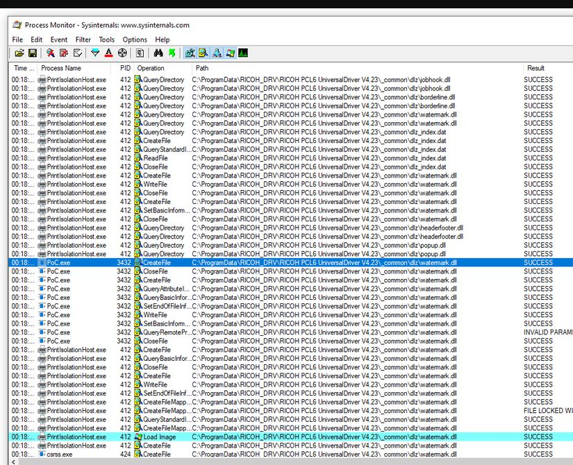
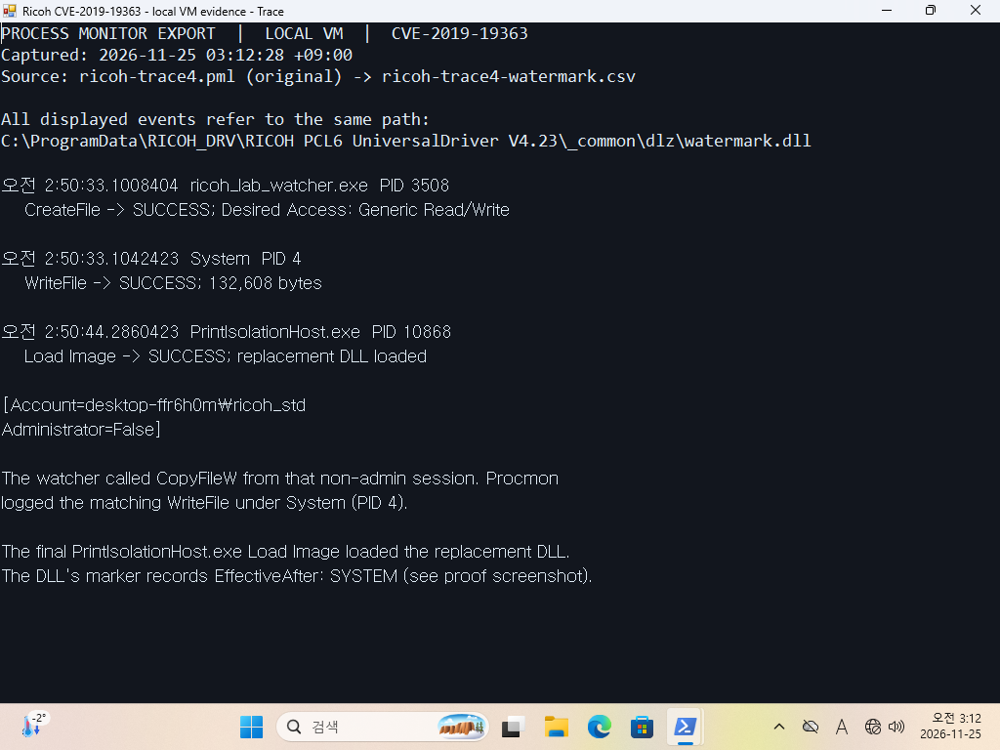
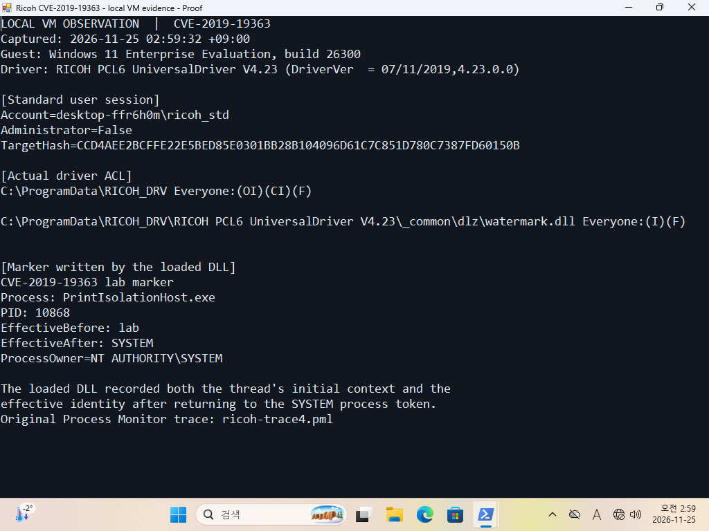

프린터를 쓰는 일반 사용자가 어떻게 Windows의 `SYSTEM` 권한으로 코드를 실행할 수 있었을까. 이번 HSKF 3기 BugBounty 미션에서 가장 이해에 도움이 된 자료는 Process Monitor 화면 한 장이었다. 한 프로세스가 Ricoh 드라이버의 DLL에 쓰고, 다른 프로세스가 같은 경로의 DLL을 로드했다. 파일을 바꿀 수 있는 사람과 그 파일을 코드로 실행하는 계정을 차례로 보면, 인쇄 기능이 어떻게 권한 상승으로 이어졌는지 설명할 수 있다. [공개 PoC의 관찰 화면](#ricoh-procmon-figure) · [로컬 VM 재현 결과](#4-2-로컬-vm에서-확인한-실행-흐름)

CVE-2019-19363의 영향 대상은 일부 Ricoh·Savin·Lanier 드라이버를 사용하는 **Windows PC와 인쇄 서버**다. 공개 사례에서 공격자의 출발점은 그 호스트의 일반 사용자였고, 변경된 DLL의 코드는 그 호스트의 `NT AUTHORITY\SYSTEM` 문맥에서 실행됐다. [NVD 취약점 기록][nvd] · [Pentagrid, Impact][pg-impact]

> **분석 범위**　공개 분석과 PoC의 검증 방식, 제조사 공지와 패치 가이드를 대조했다. 별도로 2026년 11월 25일 격리된 Windows 11 VM에서 Ricoh PCL6 UniversalDriver 4.23.0.0을 사용해 일반 사용자 세션의 파일 교체 요청, 대상 DLL 쓰기, `PrintIsolationHost.exe`의 DLL 로드와 DLL 내부의 `SYSTEM` 유효 권한 기록까지 확인했다. 이는 패치 전 취약 구성의 로컬 재현이며, 패치 효과나 실제 운영 환경을 시험한 것은 아니다.

## 1. 인쇄 요청을 보낸 계정과 드라이버를 실행하는 계정

Windows에서 프린터 드라이버는 문서를 인쇄할 형식으로 변환하는 기능과 설정 화면 등을 제공한다. 이 기능의 일부는 프로세스 안에 로드되어 실행되는 라이브러리(DLL)로 구현된다. 그래서 인쇄 작업을 요청한 사용자를 알아도, 드라이버 DLL을 실행한 계정은 별도로 확인해야 한다. [Microsoft 인쇄 서비스 보안 모델][ms-security] · [Microsoft 인쇄 실행 문맥][ms-context]

| 구성 요소 | 이 사례를 이해하는 데 필요한 역할 |
| --- | --- |
| 응용 프로그램과 인쇄 대기열 | 사용자가 인쇄를 요청하고, 대기열이 작업을 관리한다. |
| Print Spooler(`spoolsv.exe`) | Windows 인쇄 서비스다. 격리 모드가 `None`이면 드라이버가 스풀러 프로세스 안에서 실행될 수 있다. |
| `PrintIsolationHost.exe` | `Shared` 또는 `Isolated` 모드에서 드라이버를 스풀러와 별도의 프로세스에서 실행한다. Pentagrid가 Ricoh DLL의 로드를 관찰한 프로세스다. |

Microsoft가 설명하는 **드라이버 격리의 목적은 인쇄 서비스의 안정성**이다. 드라이버 하나가 고장 나도 스풀러가 계속 동작할 수 있게 프로세스를 분리한다. 어느 프로세스에서 실행할지는 드라이버와 관리자 설정에 달려 있다. Ricoh 사례에서 DLL을 로드한 격리 호스트는 `SYSTEM`으로 실행 중이었다. 일반 사용자가 바꾼 코드가 이 계정으로 실행되면 그 사용자에게 허용되지 않던 시스템 파일과 레지스트리에도 접근할 수 있다. [Microsoft의 격리 모드 표][ms-isolation] · [Microsoft의 LocalSystem 계정 설명][ms-system] · [Pentagrid, Impact][pg-impact]

## 2. DLL을 바꿀 수 있었던 이유

Pentagrid가 조사한 **PCL6 Driver for Universal Print 4.23.0.0**은 프린터를 구성할 때 `C:\ProgramData\RICOH_DRV` 아래에 실행할 DLL을 배치했다. 공개된 `icacls` 출력에서 경로를 줄이고 권한 항목만 옮기면 다음 두 줄이 남는다. 둘째 줄은 하위 DLL 6개에서 각각 같은 값이 나온 결과다. [Pentagrid, Technical Details의 ACL 출력][pg-acl]

```text
RICOH_DRV 폴더    Everyone:(OI)(CI)(F)
하위 DLL 6개      Everyone:(I)(F)
```

ACL은 파일이나 폴더에 대해 **누구에게 어떤 동작을 허용하거나 거부하는지** 기록한다. 첫째 줄의 `Everyone`에는 일반 사용자도 속한다. `(F)`는 모든 권한, `(OI)`와 `(CI)`는 각각 하위 파일과 하위 폴더로 권한을 상속한다는 표시다. 둘째 줄에서 `(I)`는 해당 권한을 상속받았다는 뜻이다. 두 줄을 함께 보면 **상위 폴더의 허용 규칙이 실제 DLL까지 내려와 일반 사용자가 그 내용을 바꿀 수 있었다**는 점이 드러난다. [Microsoft의 icacls 권한·상속 표기][ms-icacls]

드라이버 설치 패키지에 유효한 서명이 있어도, 이 DLL의 내용은 설치가 끝난 뒤 바뀔 수 있었다. 공개 자료로 확인할 수 있는 원인은 이렇게 **설치 결과에 남은 파일 권한**까지다. 그 ACL을 설정한 Ricoh 내부 함수는 공개 분석에서 특정되지 않았다. Ricoh는 Yaron Samuel, Or Chechik, Alexander Pudwill을 발견자로 명시한다. Pentagrid는 Pudwill의 초기 PoC를 바탕으로 독립 검증과 공개 조율을 맡았다. [Ricoh 공지의 발견자 표기][ricoh-advisory] · [Pentagrid, Credits][pg-credits]

NVD의 분류는 **CWE-732**(중요 자원에 대한 잘못된 권한 할당)다. 심각도는 NVD가 CVSS 3.1 **7.8**(`S:U`), Pentagrid가 **8.8**(`S:C`)로 평가했다. 두 벡터에서 다른 항목은 *Scope* 하나다. 이는 영향이 취약한 구성 요소가 속한 보안 권한 범위를 넘어가는지에 대한 평가다. 두 자료 모두 로컬 접근(`AV:L`)과 낮은 초기 권한(`PR:L`)을 전제로 한다. [NVD 평가][nvd] · [Pentagrid 평가][pg-impact] · [FIRST CVSS 3.1 명세 §2.2][cvss]

## 3. Universal Print 4.26도 조치 대상일까

**4.26은 조치 대상에 포함된다.** 범위를 잡을 때는 드라이버의 제품명부터 확인해야 한다. 아래는 Ricoh가 2020년 4월 15일 갱신한 목록이다. 범위의 양 끝값을 모두 포함한다. 당시 가이드의 운영체제 범위는 그 시점에 지원되던 Windows 버전이며, 실제 적용 대상은 해당 드라이버가 설치된 호스트다. [Ricoh 영향 드라이버·모델 표][ricoh-models] · [Ricoh 유럽 가이드 1쪽][guide1]

| Windows 드라이버 제품군 | 2020년 공지의 영향 범위 |
| --- | --- |
| PCL6 Driver for Universal Print / PS Driver for Universal Print | 각각 4.0–4.26 |
| PC FAX Generic Driver | 9.0–9.5 및 10.0–11.3 |
| Generic PCL5 Driver | 1.0–1.3 |
| RPCS Driver | 모델별로 다름. 공지에 열거된 모델과 설치 패키지를 대조한다. |
| PostScript3 Driver / PCL6 (PCL XL) Driver | 모델별로 다름. 같은 장비에 쓰는 범용 드라이버와도 릴리스 번호가 다를 수 있다. |
| RPCS Raster Driver | 공지에 열거된 GELJET 및 의류용 프린터 모델에서 당시 모든 버전 |

같은 **4.26**을 넣어 보니 자료에 따라 답이 달랐다. NVD 본문에는 범용 드라이버가 ‘4.0 이상’으로 적혀 있지만, 제품 버전을 기계가 대조하는 CPE 항목의 상한은 **4.26 미만**이다. 설치 버전을 CPE로만 판정하면 4.26이 빠진다. Ricoh의 제품표는 **4.26까지** 포함하고, 두 범용 드라이버에 대해 **4.27 이상**을 안내한다. 이 글에서 조치 기준을 제조사의 갱신 표로 잡은 이유다. [NVD, Description 및 Known Affected Software Configurations][nvd] · [Ricoh의 수정 버전 안내][ricoh-models]

파일 권한을 살펴본 후속 기록도 있다. Pentagrid가 2020년 1월 31일에 확인한 **PCL6 Universal Print 4.26.0.0**에서는 DLL과 바로 위의 `dlz` 폴더에 일반 사용자의 쓰기 권한이 사라졌지만, 그 위 폴더에는 쓰기 권한이 남아 있었다. 연구진이 이 후속 기록에서 보고한 범위는 권한 상태까지다. 4.26에서 이전 PoC가 그대로 성공했는지는 미확인이다. [Pentagrid, Updates의 1월 31일 기록][pg-updates]

## 4. 공개 PoC가 보여 준 권한 상승 과정

### 4-1. 공개 PoC의 기록

공개 PoC는 일반 사용자가 영향 드라이버로 프린터를 추가할 수 있는 환경을 전제로 한다. `WatchDirectories`에서 변경 감시를 시작한 뒤 `InstallPrinter`를 호출해 프린터 추가를 유발한다. `HandleDirectoryChange`는 대상 DLL의 변경 알림을 처리하고, 대상 경로·변경 종류·변경 횟수 조건이 맞으면 `CopyFile`로 준비한 DLL을 대상 경로에 덮어쓰려고 시도한다. 이후 격리 호스트가 교체된 DLL을 로드하면 DLL의 코드가 호스트의 실행 권한으로 동작한다. [Pentagrid, Proof of Concept Exploit][pg-poc] · [실행 문맥 설명][pg-observation]

**감시, 쓰기, 로드, 실행 계정**은 서로 다른 사실이다. 공개 코드와 그림 1을 함께 보면 각 근거가 뒷받침하는 범위를 구분할 수 있다. 그림과 표의 PID는 Pentagrid가 공개한 한 번의 실행 기록에 표시된 값이다. [Pentagrid의 분석과 관찰 설명][pg-observation]

<span id="ricoh-procmon-figure"></span>



**그림 1. Pentagrid가 공개한 PoC 실행 기록.** 파란색 선택 행은 `CreateFile`이며, 실제 쓰기 근거는 그 아래 `PoC.exe`의 `WriteFile → SUCCESS` 행이다. 하단의 청록색 행에는 `PrintIsolationHost.exe`의 `Load Image → SUCCESS`가 표시된다. 이 화면은 Pentagrid의 공개 관찰 자료를 인용한 것으로, 작성자의 직접 재현 결과가 아니다. 출처: [Pentagrid AG][pg-observation] · [원본 이미지][pg-figure]

아래 표는 코드와 화면에서 확인할 수 있는 사실을 구분한 것이다.

| 공개 자료에서 볼 지점 | 그 지점에서 확인할 수 있는 사실 |
| --- | --- |
| 변경 감시부 `WatchDirectories`와 `ReadDirectoryChangesW` | 코드가 변경된 파일 이름과 변경 종류에 대한 알림을 받도록 구성돼 있다. 이 알림만으로 DLL 교체 성공이나 `SYSTEM` 실행을 입증하지는 않는다. [Microsoft 변경 알림 구조][ms-notify] |
| `PoC.exe`(PID 3432)의 `WriteFile → SUCCESS` | 공개 화면에서 연구진의 프로세스가 DLL에 실제로 썼다. 왜 이 쓰기가 허용됐는지는 2절의 ACL에서 확인할 수 있다. |
| `PrintIsolationHost.exe`(PID 412)의 `Load Image → SUCCESS` | 이어서 격리 호스트가 **같은 경로**의 DLL을 모듈로 로드했다. 파일을 쓴 프로세스와 코드를 로드한 프로세스가 다르다. |
| 검증 DLL의 진입점 `DllMain`과 연구진의 실행 결과 설명 | 검증 코드는 로드된 코드의 실행 계정을 기록하도록 작성됐다. 연구진은 이 코드가 격리 호스트의 `SYSTEM` 문맥에서 실행됐다고 보고했다. |

그림 1의 `SUCCESS`는 각 파일 작업과 모듈 로드가 성공했다는 뜻이다. 그림에는 사용자 계정 열이 없다. 그래서 **무엇을 로드했는지**에 대한 근거는 위 두 행이고, **어떤 권한으로 실행됐는지**에 대한 근거는 연구진의 실행 문맥 설명이다. Rapid7도 시연 결과가 파일 처리 시점에 민감하다고 기록했다. 타이밍은 관찰한 시연의 성공 조건이고, 그 시연이 가능했던 근본 원인은 로드 대상 DLL에 부여된 쓰기 권한이다. 한 번의 시연 실패만으로는 패치 효과를 판단하기 어렵다. [Pentagrid, Exploitation][pg-observation] · [Rapid7의 2020년 2월 분석][rapid7]

여기서 프린터 **대기열을 추가하는 권한**과 **새 드라이버를 설치하는 권한**도 구분해야 한다. 공개 당시에도 기존 드라이버의 유무와 그룹 정책이 전제에 영향을 주었다. 2021년 8월 10일 이후 Windows 업데이트는 Point and Print에서 원격 서버의 드라이버를 새로 설치하거나 업데이트할 때 기본적으로 관리자 권한을 요구한다. 이 정책으로 관리하는 대상은 드라이버 설치 단계이고, 이미 설치된 Ricoh DLL의 ACL은 해당 호스트에서 점검해야 한다. [Pentagrid의 설치 전제 보충][pg-updates] · [Microsoft KB5005652][kb]

### 4-2. 로컬 VM에서 확인한 실행 흐름

공개 기록과 같은 흐름을 격리된 로컬 VM에서 다시 확인했다. 게스트는 **Windows 11 Enterprise Evaluation 빌드 26300**, 드라이버는 **RICOH PCL6 UniversalDriver V4.23.0.0**이었다. 작업을 시작한 계정 `desktop-ffr6h0m\ricoh_std`는 관리자 그룹에 속하지 않았다.

Process Monitor 원본 기록 `ricoh-trace4.pml`을 CSV로 내보내 대상 경로만 추린 결과는 다음과 같다. 모든 행은 `C:\ProgramData\RICOH_DRV\RICOH PCL6 UniversalDriver V4.23\_common\dlz\watermark.dll`을 가리킨다. 일반 사용자 세션의 `ricoh_lab_watcher.exe`가 `CreateFile → SUCCESS`를 기록한 뒤, `System`(PID 4)의 `WriteFile → SUCCESS`와 `PrintIsolationHost.exe`(PID 10868)의 `Load Image → SUCCESS`가 이어졌다. 쓰기와 로드는 서로 다른 프로세스에서 일어났지만 대상 경로는 같았다.



**그림 2. 로컬 VM의 Process Monitor 기록 요약.** 비관리자 세션에서 파일 교체를 요청한 뒤 `System`의 쓰기와 `PrintIsolationHost.exe`의 DLL 로드가 성공한 흐름을 원본 PML과 내보낸 CSV에서 확인했다.

같은 VM에서 `RICOH_DRV` 루트에는 `Everyone:(OI)(CI)(F)`, 대상 `watermark.dll`에는 상속된 `Everyone:(I)(F)`가 남아 있었다. 로드된 검증 DLL이 기록한 마커에는 프로세스가 `PrintIsolationHost.exe`(PID 10868), 프로세스 소유자가 `NT AUTHORITY\SYSTEM`, 최종 유효 권한이 `SYSTEM`으로 표시됐다.



**그림 3. 로컬 VM의 권한과 실행 계정 확인 결과.** 일반 사용자에게 쓰기를 허용한 드라이버 ACL과, 교체된 DLL이 `PrintIsolationHost.exe` 안에서 기록한 `SYSTEM` 유효 권한을 한 화면에 정리했다.

그림 2와 그림 3은 이 VM 구성에서 직접 확인한 결과다. 공개 PoC의 모든 환경이나 다른 Ricoh 드라이버 버전에서 같은 타이밍과 프로세스 ID가 재현된다는 뜻은 아니다. 또한 이 실험은 취약한 4.23.0.0 구성의 실행 흐름을 확인한 것이며, 4.27 이상 수정본이나 Ricoh 보안 프로그램의 효과는 별도로 검증하지 않았다.

## 5. 패치가 바꿔야 하는 파일과 권한

Ricoh는 2020년 1월 22일 보안 공지에서 수정 드라이버와 보안 프로그램 제공을 안내했다. Ricoh가 권고하는 근본 조치는 영향 드라이버를 제거하고 구형 설치 사본을 정리한 뒤, 모델과 운영체제에 맞는 최신 수정 드라이버를 설치하는 것이다. 범용 PCL6·PS의 4.27은 **이 CVE에 대한 당시 수정 기준**이다. 장치별 드라이버는 릴리스 이력의 `Countermeasure for vulnerability “CVE-2019-19363”` 표시를 확인한다. 수정본을 쓸 수 없어 영향 드라이버를 유지해야 한다면 제조사가 지정한 보안 프로그램을 각 설치 호스트에 적용한다. [Ricoh 보안 공지][ricoh-advisory] · [모델별 선택 기준][ricoh-models] · [공식 보안 프로그램 배포처][ricoh-program]

이 프로그램이 처리하는 순서에도 이유가 있다. Ricoh 가이드에 따르면 일부 DLL은 드라이버를 업데이트한 뒤에도 사용자가 설정 화면을 열거나 인쇄할 때까지 이전 내용이 남을 수 있다. 먼저 권한을 잠그면 이렇게 남은 파일의 갱신까지 막을 수 있다. 그래서 프로그램은 **Windows 인쇄 드라이버 폴더의 `.dlz` 압축 파일에서 꺼낸 DLL과 `ProgramData`에 배치된 DLL을 비교하고, 다르면 배치된 DLL을 교체한 다음 ACL을 적용**한다. 임의로 권한만 바꾸면 기존 파일의 내용을 확인하는 단계가 빠진다. [Ricoh 가이드 2쪽, How the Security Program works][guide2]

**공개된 취약 상태와 제조사의 패치 후 기대 상태**를 비교하면 다음과 같다. 폴더별 권한은 Ricoh 가이드 Q4의 표를 요약했다. [Ricoh 가이드 3쪽][guide3] · [상위 폴더 권한표가 이어지는 4쪽][guide4]

| 확인 대상 | 취약 사례에서 드러난 점 | 조치 후 대조할 기준 |
| --- | --- | --- |
| 로드 대상 DLL과 `dlz` 폴더 | 일반 사용자가 하위 DLL에 쓸 수 있었다. | `dlz`에서 `Users`·`Authenticated Users`는 **읽기·실행, 폴더 내용 보기, 읽기**, `SYSTEM`·`Administrators`는 모든 권한이다. 실제 DLL에서도 일반 사용자가 쓰거나 교체할 수 있는 권한이 남는지 확인한다. |
| `RICOH_DRV` 또는 `RICOH` 루트, 제품명 폴더, `_common` | 상위 폴더의 규칙이 하위에 상속됐고, 초기 수정본에서는 계층별 권한 상태가 달랐다. | 가이드에는 두 사용자 그룹에 수정·쓰기를 허용하면서 **해당 폴더 자체에만 삭제 거부**를 두는 예가 나온다. `Everyone` 항목 제거 여부, 허용·거부의 적용 대상과 상속 범위를 함께 본다. |
| 디스크에 배치된 DLL | 설치 이력상 드라이버 버전과 실제 사용 중인 DLL의 갱신 시점이 다를 수 있다. | 보안 프로그램 적용 이력과 실제 파일을 대조한다. 파일 내용을 검증할 때는 같은 모델·릴리스의 신뢰 가능한 패키지에서 꺼낸 동일 DLL을 기준으로 삼는다. |
| 인쇄 서버와 클라이언트 | 두 호스트에 각각 드라이버 사본이 있을 수 있다. | 서버와 대기열에 연결한 클라이언트 양쪽에서 드라이버 릴리스, 프로그램 적용 여부, 실제 ACL을 확인한다. |

**Point and Print에는 배포 방식에 따른 예외가 있다.** 서버에서 독립형 `PrinterFAXDriverSecurityProgram.msi`를 실행해도 그 효과가 클라이언트에 자동 전달되지는 않는다. 반면 Ricoh 가이드의 PCL6/PS Universal Print **4.27**에는 무인 실행 보안 프로그램이 포함돼 있다. 서버가 4.27 대기열을 제공하면 클라이언트가 그 대기열에 연결할 때 드라이버와 함께 배포된 프로그램이 실행된다. 어느 경로로 배포했는지 확인해야 클라이언트에서 찾아야 할 적용 이력도 알 수 있다. [Ricoh 가이드 3쪽, Q3][guide3]

당시 가이드 1쪽은 독립형 프로그램 **1.3.0.0** 적용 전 재부팅과 관리자 권한 실행을 안내하고, 실패하면 재부팅 후 재적용하도록 한다. 적용 후 재부팅도 권고한다. 이후 **영향 드라이버를 재설치·갱신**하면 보안 프로그램을 다시 적용한다. 기존 드라이버로 **대기열만 추가**했다면 다시 실행할 필요가 없다. 적용 단위가 대기열이 아니라 각 호스트에 설치된 드라이버이기 때문이다. [Ricoh 가이드 1쪽, 적용 절차][guide1] · [3쪽, Q2][guide3] · [Ricoh의 재설치 안내][ricoh-advisory]

## 6. 운영 환경에서 확인할 것

### 설치된 드라이버와 ACL 읽기

아래는 Windows의 PrintManagement 모듈과 `icacls.exe`를 사용하는 **조회 전용** PowerShell 예시다. 먼저 대기열의 `DriverName`을 설치된 드라이버의 `Name`과 대조한다. `InfPath`로 설치 정보 파일을 식별할 수 있으면 `DriverVer`의 날짜·버전을 제조사 배포 이력과 맞춰 본다. `MajorVersion`의 3이나 4는 Windows의 드라이버 모델 구분이므로, Ricoh 릴리스 4.26·4.27 판정에는 제조사 버전을 사용한다. [Get-Printer][ms-printer] · [Get-PrinterDriver][ms-driver] · [Microsoft의 v3/v4 확인 예시][ms-major] · [INF DriverVer][ms-inf]

```powershell
Get-Printer -ErrorAction Continue |
    Select-Object Name, DriverName
Get-PrinterDriver -ErrorAction Continue |
    Select-Object Name, Manufacturer, PrinterEnvironment, InfPath

foreach ($folderName in 'RICOH_DRV', 'RICOH') {
    $driverRoot = Join-Path $env:ProgramData $folderName
    if (Test-Path -LiteralPath $driverRoot -PathType Container -ErrorAction Continue) {
        icacls.exe $driverRoot /T /C /L
    } else {
        Write-Warning "폴더가 없거나 조회할 수 없습니다. 경로: $driverRoot"
    }
}
```

`/T`는 루트부터 제품명 폴더, `_common`, `dlz`, DLL을 포함한 하위 항목의 ACL을 나열한다. `/C`는 접근 거부 등 오류를 표시하면서 나머지 조회를 계속한다. `/L`은 심볼릭 링크 자체의 권한을 표시하므로 실제 로드 경로에 링크가 있으면 대상의 권한도 확인해야 한다. 설치한 드라이버에 따라 두 루트 중 하나가 없을 수 있다. 접근 거부, 처리 실패 건수, 비어 있는 출력은 드라이버 목록과 함께 확인하고, 읽지 못한 항목은 **미확인**으로 남긴다. [Microsoft icacls 옵션][ms-icacls] · [Ricoh 가이드 4쪽의 경로 설명][guide4]

운영 호스트에서 패치 여부를 판단하려면 출력된 항목의 허용·거부, 상속·적용 범위와 해당 계정의 그룹 소속까지 대조해야 한다. 예를 들어 상위 폴더의 `Modify`는 제조사 기준과 양립할 수 있지만, 로드되는 DLL에 상속된 `Everyone:(I)(F)`는 전혀 다른 의미다. [Ricoh 가이드 Q4][guide3] · [Microsoft의 접근 제어 설명][ms-access]

### 파일을 쓴 프로세스와 로드한 프로세스 연결하기

운영 로그를 읽을 때도 그림 1에서 본 쓰기와 로드 행이 출발점이 된다. Sysmon을 사용하는 환경이라면 다음처럼 확인할 수 있다. **11번과 7번은 서로 다른 프로세스가 남길 수 있으므로**, 이 둘을 같은 프로세스 ID로 묶으면 정작 찾으려는 사례를 놓친다. [Microsoft Sysmon 이벤트 설명][sysmon] · [Pentagrid의 관찰 화면][pg-figure]

| 로그 | 확인할 필드와 판단 |
| --- | --- |
| **11 · FileCreate** | Ricoh 드라이버 폴더의 DLL 생성·덮어쓰기를 찾는다. `TargetFilename`이 대상 파일이고 `Image`가 쓴 프로세스다. 기존 파일의 일부만 수정하면 이 이벤트가 없을 수 있다. |
| **7 · ImageLoad** | 같은 호스트에서 가까운 시각에 `PrintIsolationHost.exe`가 로드한 `ImageLoaded` 경로를 11번의 `TargetFilename`과 맞춘다. 수집된 해시와 서명 정보를 정상 배포본과 대조한다. |
| **1 · ProcessCreate** | 후속 프로세스가 있다면 그 `ParentProcessGuid`를 7번에 기록된 격리 호스트의 `ProcessGuid`와 연결한다. DLL은 호스트 안에서도 실행될 수 있어 자식 프로세스는 보조 증거다. |

정상 드라이버 업데이트 중에도 파일 쓰기와 로드가 이어진다. 변경 승인 기록, 배포 시각, 작성 계정, 동일 릴리스의 DLL 해시를 대조해야 그 차이를 판단할 수 있다. Sysmon 7번은 기본적으로 꺼져 있어 수집 설정과 보존 기간도 먼저 확인해야 한다. 이 표는 **탐지 가설**이며 탐지율과 오탐률은 측정하지 않았다. 의심스러운 쓰기와 로드가 연결되면 교체 전에 해당 파일, ACL, 관련 로그를 보존하고 같은 배포본을 받은 호스트로 조사 범위를 넓힌다. [Microsoft Sysmon, ImageLoad 및 FileCreate][sysmon]

## 7. 자료를 비교하고 남긴 판단

이번 조사에서 내 판단이 달라진 지점은 **4.26을 점검 목록에 넣을지**였다. NVD의 버전 필터만 보면 제외할 수 있지만, Ricoh는 4.26을 명시했고 Pentagrid는 그 버전의 상위 폴더에 남은 쓰기 권한을 따로 기록했다. 그래서 제품별 조치 범위는 제조사의 갱신 표를 따르고, 실제 호스트의 상태는 설치된 DLL과 폴더의 권한으로 확인하는 쪽을 택했다. [Ricoh 영향 목록][ricoh-models] · [Pentagrid의 4.26 관찰][pg-updates]

다음에 로컬 권한 상승 사례를 볼 때도 파일 하나를 두고 세 가지를 적어 보려고 한다. **누가 그 파일을 바꿀 수 있었는지, 어느 프로세스가 그 파일을 사용했는지, 그 프로세스의 실행 계정은 무엇이었는지.** 이번 사례에서는 첫 질문에 ACL이, 둘째에 공개 화면과 로컬 VM의 `Load Image` 기록이, 셋째에 연구진의 설명과 검증 DLL의 마커가 답을 줬다. 패치 판정도 같은 질문에서 시작할 수 있다. 일반 사용자가 그 프로세스에 들어갈 코드를 여전히 바꿀 수 있는지를 확인하는 것이다.

## 부록. 함께 살펴본 인쇄 관련 CVE

아래 세 건은 이 사례와 같은 제품군 또는 인쇄 경로를 다룬다. 검토한 공지에서 CVE-2019-19363과의 직접적인 공격 사슬은 확인되지 않았다. 운영자가 적용해야 하는 수정의 대상은 각각 다음과 같다.

| CVE | 이 사례와의 접점 | 조치를 확인할 곳 |
| --- | --- | --- |
| **CVE-2021-34481** | Point and Print에서 클라이언트로 드라이버가 들어오는 단계다. 2021년 8월 Windows 업데이트로 새 드라이버 설치·업데이트의 관리자 권한 기본값이 바뀌었다. | Windows 업데이트와 클라이언트의 설치 정책. 이미 설치된 Ricoh 파일의 상태는 별도로 확인한다. [Microsoft KB5005652][kb] |
| **CVE-2021-34527** (PrintNightmare) | 높은 권한의 인쇄 서비스를 공유하는 사례다. Microsoft가 공지한 결함은 Windows Print Spooler의 원격 코드 실행이다. | 해당 Windows 보안 업데이트와 Point and Print 설정. [Microsoft 보안 대응 센터 공지][ms-nightmare] |
| **CVE-2026-50100** | Ricoh와 KONICA MINOLTA JAPAN의 일부 드라이버에서 보고된 별도의 로컬 권한 상승이다. JVN은 **CWE-427**(제어되지 않는 검색 경로 요소)로 분류한다. | 2026년 공지의 대상 모델과 해당 CVE를 수정한 드라이버. 2019년 건의 4.27 기준은 이 건에 적용할 수 없다. [JVN#55319858][jvn] · [Ricoh 모델별 공지][ricoh-2026] |

운영 환경에서 타사 드라이버 의존도 자체를 줄일 수 있다면, 호환 장비에 한해 Windows Protected Print Mode와 기본 IPP 드라이버도 검토할 수 있다. 이때는 기존 장치에서 쓰던 인쇄 기능이 지원되는지 확인해야 한다. [Microsoft의 Windows Protected Print Mode 설명][ms-protected]

## 참고 자료

- **영향 범위와 배포 판단**은 CVE 기록, Ricoh의 글로벌 보안 공지와 제품별 표를 대조했다. [NVD][nvd] · [Ricoh 공지][ricoh-advisory] · [대상 드라이버와 모델][ricoh-models]
- **파일 권한과 실행 증거**는 원문에서 각각 다른 위치에 있다. [상속된 ACL 출력][pg-acl] · [공개 Process Monitor 화면][pg-figure] · [실행 문맥 설명][pg-observation] · [4.26 후속 기록][pg-updates]
- **패치 후 검증**은 Ricoh 가이드 v1.2(2020년 2월 19일)의 동작 설명과 Q&A를 기준으로 했다. [파일 비교·교체, 2쪽][guide2] · [배포 예외와 권한표, 3쪽][guide3] · [상위 폴더 권한표, 4쪽][guide4]

[nvd]: https://nvd.nist.gov/vuln/detail/CVE-2019-19363
[pg-impact]: https://www.pentagrid.ch/en/blog/local-privilege-escalation-in-ricoh-printer-drivers-for-windows-cve-2019-19363/#impact
[pg-acl]: https://www.pentagrid.ch/en/blog/local-privilege-escalation-in-ricoh-printer-drivers-for-windows-cve-2019-19363/#technical-details
[pg-observation]: https://www.pentagrid.ch/en/blog/local-privilege-escalation-in-ricoh-printer-drivers-for-windows-cve-2019-19363/#exploitation
[pg-poc]: https://www.pentagrid.ch/en/blog/local-privilege-escalation-in-ricoh-printer-drivers-for-windows-cve-2019-19363/#proof-of-concept-exploit
[pg-figure]: https://www.pentagrid.ch/images/202001_Ricoh_Privilege_Escalation_Screenshot_Procmon_PoC_in_action.png
[pg-credits]: https://www.pentagrid.ch/en/blog/local-privilege-escalation-in-ricoh-printer-drivers-for-windows-cve-2019-19363/#credits
[pg-updates]: https://www.pentagrid.ch/en/blog/local-privilege-escalation-in-ricoh-printer-drivers-for-windows-cve-2019-19363/#updates
[ricoh-advisory]: https://www.ricoh.com/info/2020/0122_1
[ricoh-models]: https://www.ricoh.com/info/2020/0122_1/list
[ricoh-program]: https://support.ricoh.com/bb/html/dr_ut_e/re1/model/Security_Patch/Security_Patch.htm
[guide1]: https://www.ricoh.nl/media/driver%20vulnerability%20%E2%80%98how%20to%E2%80%99%20guide%20-%20updated_tcm91-38821.pdf#page=1
[guide2]: https://www.ricoh.nl/media/driver%20vulnerability%20%E2%80%98how%20to%E2%80%99%20guide%20-%20updated_tcm91-38821.pdf#page=2
[guide3]: https://www.ricoh.nl/media/driver%20vulnerability%20%E2%80%98how%20to%E2%80%99%20guide%20-%20updated_tcm91-38821.pdf#page=3
[guide4]: https://www.ricoh.nl/media/driver%20vulnerability%20%E2%80%98how%20to%E2%80%99%20guide%20-%20updated_tcm91-38821.pdf#page=4
[ms-security]: https://learn.microsoft.com/en-us/openspecs/windows_protocols/ms-prsod/fdfe950b-bdb5-47ff-8678-41d3b8ebe119
[ms-isolation]: https://learn.microsoft.com/en-us/windows-hardware/drivers/print/printer-driver-isolation
[ms-system]: https://learn.microsoft.com/en-us/windows/win32/services/localsystem-account
[ms-context]: https://learn.microsoft.com/en-us/windows/win32/printdocs/print-execution-context
[ms-icacls]: https://learn.microsoft.com/en-us/windows-server/administration/windows-commands/icacls
[ms-notify]: https://learn.microsoft.com/en-us/windows/win32/api/winnt/ns-winnt-file_notify_information
[ms-access]: https://learn.microsoft.com/en-us/windows/security/identity-protection/access-control/access-control
[cvss]: https://www.first.org/cvss/v3.1/specification-document
[rapid7]: https://www.rapid7.com/blog/post/2020/02/14/metasploit-wrap-up-51/
[kb]: https://support.microsoft.com/en-us/servicing/os/windows/2021/08/kb5005652-manage-new-point-and-print-default-driver-installation-behavior-cve-2021-34481
[ms-driver]: https://learn.microsoft.com/en-us/powershell/module/printmanagement/get-printerdriver
[ms-printer]: https://learn.microsoft.com/en-us/powershell/module/printmanagement/get-printer
[ms-major]: https://learn.microsoft.com/en-us/windows-hardware/drivers/devapps/how-to-display-printer-status
[ms-inf]: https://learn.microsoft.com/en-us/windows-hardware/drivers/install/inf-driverver-directive
[sysmon]: https://learn.microsoft.com/en-us/sysinternals/downloads/sysmon
[ms-nightmare]: https://www.microsoft.com/en-us/msrc/blog/2021/07/clarified-guidance-for-cve-2021-34527-windows-print-spooler-vulnerability
[jvn]: https://jvn.jp/en/jp/JVN55319858/
[ricoh-2026]: https://www.ricoh.com/products/security/vulnerabilities/vul?id=ricoh-2025-000002
[ms-protected]: https://learn.microsoft.com/en-us/windows/modern-print/windows-protected-print-mode/more-information-on-windows-protected-print-mode-for-enterprises-and-developers
