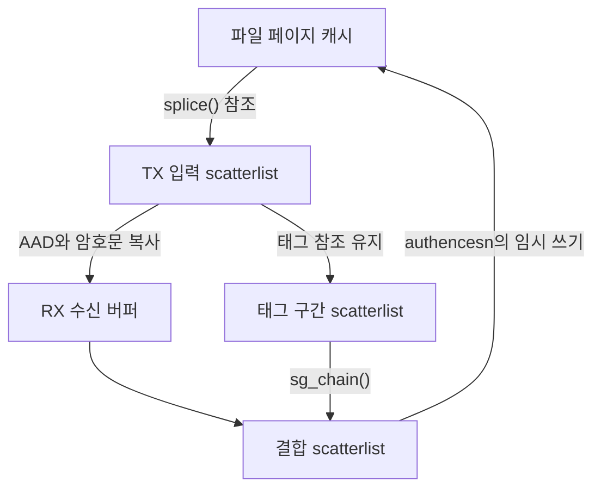
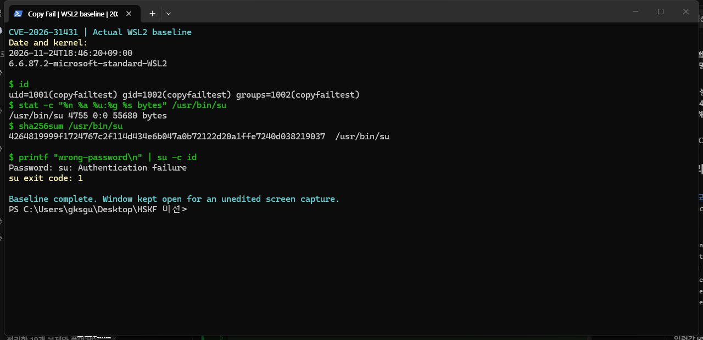
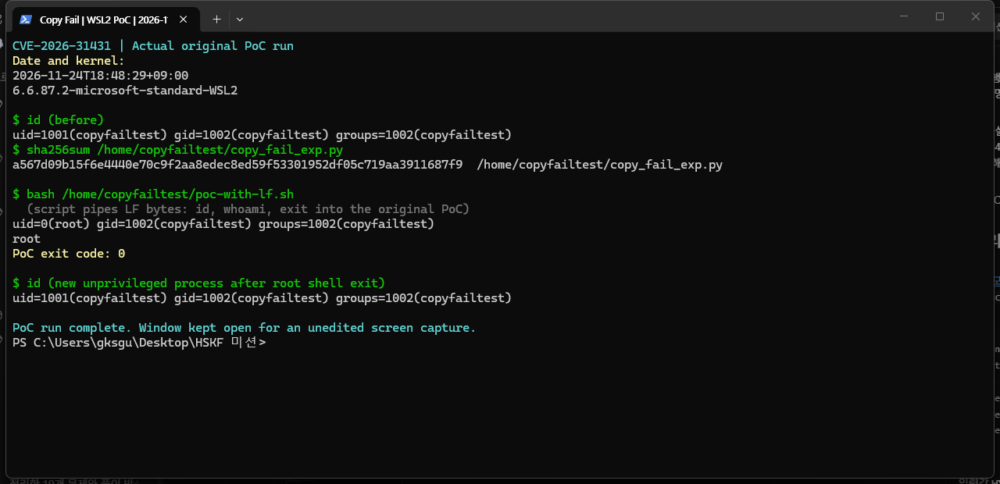

*작성·실험 기준: 2026년 11월 24일*

인증에 실패한 복호화 요청이 쓰기 권한도 없는 파일의 내용에 영향을 줄 수 있을까. **Copy Fail**은 Linux 커널에서 그 경계가 깨진 사례다. 일반 사용자가 커널 암호화 인터페이스에 파일 데이터를 전달하면, 인증 태그를 검사하기 전에 해당 파일의 **페이지 캐시**에 원하는 4바이트를 기록할 수 있었다. 공개 PoC는 이 동작을 반복해 setuid-root 프로그램인 `/usr/bin/su`의 캐시 내용을 바꾸고 root 셸을 실행한다. 취약점 식별자는 **CVE-2026-31431**이며, Ubuntu는 **CVSS 3.1 기준 7.8(High)**로 평가한다. [1][ubuntu-cve] [2][ubuntu-response]

이 글에서는 커널 소스와 고정 버전의 공개 PoC를 따라 쓰기 경로를 분석하고, 실험 전용 WSL2 배포판에서 원본 PoC로 root 셸을 얻은 결과를 정리한다. 사용자 공간은 Ubuntu 24.04 LTS였으며, 실제 부팅한 커널은 **`6.6.87.2-microsoft-standard-WSL2`**였다. 코드에서 확인한 처리 순서와 실험에서 관측한 결과는 각각 구분해 설명한다.

## 핵심 요약

| 항목 | 내용 |
| --- | --- |
| 공격 조건 | 취약한 커널에서 `AF_ALG` AEAD 인터페이스와 해당 알고리즘을 사용할 수 있는 로컬 사용자 |
| 쓰기 대상 | 사용자가 읽을 수 있는 파일의 페이지 캐시 |
| 쓰기 단위 | 해당 경로를 이용한 요청 한 번에 제어 가능한 4바이트 |
| 근본 원인 | `algif_aead`가 입력 파일 페이지의 참조를 출력 scatterlist에 연결하고, `authencesn`이 그 경계에 임시 데이터를 기록함 |
| 공개 PoC의 동작 | `/usr/bin/su`의 파일 시작 160바이트를 캐시에서 변경한 뒤 setuid 권한으로 실행 |
| 직접 재현 결과 | LF 입력을 명시한 재실행에서 `uid=0(root)` 확인, 별도 캡처용 재실행에서도 root 출력 확인 |
| 검증 범위 | 위 Microsoft WSL 커널 한 빌드와 해당 실험 환경 |

페이지 캐시는 파일 내용을 메모리에 보관해 일반적인 파일 읽기와 실행 등에 사용하는 계층이다. Copy Fail은 정상적인 파일 쓰기 권한 검사를 통과해 파일을 수정하는 방식이 아니라, **이후 파일 읽기에 사용될 메모리 내용을 바꾸는 방식**이다. 연구진은 이 쓰기가 일반적인 파일 쓰기 경로를 거치지 않아 해당 변경을 디스크에 기록하도록 페이지를 dirty 상태로 표시하지 않는다고 설명한다. 따라서 캐시를 통한 읽기와 디스크의 실제 저장 내용을 구분해야 한다. [3][research]

## 1. 파일 페이지가 암호화 요청의 출력에 연결되는 과정

### 1-1. `AF_ALG`, `splice()`, scatterlist

Linux의 `AF_ALG`는 사용자 프로그램이 소켓 인터페이스로 커널의 암호화 기능을 사용할 수 있게 한다. 공개 PoC는 AEAD 복호화에 사용할 알고리즘으로 `authencesn(hmac(sha256),cbc(aes))`를 선택한다.

취약한 구현에서 파일 데이터를 파일→파이프→`AF_ALG` 소켓 순서로 `splice()`하면, 입력 scatterlist가 파일 페이지 캐시의 페이지를 참조할 수 있다. **Scatterlist는 여러 메모리 조각을 하나의 데이터 흐름처럼 다루기 위한 커널 자료구조**다. 여기서는 파일 내용의 별도 복사본뿐 아니라 원래 파일 페이지를 가리키는 참조가 요청에 들어갈 수 있다는 점이 중요하다. 아래 설명은 해당 취약 경로를 기준으로 한다. [3][research] [4][algif-fix]

AEAD 복호화 입력의 구성은 다음과 같다.

`AAD(부가 인증 데이터) || 암호문 || 인증 태그`

### 1-2. 복사되는 영역과 참조로 연결되는 영역

취약한 `algif_aead`는 AAD와 암호문을 RX 수신 버퍼로 복사한다. 그러나 인증 태그는 같은 방식으로 복사하지 않는다. 태그 구간을 가리키는 TX 쪽 페이지 참조를 유지한 채, `sg_chain()`으로 RX scatterlist 뒤에 연결한다. 이어 이 결합 scatterlist를 암호화 요청의 입력과 출력으로 함께 사용한다. [4][algif-fix]



이때 `req->src`와 `req->dst`는 같은 결합 scatterlist를 가리킨다. 앞부분은 사용자 수신 버퍼이고, 그 뒤에는 입력 파일의 페이지 캐시를 참조하는 태그 구간이 붙는다. 따라서 파일 자체를 읽기 전용으로 열었어도, 암호화 알고리즘이 출력 scatterlist의 이 구간에 쓰면 원래 파일의 페이지 캐시에 영향을 줄 수 있다.

이 제자리 처리(in-place) 경로는 2017년의 `algif_aead` 변경으로 도입됐다. CVE-2026-31431의 수정은 이 경로를 대부분 되돌려 입력 파일 페이지가 출력의 쓰기 대상으로 이어지는 연결을 제거한다. [4][algif-fix]

## 2. `authencesn`의 임시 쓰기가 인증보다 먼저 일어난다

### 2-1. AAD의 4바이트를 출력 경계에 놓는 코드

`authencesn`은 IPsec의 확장 시퀀스 번호(ESN)를 처리하기 위해 인증할 데이터를 재배열한다. 이 과정에서 AAD 첫 8바이트 중 **바이트 오프셋 4~7**, 즉 `AAD[4:8]`의 4바이트를 목적지 뒤쪽에 임시로 기록한다. 문제의 호출은 다음과 같다. [5][authencesn]

```c
scatterwalk_map_and_copy(tmp + 1, dst, assoclen + cryptlen, 4, 1);
```

마지막 인자 `1`은 scatterlist 쪽으로 데이터를 **쓰는 방향**을 뜻한다. 이 호출은 해시 계산과 인증 태그 비교가 끝나기 전에 실행된다.

이후 `crypto_authenc_esn_decrypt_tail()`은 AAD를 복원하고, 태그가 일치하지 않으면 `-EBADMSG`를 반환한다. 하지만 출력 경계에 있던 원래 4바이트를 되돌리는 처리는 없다. **AAD를 원래 배치로 돌려놓는 것과 파일의 태그 위치에 있던 원래 내용을 복원하는 것은 다른 동작**이다. [5][authencesn]

### 2-2. `req->cryptlen`과 지역변수 `cryptlen`의 차이

쓰기 위치를 해석할 때는 두 길이를 구분해야 한다.

| 값 | 이 복호화 경로에서의 의미 |
| --- | --- |
| `req->assoclen` | AAD 길이 |
| `req->cryptlen` | 인증 태그를 포함한 암호문 영역의 길이. AAD는 제외 |
| `authsize` | 인증 태그 길이 |
| 감산 후 지역변수 `cryptlen` | `req->cryptlen - authsize`, 즉 태그를 제외한 암호문 길이 |

문제의 쓰기 지점에서는 이미 지역변수에서 인증 태그 길이를 뺀 상태다. 따라서 `assoclen + cryptlen`은 **정상 복호화 출력으로 사용할 AAD·평문 영역의 끝**에 해당한다. 아직 인증과 복호화가 완료되지 않은 현재 버퍼에는 AAD와 암호문이 복사돼 있으며, 취약한 결합 scatterlist에서는 바로 그 뒤에 입력의 인증 태그 구간이 연결된다. [5][authencesn]

이 구조와 임시 쓰기를 합치면 다음과 같은 흐름이 된다.

1. 읽을 수 있는 파일의 페이지가 `splice()`를 통해 암호화 요청의 입력에 참조로 들어간다.
2. `algif_aead`가 태그 구간의 파일 페이지 참조를 출력 뒤에 연결한다.
3. `authencesn`이 정상 출력 영역의 끝에 `AAD[4:8]`의 값을 기록한다.
4. 해당 위치가 파일 페이지 캐시를 가리키므로 파일의 캐시 내용이 바뀐다.
5. 이후 태그 검증이 실패하더라도 앞선 쓰기는 되돌려지지 않는다.

즉, **인증 실패는 요청 처리 중 발생한 모든 메모리 변경을 취소한다는 뜻이 아니었다.** 읽기용 입력 파일의 페이지를 출력의 임시 저장소로 사용할 수 있게 된 것이 권한 경계를 깨뜨렸다. [4][algif-fix] [5][authencesn]

## 3. 공개 PoC의 요청 구성과 4바이트 쓰기 계산

분석한 PoC는 Theori 저장소의 커밋 **`09e97bd8f1aa3868b720a7a12a60b1c365798e06`**에 있는 `copy_fail_exp.py`다. 파일은 **10줄, 732바이트**이며 Python 표준 라이브러리인 `os`, `socket`, `zlib`를 사용한다. [6][poc]

### 3-1. 요청을 구성하는 값

파일 오프셋을 `t`, 기록하려는 4바이트를 `c`라고 하면 한 번의 요청은 다음과 같이 구성된다.

| PoC의 동작 | 역할 |
| --- | --- |
| `socket(38, 5, 0)` | `AF_ALG`, `SOCK_SEQPACKET` 소켓 생성 |
| `authencesn(hmac(sha256),cbc(aes))` 바인딩 | 문제가 되는 AEAD 구현 선택 |
| 키와 IV 설정, 복호화 연산 지정 | 해당 알고리즘의 복호화 요청 구성 |
| 인증 태그 길이를 `4`로 설정 | 파일에서 전달한 마지막 4바이트를 태그로 취급 |
| `sendmsg([b"A"*4 + c], …, MSG_MORE)` | 8바이트 AAD를 전달하고, 오프셋 4~7에 기록할 값 배치 |
| 파일 시작부터 `t+4`바이트를 파일→파이프→소켓으로 전달 | 마지막 4바이트가 파일의 `[t,t+4)`를 가리키도록 구성 |
| `recv(8+t)` | 요청 처리를 시작해 임시 쓰기 경로에 도달 |

`MSG_MORE`는 AAD 뒤에 추가 입력이 이어진다는 것을 알린다. 이 요청에서 AAD는 `sendmsg()`가 제공하고, 그 뒤의 암호문·태그로 해석될 데이터는 파일에서 가져온다. [6][poc]

### 3-2. 길이와 파일 오프셋의 대응

| 항목 | 값 |
| --- | --- |
| AAD 길이 | `8`바이트 |
| 파일에서 전달할 길이 | `t + 4`바이트 |
| 인증 태그 길이 | `4`바이트 |
| `req->cryptlen` | `t + 4` |
| 태그를 제외한 지역변수 `cryptlen` | `t` |
| AAD를 포함한 정상 출력 영역의 끝 | `8 + t` |
| 그 경계에 연결되는 파일 범위 | `[t,t+4)` |
| 임시 쓰기에 사용되는 값 | `AAD[4:8] = c` |

필요한 `t+4`바이트가 모두 전달되면, 임시 쓰기 위치는 파일의 `[t,t+4)` 구간에 대응한다. 원본 PoC는 이 계산을 파일 시작 부분에 반복 적용한다. `splice()`는 요청한 길이보다 적은 바이트를 전송할 수 있고 원본은 반환 길이를 확인하지 않으므로, 이 짧은 스크립트에 큰 `t`를 넣기만 하면 모든 파일 오프셋에서 동일하게 성공한다고 일반화할 수는 없다. [6][poc] [7][splice]

이 PoC에서 `recv()`의 목적은 복호화된 데이터를 얻는 것이 아니라, 임시 쓰기가 일어나는 코드에 도달하는 것이다. 원본은 `recv()`에서 발생한 예외를 잡고 계속 진행한다. 따라서 원본 스크립트의 출력만으로 실제 오류가 `EBADMSG`였다고 확인할 수는 없다. [6][poc]

### 3-3. 160바이트 ELF와 권한 상승

PoC에 압축된 페이로드를 풀면 **160바이트의 x86-64 ELF**가 나온다. 시작 바이트는 ELF 시그니처인 `7f 45 4c 46`이며, 코드에는 `setuid(0)`과 `/bin/sh`를 실행하는 경로가 포함돼 있다. 스크립트는 `t=0,4,…,156`으로 40회 요청해 파일의 **`[0,160)` 범위**를 변경한 뒤 `su`를 실행한다. 기존 `.text` 섹션의 위치를 계산해 그 내부를 패치하는 방식이 아니다. [6][poc]

대상 `/usr/bin/su`가 root 소유의 setuid 실행 파일이고 해당 권한 전환이 허용되는 환경이라면, 실행 시 커널은 변조된 페이지 캐시의 ELF 내용을 읽을 수 있다. 삽입된 코드가 `setuid(0)`을 호출하고 셸을 실행하면서 권한 상승이 이어진다. 이 동작은 파일의 캐시 내용을 이용하며, 디스크 파일을 영구적으로 덮어쓰는 것을 전제로 하지 않는다. [3][research] [6][poc]

## 4. 실험 전용 WSL2 배포판에서 직접 재현

최초 실험의 원본 JSON은 [실행 전 확인 로그][baseline-log]와 [PoC 실행·후속 검사 로그][poc-log]로 첨부했다. 각 항목에는 명령, 실행 사용자, 시작 시각, 종료 코드와 표준 출력·표준 오류가 기록돼 있다. 아래 표처럼 최초 실험의 두 시도와 별도의 스크린샷 촬영용 재실행을 구분한다.

| 구분 | 배포판·로그 항목 | 확인한 결과 |
| --- | --- | --- |
| 최초 실험의 첫 시도 | `CopyFailLab-20261123` · `original_poc` | 권한 확인 명령에서 `not found` 오류가 발생해 root 출력은 확인하지 못함. 이후 일반 읽기의 전체 파일 해시가 바뀜 |
| 최초 실험의 LF 입력 재실행 | 같은 배포판 · `original_poc_lf_stdin` | `uid=0(root)`와 `root` 출력 확인. 후속 읽기에서는 전체 파일 해시가 기준값으로 돌아옴 |
| 스크린샷 촬영용 재실행 | `CopyFailShot-20261124` | 그림 1·2와 캡처용 LF 입력 스크립트 |

JSON의 `started_utc`는 UTC 기준이다. 예를 들어 `2026-11-23T15:02:59.497317+00:00`은 한국 표준시로 **2026년 11월 24일 00:02:59.497**이다. 이 절의 시각은 한국 표준시(KST, UTC+9)로 표기하며, 각 명령의 **시작 시각**을 뜻한다.

### 4-1. 실험 환경과 사용한 파일

최초 실험에서는 공식 Ubuntu 24.04 WSL rootfs를 가져온 `CopyFailLab-20261123`을 사용했다. 다음 값은 실행 전 확인 로그에서 확인할 수 있다. [17][baseline-log]

| 확인 항목 | 실험값 | 로그의 `label` |
| --- | --- | --- |
| 실험일·배포판 | 2026년 11월 24일 KST · `CopyFailLab-20261123` | 각 항목의 시각과 명령 |
| 사용자 공간 | Ubuntu 24.04 LTS | `distro` |
| 실제 부팅 커널·아키텍처 | `6.6.87.2-microsoft-standard-WSL2` · x86-64 | `kernel` |
| Python | `3.12.3` | `python` |
| 실행 전 사용자 | `copyfailtest`, UID/EUID `1001/1001`, GID `1002` | `identity_before` |
| 대상 파일 | `/usr/bin/su`, 소유자 `0:0`, 권한 `4755`, 크기 55,680바이트 | `su_metadata` |
| 설치된 `util-linux` 버전 | `2.39.3-9ubuntu6` | `su_package` |
| 실행 전 `su -c id` | 잘못된 비밀번호를 전달했을 때 인증 실패, 종료 코드 `1` | `su_without_poc` |

`su_package`는 `dpkg-query -W util-linux`의 결과를 담은 항목이다. 이 명령은 설치된 패키지 버전을 확인한 것으로, `/usr/bin/su`의 패키지 소유권을 따로 조회한 기록은 아니다.

환경 확인과 일부 해시 측정은 준비·관찰용 root 프로세스에서 수행했다. **두 PoC 실행의 명령에는 모두 `-u copyfailtest`가 명시돼 있고, 실행 전 해당 사용자의 UID/EUID는 `1001/1001`이었다.** 측정을 수행한 사용자와 PoC를 실행한 사용자를 구분해야 한다. [17][baseline-log] [18][poc-log]

사용한 rootfs의 파일명은 **`ubuntu-noble-wsl-amd64-wsl.rootfs.tar.gz`**다. 이미지 준비 기록에 남긴 SHA-256은 Ubuntu의 날짜 고정 체크섬과 일치한다. 체크섬 URL의 `20240423`은 이미지 릴리스 경로이며 실험일과는 구분된다. rootfs 검사 명령은 이번에 첨부한 두 JSON에 포함돼 있지 않으며, PoC 파일의 해시는 `poc_hash` 항목에 기록돼 있다. [8][rootfs] [17][baseline-log]

```text
Ubuntu WSL rootfs
8251e27ffff381a4af5f41dcb94d867de3e0d9774a9241908ab34555d99315ea

copy_fail_exp.py
a567d09b15f6e4440e70c9f2aa8edec8ed59f53301952df05c719aa3911687f9
```

PoC 파일의 해시는 연구진이 공개한 값과 일치했다. [9][disclosure] [17][baseline-log]

`wsl_config`에는 Windows 드라이브 자동 마운트와 Windows 실행 파일 연동을 끈 설정이 남아 있다. 대상 `/usr/bin/su`는 실험용 Linux 파일시스템에 있는 파일이다. 여기서 실험 전용 또는 일회용이라는 표현은 별도로 가져온 배포판을 뜻한다. **같은 WSL2 환경의 다른 배포판과 커널까지 분리된 별도 VM을 뜻하지는 않는다.** WSL2 배포판들은 관리되는 VM 안에서 실행되며 커널 등을 공유한다. [10][wsl-about] [11][wsl-config] [17][baseline-log]

아래 두 스크린샷은 같은 날 별도로 만든 일회용 배포판 `CopyFailShot-20261124`에서 **원본 PoC를 재실행하며 캡처한 Windows Terminal 화면**이다. 재실행에서도 앞서 적은 PoC의 SHA-256과 실제 부팅한 커널을 확인했다. 두 JSON은 모두 최초 실험 배포판의 기록이므로, 이 스크린샷과는 별도 자료로 구분한다.



_그림 1. 캡처용 배포판 `CopyFailShot-20261124`에서 실행 전 사용자 UID가 1001이고 `/usr/bin/su`가 root 소유의 setuid 실행 파일(권한 `4755`)임을 확인했다. 잘못된 비밀번호를 전달한 `su -c id`는 인증에 실패했으며 종료 코드는 1이었다._

[그림 1 원본 크기로 보기](/assets/img/copy-fail/01-baseline-real-screen.png)

### 4-2. 첫 시도의 확인 명령 오류와 LF 입력 재실행

최초 실험 배포판의 `original_poc`와 `original_poc_lf_stdin`에는 같은 실행 명령이 기록돼 있다. WSL 실행 파일의 경로를 `wsl.exe`로 줄이고 한 줄로 정리하면 다음과 같다. 대기 시간을 제한하는 `timeout`은 원본 PoC 바깥에서 적용했다. [18][poc-log]

```text
wsl.exe -d CopyFailLab-20261123 -u copyfailtest --cd /home/copyfailtest -- timeout -k 5s 45s python3 /home/copyfailtest/copy_fail_exp.py
```

두 시도의 결과는 달랐다.

| 항목 | 첫 시도 | LF 입력을 명시한 재실행 |
| --- | --- | --- |
| 로그의 `label` | `original_poc` | `original_poc_lf_stdin` |
| 시작 시각(KST) | 00:02:59.497 | 00:03:28.360 |
| 표준 출력 | 빈 문자열 | `uid=0(root)` 및 `root` |
| 표준 오류 | `id`, `whoami`, `exit`에 대한 `not found` 오류 | 빈 문자열 |
| 종료 코드 | `0` | `0` |

첫 시도의 기록에서 결과 필드를 발췌하면 다음과 같다. 문자열의 줄바꿈은 JSON 표현 그대로 표시했다.

```json
{
  "label": "original_poc",
  "exit_code": 0,
  "stdout": "",
  "stderr": ": 1: id\n: not found\n: 2: whoami\n: not found\n: 3: exit\n: not found\n"
}
```

따라서 **첫 시도에서 root를 확인했다고 적을 수는 없다.** 반대로 이 오류만으로 취약점 트리거나 권한 상승 자체가 실패했다고 단정할 수도 없다. 종료 코드가 0이라는 사실만으로 확인 명령의 성공을 판단하지 않고, 실제 출력과 오류를 함께 봐야 한다. [18][poc-log]

두 번째 항목 `original_poc_lf_stdin`에는 `id`, `whoami`, `exit`을 LF 바이트로 전달했다는 설명이 `stdin_escaped`에 남아 있다. 이 재실행의 표준 출력은 다음과 같다.

```text
uid=0(root) gid=1002(copyfailtest) groups=1002(copyfailtest)
root
```

이 항목의 종료 코드는 **`0`**이고 표준 오류는 비어 있다. **LF 입력을 명시한 재실행에서 일반 사용자로 실행한 PoC의 root 출력을 확인했다.** 이 기록과 별도의 캡처용 재실행 화면이 해당 WSL 커널 빌드에서의 로컬 권한 상승 재현을 뒷받침한다. [18][poc-log]

첫 시도의 `stdin`도 JSON 문자열로 기록돼 있으므로, 이 자료만으로 실제 프로세스에 전달된 원시 바이트나 줄바꿈 변환 지점을 복원할 수는 없다. 첫 오류의 원인을 특정한 CRLF 변환이나 따옴표 처리 문제로 단정하지 않는다.

#### 캡처용 재실행의 입력 스크립트와 화면

캡처용 배포판 `CopyFailShot-20261124`에서는 확인 명령을 LF 줄바꿈으로 전달하기 위해 WSL 내부의 `poc-with-lf.sh`를 사용했다. 이 스크립트는 원본 `copy_fail_exp.py`를 수정하지 않고 표준 입력과 시간 제한을 제공한다. 아래 스크립트는 캡처용 재실행에 사용한 것이며, 최초 실험의 호스트 측 입력 전달 코드를 뜻하지 않는다.

```bash
#!/usr/bin/env bash
set -o pipefail
printf 'id\nwhoami\nexit\n' | timeout -k 5s 45s python3 /home/copyfailtest/copy_fail_exp.py
```



_그림 2. 캡처용 배포판 `CopyFailShot-20261124`에서 원본 PoC를 일반 사용자로 실행해 `uid=0(root)`와 `whoami`의 `root` 출력을 확인했다. root 셸 종료 후 별도로 실행한 일반 사용자 프로세스의 UID는 1001이다._

[그림 2 원본 크기로 보기](/assets/img/copy-fail/02-root-shell-real-screen.png)

### 4-3. 원본 로그에 기록된 해시 측정과 관찰 시점

일반 읽기에는 다음 명령을 사용해 `/usr/bin/su` 전체의 SHA-256을 계산했다. [17][baseline-log] [18][poc-log]

```bash
sha256sum /usr/bin/su
```

직접 I/O 측정은 원본 로그의 `su_direct_first4k_before`, `su_direct_first4k_after`, `su_direct_first4k_after_root_shell` 항목에 남아 있다. WSL 안에서 `sh -lc`에 전달한 명령은 다음과 같다.

```bash
dd if=/usr/bin/su iflag=direct bs=4096 count=1 status=none | sha256sum
```

`iflag=direct`는 캐시를 우회하는 직접 I/O를 요청한다. `bs=4096 count=1`은 파일 시작부터 4,096바이트짜리 입력 블록 하나를 읽도록 요청한다. 일반 읽기는 파일 전체를 대상으로 하므로 두 명령의 측정 범위는 다르다. [16][gnu-dd]

로그에서 확인한 값은 다음과 같다.

```text
일반 읽기 — 전체 파일
실행 전 (su_sha256_before):
4264819999f1724767c2f114d434e6b047a0b72122d20a1ffe7240d038219037
첫 시도 후 (su_sha256_after_cached_read):
2a053f828cffc79d15a4bbf6b560a17bb54fc5331102f866fe68f73baff655f1
LF 재실행 후 (su_sha256_after_root_shell):
4264819999f1724767c2f114d434e6b047a0b72122d20a1ffe7240d038219037

직접 I/O — 파일 시작의 4,096바이트 입력 블록 1개 요청
실행 전, 첫 시도 후, LF 재실행 후 모두:
4ec7a4ea956876e40e25997260fd2f72f8d98318dbecc5225adb8489c5a29d03
```

**root 출력은 확인하지 못한 첫 시도 뒤에 일반 읽기의 전체 파일 해시가 달라졌다.** 그때 직접 I/O를 요청한 읽기의 해시는 기준값과 같았다. root 출력은 그 뒤의 LF 입력 재실행에서 확인했다. 이 두 관찰을 하나의 실행에서 얻은 결과로 합쳐 해석해서는 안 된다. [18][poc-log]

첫 시도 후의 해시 차이는 파일 시작 부분에 쓰기를 수행한다는 정적 분석과 함께 볼 때 **페이지 캐시 변조에 부합하는 결과**다. 다만 동일한 첫 4,096바이트를 두 방식으로 직접 비교한 실험은 아니며, 직접 I/O로 파일 전체를 읽어 디스크 파일 전체의 불변성을 검증한 결과도 아니다.

직접 I/O 측정 세 건은 표준 오류가 비어 있고 종료 코드가 0으로 기록돼 있다. 다만 이 값은 `sh -lc`로 실행한 파이프라인의 종료값이며, **`dd`의 개별 종료 상태와 실제 전송 바이트 수는 별도로 수집하지 않았다.** `status=none`은 전송 통계를 표시하지 않지만 오류 메시지를 억제하지는 않는다. 따라서 로그에 I/O 오류가 보고된 것은 아니며, 측정 범위는 “파일 시작의 4,096바이트 블록 하나를 직접 I/O로 읽도록 요청했다”는 수준으로 설명한다. [16][gnu-dd] [17][baseline-log] [18][poc-log]

### 4-4. LF 재실행 뒤의 후속 검사와 검증 범위

LF 입력 재실행 뒤, 00:04:13.965에 시작한 `su_sha256_after_root_shell`에서 일반 읽기의 전체 파일 해시는 기준값으로 돌아와 있었다. 이어진 직접 I/O 요청의 해시도 기준값을 유지했다. [18][poc-log]

00:04:14.161에 시작한 `payload_cache_comparison`은 PoC의 압축 페이로드를 해제한 뒤, 그 시점에 일반 읽기로 얻은 `/usr/bin/su`의 첫 160바이트와 비교한 후속 검사다. 결과는 다음과 같다.

```text
payload_length= 160
cached_first_160_equals_payload= False
cached_first_16= 7f454c46020101000000000000000000
```

이는 **해당 읽기 시점의 첫 160바이트가 PoC 페이로드와 같지 않았음**을 뜻한다. 앞선 실행 시점에도 페이로드가 없었다는 증거로 해석할 수는 없다. 첫 16바이트의 ELF 시그니처만으로 페이로드 일치를 판단할 수도 없다. [18][poc-log]

두 시도는 같은 배포판에서 진행됐고, 제공한 로그에는 그 사이의 환경 초기화나 캐시 상태를 통제한 기록이 없다. 해시가 기준값으로 돌아온 원인과 시점도 확정할 수 없다. 따라서 두 시도를 초기 상태가 통제된 독립 실험으로 간주하거나, 셸 종료가 캐시 복원을 일으켰다고 해석하지 않는다.

마지막 `identity_after_root_shell_exited` 항목에서는 별도로 실행한 일반 사용자 프로세스의 UID/EUID가 `1001/1001`이었다. 이는 해당 프로세스의 권한을 확인한 결과다. [18][poc-log]

또한 시스템 호출 추적은 남기지 않았다. **`recv()`가 `EBADMSG`를 반환하는 장면을 직접 관측한 것은 아니다.** 임시 쓰기가 인증 태그 비교보다 앞서 실행된다는 설명은 2절의 커널 소스 분석에 근거한다.

이 실험에서 직접 확인한 핵심은 첫 시도 이후의 파일 읽기 해시 변화, LF 입력 재실행의 root 출력, 후속 읽기에서의 기준 해시 복귀와 페이로드 불일치다. 수정 커널에서의 차단 여부, 캐시 변경의 유지 시간, 다른 배포판에서의 동작과 컨테이너 탈출은 별도로 검증하지 않았다.

## 5. 두 커널 패치가 수정한 부분

### 5-1. `algif_aead`에서 입력과 출력을 분리

CVE-2026-31431의 상위 커널 수정 커밋 **`a664bf3d603d`**는 `algif_aead`의 제자리 처리 경로를 대부분 되돌렸다. 수정 후 요청은 TX scatterlist를 입력으로, RX scatterlist를 출력으로 사용한다. 태그 구간의 파일 페이지 참조를 출력 뒤에 연결하던 경로가 제거되므로, 이 글에서 추적한 파일 페이지 캐시 쓰기 연결이 끊긴다. [4][algif-fix]

### 5-2. `authencesn`의 별도 출력 버퍼 처리 수정

이어지는 **`e02494114ebf`** 커밋은 입력과 출력이 분리된 `authencesn` 복호화에서 정상 출력 경계 바깥에 임시 데이터를 쓰는 문제를 수정한다. 이 변경은 입력·출력이 같은 경우와 다른 경우를 구분하고, 출력이 분리된 경로에서는 임시 데이터의 배치를 바꾸며 AAD를 원본 입력에서 복원한다. [12][authencesn-fix]

이 문제에는 **CVE-2026-43033**이 별도로 부여됐다. 두 수정은 서로 관련돼 있지만, 각 수정이 다루는 부분은 구분된다. [13][companion-cve]

| 커밋 | 수정 범위 |
| --- | --- |
| `a664bf3d603d` | `algif_aead`에서 입력 파일 페이지 참조가 쓰기 가능한 출력으로 연결되는 경로 제거 |
| `e02494114ebf` | `authencesn`의 out-of-place 복호화에서 정상 출력 경계 바깥의 임시 쓰기 수정 |

## 6. 운영 환경에서의 대응

### 6-1. 일반 Linux 배포판

운영 환경에서는 사용하는 배포판과 커널 계열에 맞는 수정 커널을 적용하고, 수정된 커널로 부팅됐는지 확인해야 한다. Ubuntu 추적 페이지는 24.04 LTS 기본 `linux` 패키지를 **`6.8.0-117.117`**에서 수정된 것으로 표시한다. HWE·클라우드 커널은 별도 계열이므로 실제 사용하는 패키지의 수정 상태를 확인해야 한다. [1][ubuntu-cve]

패치 전에는 `algif_aead` 모듈의 로드를 차단하는 임시 완화를 검토할 수 있다. 다만 로드 차단 설정은 이미 로드된 모듈을 제거하지 않으므로 현재 상태와 언로드 성공 여부도 확인해야 한다. 커널에 내장된 구성에서는 모듈 블랙리스트만으로 해당 기능을 차단할 수 없다. [2][ubuntu-response]

### 6-2. 이번 실험에 사용한 WSL2

이번 환경은 Microsoft WSL 커널로 부팅했다. 따라서 Ubuntu 내부의 `linux-image` 패키지를 업데이트하는 것만으로 실행 중인 WSL 커널이 교체되지는 않는다. Microsoft가 제공하는 WSL 업데이트 경로를 통해 수정 커널을 적용하고, WSL VM을 다시 시작한 뒤 실제 실행 커널과 수정 포함 여부를 확인해야 한다. 사용자 지정 커널을 사용한다면 해당 커널을 별도로 갱신해야 한다. [11][wsl-config] [14][wsl-commands]

Microsoft는 WSL 업데이트에 `wsl --update`, 구성 요소 확인에 `wsl --version`과 `wsl --status`, WSL VM 종료에 `wsl --shutdown`을 안내한다. `wsl --shutdown`은 실행 중인 모든 WSL 배포판과 관리 VM을 종료하므로 작업 상태를 고려해 사용해야 한다. 업데이트 명령을 실행했다는 사실만으로 해당 CVE의 수정 여부를 단정하지 않고, 적용된 커널의 수정 상태를 확인하는 것이 필요하다. [14][wsl-commands]

### 6-3. 컨테이너 환경

컨테이너에서의 영향은 커널 공유뿐 아니라 `AF_ALG` 접근 가능 여부, 대상 파일에 대한 접근성, 동일한 기반 파일의 inode·페이지 캐시를 공유하는지에 따라 달라진다. 연구진은 이를 이용한 후속 컨테이너 분석을 공개했다. 이번 WSL 실험은 그 공격 경로를 재현한 결과가 아니므로, 로컬 권한 상승과 컨테이너 탈출의 검증 범위는 구분해야 한다. [15][container]

## 마치며

Copy Fail에서는 세 동작이 이어졌다. `splice()`가 파일 페이지를 암호화 입력에 참조로 전달했고, `algif_aead`가 그중 태그 구간의 참조를 출력에도 연결했으며, `authencesn`이 인증 결과를 확인하기 전에 출력 경계의 4바이트를 임시 저장소로 사용했다. **읽기용 입력의 페이지 참조가 출력으로 넘어가면서, 원래 파일의 페이지 캐시에 쓰기가 도달한 것**이 핵심이다.

직접 재현에서는 `6.6.87.2-microsoft-standard-WSL2` 환경의 LF 입력 재실행에서 일반 사용자로 실행한 공개 PoC의 root 출력을 확인했다. 첫 시도 뒤의 해시 변화는 페이지 캐시 변조에 부합했고, LF 재실행 뒤에는 기준 해시 복귀와 페이로드 불일치를 관측했다. 캐시가 기준값으로 돌아온 원인과 수정 커널에서의 동작은 별도로 확인하지 않았다.

이 사례를 분석하면서 주목한 점은 오류 반환값만으로 요청의 부작용을 판단할 수 없다는 것이다. 인증 실패 여부와 함께 **실패가 결정되기 전에 어느 메모리에 쓰기가 일어났는지, 그 메모리가 누구의 데이터를 참조하는지**를 추적해야 취약점의 실제 영향을 이해할 수 있었다.

## 참고 자료

1. [Ubuntu CVE-2026-31431 추적 페이지][ubuntu-cve]
2. [Ubuntu Copy Fail 대응 안내][ubuntu-response]
3. [Theori/Xint Copy Fail 원인 분석][research]
4. [Linux `algif_aead` 수정 커밋 `a664bf3d603d`][algif-fix]
5. [고정 커밋의 Linux `authencesn.c`][authencesn]
6. [Theori 공개 PoC — 커밋 `09e97bd8f1aa`][poc]
7. [Linux `splice(2)` 매뉴얼][splice]
8. [Ubuntu WSL rootfs SHA256SUMS — `20240423`][rootfs]
9. [Copy Fail 공개 페이지][disclosure]
10. [Microsoft WSL2 구조 설명][wsl-about]
11. [Microsoft WSL 설정 안내][wsl-config]
12. [Linux `authencesn` 수정 커밋 `e02494114ebf`][authencesn-fix]
13. [Linux CVE-2026-43033 기록][companion-cve]
14. [Microsoft WSL 명령 안내][wsl-commands]
15. [Theori/Xint 컨테이너 후속 분석][container]
16. [GNU Coreutils — `dd` 공식 매뉴얼][gnu-dd]
17. [원본 실험 로그 — 실행 전 확인][baseline-log]
18. [원본 실험 로그 — PoC 실행과 후속 검사][poc-log]

[ubuntu-cve]: https://ubuntu.com/security/CVE-2026-31431
[ubuntu-response]: https://ubuntu.com/blog/copy-fail-vulnerability-fixes-available
[research]: https://xint.io/blog/copy-fail-linux-distributions
[algif-fix]: https://github.com/torvalds/linux/commit/a664bf3d603dc3bdcf9ae47cc21e0daec706d7a5
[authencesn]: https://kernel.googlesource.com/pub/scm/linux/kernel/git/herbert/crypto-2.6/%2B/a664bf3d603dc3bdcf9ae47cc21e0daec706d7a5/crypto/authencesn.c
[poc]: https://github.com/theori-io/copy-fail-CVE-2026-31431/blob/09e97bd8f1aa3868b720a7a12a60b1c365798e06/copy_fail_exp.py
[splice]: https://man7.org/linux/man-pages/man2/splice.2.html
[rootfs]: https://cloud-images.ubuntu.com/wsl/releases/noble/20240423/SHA256SUMS
[disclosure]: https://copy.fail/
[wsl-about]: https://learn.microsoft.com/en-us/windows/wsl/about
[wsl-config]: https://learn.microsoft.com/en-us/windows/wsl/wsl-config
[authencesn-fix]: https://kernel.googlesource.com/pub/scm/linux/kernel/git/herbert/crypto-2.6/%2B/e02494114ebf7c8b42777c6cd6982f113bfdbec7%5E%21/
[companion-cve]: https://kernel.googlesource.com/pub/scm/linux/security/vulns/%2B/09b74d1628ea888153f0194df38a4c2f3a80ba5f/cve/published/2026/CVE-2026-43033.mbox
[wsl-commands]: https://learn.microsoft.com/en-us/windows/wsl/basic-commands
[container]: https://xint.io/blog/copy-fail-pod-to-host
[gnu-dd]: https://www.gnu.org/software/coreutils/manual/coreutils.html#dd-invocation
[baseline-log]: /assets/logs/copy-fail/2026-11-24-wsl-baseline.json
[poc-log]: /assets/logs/copy-fail/2026-11-24-wsl-poc.json
