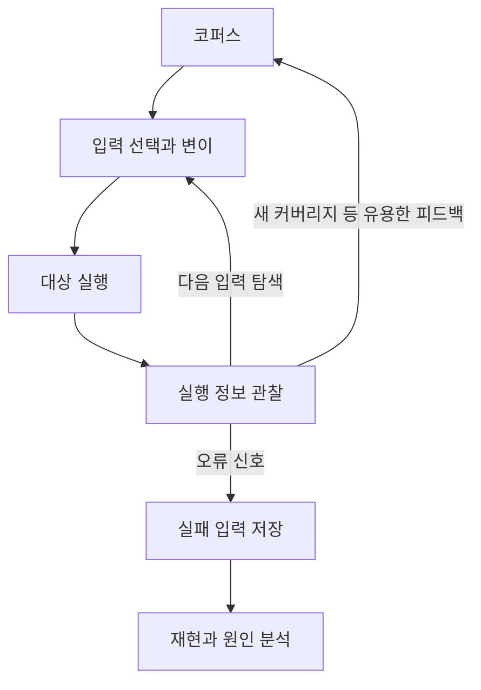

퍼징은 다양한 입력을 자동으로 만들어 프로그램을 반복 실행하고, 예상하지 못한 오류를 찾는 테스트 방법이다. 퍼징을 이해하려면 입력을 만드는 방식, 실행 결과를 관찰하는 방식, 오류를 판정하는 기준을 함께 살펴봐야 한다. 이 글에서는 퍼징의 기본 개념과 분류를 설명하고, 주요 퍼저의 특징과 선택 기준을 비교한다. [1](https://go.dev/doc/security/fuzz/)

## 1. 퍼징이란

**퍼징(Fuzzing)**은 프로그램에 여러 입력을 자동으로 제공하면서 결함을 탐색하는 동적 테스트 기법이다. **퍼저(Fuzzer)**는 이 과정을 수행하는 도구나 프레임워크를 뜻한다. 문서에 따라 퍼저라는 말을 입력 생성기나 개별 퍼징 타깃까지 포함하는 넓은 의미로 사용하기도 한다. [2](https://github.com/google/fuzzing/blob/master/docs/glossary.md)

예를 들어 이미지 파일을 읽는 프로그램을 검사한다고 가정해 보자. 정상적인 이미지가 잘 열리는지 확인하는 것에 더해, 파일이 중간에 끊기거나 크기 정보가 실제 데이터와 다를 때도 프로그램이 올바르게 처리하는지 확인해야 한다. 퍼징은 이런 입력을 대량으로 만들고 시험하는 작업을 자동화한다.

입력은 반드시 완전히 무작위이거나 잘못된 형식일 필요가 없다. 정상 입력의 일부를 바꾸거나, 입력 형식의 규칙을 따라 새로운 데이터를 만들 수도 있다. 이렇게 프로그램이 받아들일 수 있는 입력을 확보하면 초기 형식 검사를 지나 더 깊은 처리 로직을 검사하는 데 도움이 된다. [3](https://www.fuzzingbook.org/html/MutationFuzzer.html) [4](https://www.fuzzingbook.org/html/Grammars.html)

퍼징의 목적은 단순히 프로그램을 종료시키는 데 있지 않다. 처리되지 않은 예외, 메모리 오류, 지나치게 오래 걸리는 처리, 개발자가 정한 검증 조건의 위반 등을 찾을 수 있다. 어떤 문제를 발견할 수 있는지는 입력의 범위와 오류 판정 기준에 따라 달라진다. [1](https://go.dev/doc/security/fuzz/)

## 2. 퍼징을 이해하기 위한 기본 용어

| 용어 | 의미 | 예시 |
| --- | --- | --- |
| 시드 Seed | 퍼징을 시작하거나 변이할 때 바탕으로 삼는 입력 | 작은 이미지 파일, JSON 문서 |
| 코퍼스 Corpus | 퍼징에 사용하는 입력들의 모음 | 초기 시드와 탐색 중 보존한 입력 |
| 퍼징 타깃 Fuzz target | 실제로 시험할 함수나 기능, 또는 그 진입점 | 이미지 해석 함수, JSON 파서 |
| 하네스 Harness | 입력을 대상 기능에 전달하고 초기화·정리·검증을 수행하는 테스트 코드 | 바이트 배열을 파서에 전달하는 코드 |
| 계측 Instrumentation | 실행 정보를 관찰하도록 코드나 실행 환경에 장치를 추가하는 작업 | 어떤 코드 구간이 실행됐는지 기록 |
| 커버리지 Coverage | 실행이 어떤 코드 영역에 도달했는지를 나타내는 정보 | 실행된 기본 블록이나 블록 사이의 연결 |
| 오라클 Oracle | 실행 결과가 정해진 올바름의 조건을 위반했는지 판단하는 기준 또는 검사 장치 | 크래시 감시, sanitizer, 검증 조건 |

하나의 퍼징 구성 안에서도 입력 준비, 실행 관찰, 오류 판정은 서로 다른 역할을 맡는다. [2](https://github.com/google/fuzzing/blob/master/docs/glossary.md) [5](https://clang.llvm.org/docs/SanitizerCoverage.html) [6](https://softsec.kaist.ac.kr/~sangkilc/papers/manes-tse19.pdf)

시드와 코퍼스는 구분해야 한다. 시드는 개별 출발 입력을 가리키고, 코퍼스는 그런 입력들을 포함하는 집합이다. 코퍼스에는 정상 입력과 비정상 입력을 함께 담을 수 있다. 일부 퍼저는 준비된 시드 없이도 시작할 수 있지만, 복잡한 입력 형식을 다룰 때는 적절한 시드가 탐색에 도움이 된다. [2](https://github.com/google/fuzzing/blob/master/docs/glossary.md) [7](https://llvm.org/docs/LibFuzzer.html)

하네스는 퍼저와 실제 기능을 연결한다. 이미지 뷰어의 모든 화면을 조작하는 대신 이미지 해석 함수를 직접 호출하는 하네스를 만들 수 있다. 이때 검사하려는 기능에 입력이 도달해야 하고, 반복 실행 중 남는 상태나 자원이 다음 입력의 결과를 불필요하게 바꾸지 않도록 해야 한다. [8](https://github.com/google/fuzzing/blob/master/docs/good-fuzz-target.md)

**커버리지는 탐색을 안내하는 정보이고, 오라클은 오류를 판단하는 기준이다.** 새 코드에 도달했다는 사실과 버그가 발생했다는 사실은 서로 다르다. [9](https://www.fuzzingbook.org/html/GreyboxFuzzer.html) [6](https://softsec.kaist.ac.kr/~sangkilc/papers/manes-tse19.pdf)

## 3. 커버리지 유도 퍼징의 동작 과정

커버리지 유도 퍼징은 실행 결과를 다음 입력 탐색에 반영한다. 아래는 변이 기반 퍼저가 동작하는 대표적인 흐름이다. [9](https://www.fuzzingbook.org/html/GreyboxFuzzer.html)



1. **입력을 준비한다.** 검사 대상의 여러 기능에 도달할 수 있는 작은 입력들을 마련한다.

2. **새 입력을 만든다.** 기존 입력의 바이트를 바꾸거나, 내용을 추가·삭제하거나, 여러 입력의 일부를 조합한다.

3. **대상을 실행한다.** 실행 파일에 입력을 전달하거나 하네스에서 대상 함수를 호출한다.

4. **실행 정보를 수집한다.** 새 코드에 도달했는지와 오류가 발생했는지를 관찰한다.

5. **유용한 입력을 보존한다.** 새로운 탐색에 도움이 되는 입력을 코퍼스에 추가하고, 실패 입력은 재현과 분석에 사용한다. [3](https://www.fuzzingbook.org/html/MutationFuzzer.html) [9](https://www.fuzzingbook.org/html/GreyboxFuzzer.html)

예를 들어 어떤 입력이 처음으로 이미지의 압축 해제 코드까지 도달했다면, 아직 크래시가 없어도 후속 탐색에 쓸 가치가 있다. 그 입력을 다시 변형하면서 압축 처리 내부의 다른 동작을 시험할 수 있기 때문이다.

이 흐름은 커버리지 피드백을 사용하는 경우의 설명이다. 모든 퍼저가 코드 커버리지를 수집하는 것은 아니며, 네트워크 응답이나 요청 사이의 상태를 활용하는 방식도 있다. [10](https://github.com/microsoft/restler-fuzzer)

## 4. 퍼징의 종류

퍼징은 여러 기준으로 나뉜다. **내부 정보를 활용하는 정도**와 **입력을 만드는 방법**은 서로 다른 분류 기준이다. 따라서 하나의 퍼저가 변이 기반이면서 커버리지 유도 방식의 그레이박스 퍼저일 수 있다. [6](https://softsec.kaist.ac.kr/~sangkilc/papers/manes-tse19.pdf)

### 4-1. 내부 정보 활용 정도에 따른 분류

| 구분 | 활용하는 정보 | 특징과 한계 |
| --- | --- | --- |
| 블랙박스 Black box | 입력과 외부에서 관찰되는 결과 | 내부 계측 없이 접근할 수 있지만, 어떤 코드에 도달했는지 직접 파악하기 어렵다. |
| 그레이박스 Grey box | 커버리지 등 비교적 가벼운 실행 피드백 | 얻은 정보를 이용해 다음 탐색을 조정한다. 피드백만으로 복잡한 조건을 모두 해결하지는 못한다. |
| 화이트박스 White box | 실행 경로의 조건 등 자세한 프로그램 정보 | 내부 조건을 분석해 입력을 계산할 수 있지만, 분석 비용과 다뤄야 할 경로 수가 커질 수 있다. |

이 분류는 프로그램 내부를 얼마나 자세히 관찰하고 분석하는지에 관한 것이다. 입력 파일의 형식을 안다고 해서 화이트박스가 되는 것도 아니다. [6](https://softsec.kaist.ac.kr/~sangkilc/papers/manes-tse19.pdf)

화이트박스 퍼징의 대표적인 접근은 기호 실행을 활용하는 것이다. 예를 들어 특정 분기가 `x == 1000`이라는 조건을 요구한다면, 실행 중 얻은 조건을 분석해 그 분기를 통과할 입력을 계산한다. 실제 프로그램에서는 여러 조건과 연산이 얽히므로 계산이 훨씬 복잡해진다. [11](https://www.microsoft.com/en-us/research/publication/automated-whitebox-fuzz-testing/)

**소스 코드의 보유 여부만으로 블랙박스와 화이트박스를 구분하면 부정확하다.** AFL++는 소스가 없는 바이너리에도 QEMU나 FRIDA 등을 이용해 계측할 수 있다. 반대로 소스를 빌드하더라도 탐색에 주로 커버리지 피드백을 사용한다면 일반적으로 그레이박스 방식으로 설명한다. [12](https://aflplus.plus/docs/fuzzing_binary-only_targets/) [9](https://www.fuzzingbook.org/html/GreyboxFuzzer.html)

### 4-2. 입력 생성 방법에 따른 분류

| 구분 | 입력을 만드는 방법 | 강점 | 한계 |
| --- | --- | --- | --- |
| 변이 기반 Mutation based | 기존 입력의 일부를 변경한다. | 예제 입력을 출발점으로 삼을 수 있다. | 형식이 쉽게 깨지면 초기 검사에서 반복적으로 거절될 수 있다. |
| 생성 기반 Generation based | 입력 규칙·문법·모델 등을 이용해 새 입력을 구성한다. | 구조가 복잡한 입력의 유효한 형태를 만들기 좋다. | 모델을 준비해야 하고, 모델에 포함하지 않은 형태는 탐색하기 어려울 수 있다. |

변이 기반은 정상 JSON 문서의 숫자를 바꾸거나 일부 필드를 삭제하는 방식으로 이해할 수 있다. 생성 기반은 JSON의 문법과 필드 규칙을 바탕으로 다양한 문서를 새로 구성하는 방식에 가깝다. [3](https://www.fuzzingbook.org/html/MutationFuzzer.html) [4](https://www.fuzzingbook.org/html/Grammars.html)

두 방식은 함께 사용할 수 있다. 문법에 맞는 입력을 생성한 뒤 특정 필드나 구조를 변이하는 구성이 가능하다. 따라서 ‘문법을 안다’와 ‘입력을 변이한다’는 서로 모순되지 않는다. [4](https://www.fuzzingbook.org/html/Grammars.html) [13](https://github.com/google/atheris)

### 4-3. 함께 활용되는 확장 기법

**문법·구조 인식 퍼징**은 입력의 구조를 고려한다. 압축 데이터나 복잡한 문서를 무작정 바꾸면 형식 검사에서 실패할 수 있으므로, 의미 있는 구조를 유지하며 일부를 바꾸는 식으로 깊은 기능에 도달하도록 돕는다. [13](https://github.com/google/atheris)

**상태 기반 퍼징**은 요청의 순서와 의존 관계를 고려한다. 예를 들어 항목을 먼저 생성해야 해당 항목을 조회하거나 수정할 수 있는 API에서는 단일 요청의 값뿐 아니라 요청 시퀀스가 중요하다. [10](https://github.com/microsoft/restler-fuzzer)

**하이브리드 퍼징**은 여러 분석 기법을 결합한다. 대표적으로 일반적인 퍼징으로 탐색하다가 어려운 조건에서 정체되면, 선택적으로 기호 실행이나 콘콜릭 실행을 사용해 그 조건을 통과할 입력을 만든다. 콘콜릭 실행은 구체적인 실행과 기호적인 조건 분석을 결합하는 방식이다. [14](https://www.ndss-symposium.org/wp-content/uploads/2017/09/driller-augmenting-fuzzing-through-selective-symbolic-execution.pdf)

이 기법들은 블랙박스·그레이박스·화이트박스 옆에 나열하는 서로 배타적인 분류가 아니다. 하나의 퍼징 시스템 안에서 여러 기법을 조합할 수 있다.

## 5. 주요 퍼저 비교

퍼저를 비교할 때는 대상 언어와 운영체제뿐 아니라, 입력을 전달하는 방법과 실행 정보를 얻는 방법을 함께 확인해야 한다.

| 도구 | 주요 대상 | 핵심 방식 | 준비할 사항 |
| --- | --- | --- | --- |
| [AFL++](https://aflplus.plus/docs/fuzzing_in_depth/) | 네이티브 프로그램과 라이브러리 | 커버리지 피드백을 이용한 변이, 소스·바이너리 계측 | 입력 전달 방식, 코퍼스, 계측 모드 |
| [libFuzzer](https://llvm.org/docs/LibFuzzer.html) | 주로 C/C++ 라이브러리 함수 | 커버리지 유도 변이와 프로세스 내 함수 반복 호출 | 퍼징 진입점, 계측 빌드, 상태 정리 |
| [honggfuzz](https://github.com/google/honggfuzz) | 네이티브 프로그램과 라이브러리 | 소프트웨어·하드웨어 기반 피드백 | 대상 빌드 또는 지원되는 추적 환경 |
| [WinAFL](https://github.com/googleprojectzero/winafl) | Windows 실행 파일과 DLL | 바이너리 커버리지 피드백과 함수 반복 실행 | 대상 함수·모듈 식별, 필요 시 하네스 |
| [Jackalope](https://github.com/googleprojectzero/Jackalope) | Windows·macOS·Linux·Android의 바이너리 | 커버리지 유도 변이, 기본 TinyInst 계측과 구성요소 확장 | 계측할 모듈, 입력 전달, 반복 실행 구성 |
| [boofuzz](https://boofuzz.readthedocs.io/en/stable/user/quickstart.html) | 네트워크 프로토콜 구현 | 메시지 모델, 필드 변이, 요청 시퀀스 | 프로토콜 정의, 응답·실패 감시 |
| [syzkaller](https://github.com/google/syzkaller/blob/master/docs/internals.md) | 운영체제 커널 | 시스템 호출 시퀀스 생성·변이와 커버리지 | 테스트 커널, 실행 환경, 호출 모델 |
| [Atheris](https://github.com/google/atheris) | Python 코드와 CPython 확장 | libFuzzer 기반 커버리지 유도 퍼징 | Python 타깃과 계측, 네이티브 확장 별도 계측 |
| [Jazzer](https://github.com/CodeIntelligenceTesting/jazzer) | Java 등 JVM 기반 코드 | 프로세스 내 커버리지 유도 퍼징 | 퍼징 타깃 또는 JUnit 테스트 구성 |
| [RESTler](https://github.com/microsoft/restler-fuzzer) | REST API | 명세와 요청 의존성을 이용한 상태 탐색 | OpenAPI 명세와 테스트 환경, 필요한 인증 정보와 의존성 보완 |

### 5-1. AFL++와 libFuzzer

**AFL++**는 커버리지 피드백을 이용해 입력을 변이하는 대표적인 퍼저다. 소스 코드가 있으면 빌드 과정에서 계측을 추가하고, 소스가 없는 경우에도 QEMU·FRIDA 등의 모드를 사용할 수 있다. 어떤 모드가 적합한지는 실행 환경과 대상에 따라 달라진다. [15](https://aflplus.plus/docs/fuzzing_in_depth/) [12](https://aflplus.plus/docs/fuzzing_binary-only_targets/)

**libFuzzer**는 라이브러리와 연결되어 같은 프로세스 안에서 타깃 함수를 반복 호출하는 엔진이다. 주로 C/C++ 파서나 API처럼 작은 단위로 호출할 수 있는 기능에 적용한다. 실행 경로는 LLVM의 SanitizerCoverage 계측으로 관찰한다. 반복 호출 사이에 남는 전역 상태, 스레드, 자원을 관리해야 한다. [7](https://llvm.org/docs/LibFuzzer.html)

둘을 ‘AFL++는 프로그램 전체만, libFuzzer는 함수만’으로 나누는 것도 지나친 단순화다. AFL++에도 함수 하네스와 반복 실행 방식을 활용하는 구성이 있다. 실제 선택에서는 기존 빌드와 테스트 구조에 어느 방식이 잘 맞는지 살펴봐야 한다. [15](https://aflplus.plus/docs/fuzzing_in_depth/)

2026년 11월 24일 확인한 LLVM 문서에 따르면 libFuzzer 원 저자들의 적극적인 신규 개발은 Centipede로 이동했지만, 중요한 버그 수정은 계속 지원된다. Centipede 관련 개발은 FuzzTest 프로젝트에 통합되어 있다. [7](https://llvm.org/docs/LibFuzzer.html) [16](https://github.com/google/fuzztest/blob/main/centipede/README.md)

### 5-2. honggfuzz와 WinAFL

**honggfuzz**는 소프트웨어 계측과 하드웨어 추적에서 얻는 피드백을 활용할 수 있는 범용 퍼저다. 병렬 실행과, 같은 프로세스를 유지한 채 여러 입력을 연속으로 시험하는 persistent fuzzing을 지원한다. 하드웨어 기반 기능은 지원되는 CPU와 운영체제 등의 조건을 확인해야 한다. [17](https://github.com/google/honggfuzz)

**WinAFL**은 Windows 바이너리를 대상으로 하는 AFL 계열 퍼저다. DynamoRIO·TinyInst를 이용한 동적 계측이나 Intel PT 등의 방식을 지원하며, 선택한 입력 처리 함수를 반복 실행한다. 소스가 없는 프로그램에도 적용할 수 있지만, 대상 함수가 입력을 처리하고 반환하도록 구성하는 작업이 필요하다. [18](https://github.com/googleprojectzero/winafl)

### 5-3. Jackalope

**Jackalope**는 소스 코드가 없는 바이너리에도 사용할 수 있는 커버리지 기반 퍼저다. Windows, macOS, Linux, Android를 지원하며, 기본 구성에서는 **TinyInst**로 바이너리를 동적으로 계측한다. TinyInst는 실행 중 선택한 모듈의 코드를 계측하는 라이브러리로, Jackalope가 커버리지 정보를 얻는 데 쓰인다. [31](https://github.com/googleprojectzero/Jackalope) [32](https://github.com/googleprojectzero/TinyInst)

Jackalope의 특징은 대상에 맞춰 변이기, 입력 전달 방식, 계측 구성요소를 바꿀 수 있도록 설계됐다는 점이다. 기본적으로 파일이나 공유 메모리로 입력을 전달하고, 여러 스레드 또는 여러 컴퓨터에 작업을 나눌 수 있다. 여러 컴퓨터를 사용할 때는 서버가 작업자 사이에서 입력과 커버리지 등의 정보를 공유한다. [31](https://github.com/googleprojectzero/Jackalope)

Linux에서는 소스 코드에 계측을 추가해 빌드하는 **SanitizerCoverage 모드**도 사용할 수 있다. 이 모드는 대상에 퍼징 반복 구간과 클라이언트 코드를 준비해야 하므로, 기본 바이너리 계측 방식과 준비 과정이 다르다. [33](https://github.com/googleprojectzero/Jackalope/blob/main/README_sancov.md)

실제 적용에서는 계측할 모듈과 입력 전달 경로를 정해야 한다. 함수 반복 실행을 사용한다면 대상 함수와 인자, 반복 사이의 상태 정리도 준비해야 한다. 공유 메모리 방식은 대상이나 하네스가 그 메모리에서 입력을 읽도록 구성해야 한다. 또한 운영체제뿐 아니라 CPU 아키텍처와 계측기의 호환 조건도 확인해야 한다. 예를 들어 TinyInst는 계측 대상의 자기 수정 코드에 제약을 둔다. [31](https://github.com/googleprojectzero/Jackalope) [32](https://github.com/googleprojectzero/TinyInst)

### 5-4. AFL++와 WinAFL 그리고 Jackalope 비교

세 도구는 모두 커버리지 피드백을 활용할 수 있다. 차이를 이해하려면 지원 대상, 계측 방식, 반복 실행 구성과 사용자 정의 기능을 함께 비교해야 한다.

| 비교 항목 | [AFL++](https://aflplus.plus/docs/fuzzing_in_depth/) | [WinAFL](https://github.com/googleprojectzero/winafl) | [Jackalope](https://github.com/googleprojectzero/Jackalope) |
| --- | --- | --- | --- |
| 주요 대상 | 네이티브 프로그램과 라이브러리 | Windows 실행 파일과 DLL | Windows·macOS·Linux·Android의 바이너리 |
| 소스가 없는 대상 | QEMU·FRIDA 등 지원되는 바이너리 모드로 적용 | 바이너리 계측이나 하드웨어 추적으로 적용 | 기본 TinyInst 계측으로 적용 |
| 계측 방식 | 빌드 단계의 소스 계측, QEMU·FRIDA 등 | DynamoRIO·TinyInst, Intel PT, Syzygy | 기본 TinyInst, Linux에서 SanitizerCoverage도 지원 |
| 반복 실행 | 실행 구성에 따라 persistent mode 활용 | 선택한 입력 처리 함수의 persistent 실행을 중시 | TinyInst의 대상 함수와 반복 실행 기능 활용 가능 |
| 사용자 정의 | 변이기와 입력 전달 훅 등 | 사용자 정의 변이기와 입력 처리 DLL 등 | 변이기·입력 전달·계측 구성요소 교체 |
| 준비할 사항 | 계측 모드, 입력 경로와 코퍼스, 필요한 하네스 | 대상 함수·모듈, 입력 처리와 정상 반환, 반복 상태 | 대상 모듈·함수, 입력 전달, 반복 상태와 필요한 구성요소 |

표의 계측 방식은 각 도구가 제공하는 선택지를 정리한 것이다. 실제 사용 가능한 조합은 운영체제, CPU 아키텍처와 해당 모드의 조건에 따라 달라진다. [12](https://aflplus.plus/docs/fuzzing_binary-only_targets/) [18](https://github.com/googleprojectzero/winafl) [32](https://github.com/googleprojectzero/TinyInst) [33](https://github.com/googleprojectzero/Jackalope/blob/main/README_sancov.md)

**WinAFL도 TinyInst를 지원하고, AFL++와 WinAFL도 사용자 정의 변이기를 제공한다.** 따라서 Jackalope를 선택할 이유는 이 기능들의 존재 여부만으로 정하기 어렵다. Jackalope의 구성요소 교체 방식이 대상에 필요한 입력 전달과 계측을 구현하는 데 잘 맞는지 비교해야 한다. [18](https://github.com/googleprojectzero/winafl) [34](https://github.com/AFLplusplus/AFLplusplus/blob/stable/docs/custom_mutators.md) [31](https://github.com/googleprojectzero/Jackalope)

Jackalope 문서의 ‘black-box binaries’는 소스를 확보하지 못한 바이너리를 가리킨다. 앞서 설명한 분류 기준을 적용하면, 실행 커버리지를 탐색에 이용하는 구성은 **그레이박스 퍼징**으로 이해할 수 있다. [31](https://github.com/googleprojectzero/Jackalope) [6](https://softsec.kaist.ac.kr/~sangkilc/papers/manes-tse19.pdf)

### 5-5. boofuzz와 RESTler

**boofuzz**는 프로토콜 메시지와 요청 순서를 직접 정의하기에 적합한 프레임워크다. 공식 예제에서는 로그인에 필요한 선행 요청을 보낸 뒤 파일 전송 요청을 퍼징하는 식으로 세션 그래프를 구성한다. 메시지 구조를 정의한 뒤 필드를 변이하므로 모델 활용과 변이가 함께 나타난다. [19](https://boofuzz.readthedocs.io/en/stable/user/quickstart.html)

**RESTler**는 OpenAPI 명세를 분석해 요청 사이의 의존 관계를 추론하고, 이전 응답을 활용해 후속 요청을 만든다. 예를 들어 생성 요청에서 받은 식별자를 조회·수정 요청에 사용하는 서비스 상태를 탐색한다. RESTler의 API 명세 커버리지와 AFL++에서 말하는 내부 코드 커버리지는 구분해서 이해해야 한다. [10](https://github.com/microsoft/restler-fuzzer)

### 5-6. syzkaller

**syzkaller**는 시스템 호출을 조합한 프로그램을 생성하고 변이하여 운영체제 커널을 검사한다. 실행 중 수집한 커버리지와 오류 정보를 이용하고, 크래시 저장과 재현 입력 최소화를 지원한다. [20](https://github.com/google/syzkaller/blob/master/docs/internals.md)

Linux뿐 아니라 다른 운영체제도 지원 목록에 포함되어 있다. 다만 운영체제별 지원 범위와 설정은 다르다. 커널과 실행 환경을 준비해야 하므로 처음 퍼징을 배우는 단계에서는 일반 프로그램의 작은 파서로 동작 원리를 익힌 뒤 접근하는 편을 제안한다. [21](https://github.com/google/syzkaller)

### 5-7. Atheris와 Jazzer

**Atheris**는 Python용 커버리지 유도 퍼징 엔진이다. Python 코드와 CPython 네이티브 확장을 시험할 수 있으며, 네이티브 확장의 커버리지를 효과적으로 얻으려면 확장 자체도 계측해야 한다. [13](https://github.com/google/atheris)

**Jazzer**는 JVM용 커버리지 유도 퍼저로, JUnit 테스트와 통합하거나 독립 실행 방식으로 사용할 수 있다. 메모리 안전성을 제공하는 언어에서도 처리되지 않은 예외나 검증 조건 위반을 찾을 수 있으므로, 퍼징의 적용 범위를 C/C++로 한정할 필요는 없다. [22](https://github.com/CodeIntelligenceTesting/jazzer)

### 5-8. OSS-Fuzz의 역할

**OSS-Fuzz**는 여러 퍼징 엔진과 sanitizer를 결합해 오픈소스 프로젝트를 지속적으로 검사하는 서비스다. AFL++·libFuzzer 같은 개별 엔진과는 역할이 다르다. 프로젝트의 퍼징 타깃과 빌드 통합을 준비하면 지속적 실행과 결과 관리에 활용할 수 있다. [23](https://google.github.io/oss-fuzz/)

## 6. 퍼저와 오류 탐지 도구의 관계

입력을 많이 실행해도 오류를 관찰할 수 없다면 발견으로 이어지기 어렵다. 그래서 퍼징에서는 입력을 생성하는 엔진과 오류를 감지하는 장치를 함께 구성한다.

| 구성 요소 | 역할 |
| --- | --- |
| 퍼징 엔진 | 입력을 생성·변이하고 다음 탐색을 선택한다. |
| 커버리지 계측 | 어떤 코드에 도달했는지 실행 정보를 수집한다. |
| AddressSanitizer ASan | 범위 밖 메모리 접근, 해제 후 사용 등 특정 메모리 오류를 탐지한다. |
| UndefinedBehaviorSanitizer UBSan | 부호 있는 정수 오버플로 등 선택한 정의되지 않은 동작을 탐지한다. |
| assertion 또는 사용자 정의 검사 | 개발자가 지정한 조건이 유지되는지 확인한다. |

ASan은 입력을 만들어 내는 퍼저가 아니라 실행 중 메모리 오류를 감지하는 도구다. UBSan 역시 검사 항목에 해당하는 동작을 감지한다. 따라서 오류 탐지 범위는 어떤 검사기를 활성화했는지에 따라 달라진다. [24](https://clang.llvm.org/docs/AddressSanitizer.html) [25](https://clang.llvm.org/docs/UndefinedBehaviorSanitizer.html)

논리 오류를 찾으려면 기대하는 성질을 검사 코드로 표현할 수도 있다. 예를 들어 허용된 입력 범위에서 ‘인코딩한 값을 다시 디코딩하면 원래 값과 같아야 한다’는 조건을 검증할 수 있다. 이때 어떤 입력과 출력이 올바른지 정의해야 실패가 의미를 가진다. 이런 검사 조건은 프로그램이 비정상 종료하지 않더라도 잘못된 결과를 실패로 드러내는 데 쓰인다. [26](https://www.fuzzingbook.org/html/Fuzzer.html)

또한 sanitizer의 경고가 퍼징에서 실패로 수집되는 방식도 확인해야 한다. UBSan의 일부 검사는 기본적으로 오류를 보고한 뒤 실행을 계속할 수 있으므로, 경고를 기록하는 것과 퍼저가 실패 입력을 저장하는 것은 별개의 설정 문제다. [25](https://clang.llvm.org/docs/UndefinedBehaviorSanitizer.html)

## 7. 가상의 파일 파서로 이해하는 퍼징

아래는 동작 원리를 설명하기 위한 가상의 파일 형식이다. 파일은 `HCT`라는 식별자, 데이터 길이, 본문으로 구성되고, 본문 길이가 선언된 길이와 같아야 한다고 가정한다.

```text
정상 입력: HCT | length=3 | data=ABC
```

퍼저는 다음과 같은 입력을 시험할 수 있다.

| 입력 변화 | 검사하려는 상황 |
| --- | --- |
| 파일을 비운다. | 필수 데이터가 없는 상황을 처리하는가? |
| 식별자를 바꾼다. | 지원하지 않는 형식을 올바르게 거부하는가? |
| length를 8로 바꾸고 data는 ABC로 둔다. | 선언된 길이와 실제 데이터 길이의 불일치를 검증하는가? |
| 본문을 중간에서 자른다. | 불완전한 입력을 처리하는가? |
| 본문을 길게 늘린다. | 입력 크기 변화에 따른 자원 사용과 경계 처리가 적절한가? |

프로그램이 잘못된 파일을 오류로 처리하고 안전하게 반환한다면 정상 동작이다. 반면 실제 데이터보다 긴 길이를 그대로 믿고 메모리에 접근한다면 결함이 드러날 수 있다. ASan으로 계측한 C/C++ 코드에서 힙·스택·전역 메모리의 유효 범위를 벗어난 접근이 발생하면, ASan 보고로 드러날 수 있다. [24](https://clang.llvm.org/docs/AddressSanitizer.html)

여기서 두 가지 결과를 구분해야 한다. 새로운 입력이 본문 처리 코드에 처음 도달했다면 탐색 범위가 넓어진 것이고, 그 입력을 처리하다 메모리 오류가 발생했다면 분석해야 할 실패가 발견된 것이다. 후자의 경우에도 실제 원인과 보안 영향은 추가로 확인해야 한다.

이 예시는 퍼징의 질문이 무엇인지를 보여준다. ‘어떤 입력에서 동작이 달라지는가’와 ‘그 차이가 올바른 동작인가’를 함께 확인하는 것이다.

## 8. 실패 입력을 발견한 뒤의 과정

퍼징 결과를 취약점 분석으로 연결하려면 재현과 원인 확인이 필요하다. 저장된 크래시 파일의 개수를 독립된 취약점 개수로 해석해서는 안 된다. [15](https://aflplus.plus/docs/fuzzing_in_depth/)

1. **재현 조건을 보존한다.** 실패 입력, 대상 버전, 빌드 옵션, sanitizer, 실행 명령과 로그를 남긴다. 같은 입력을 실행해 문제가 반복되는지 확인한다. 빌드나 아키텍처 차이로 재현 여부가 달라질 수 있다. [27](https://google.github.io/oss-fuzz/advanced-topics/reproducing/)

2. **입력을 최소화한다.** 같은 문제가 계속 발생하도록 유지하면서 불필요한 데이터를 줄인다. 작은 입력은 원인을 이해하고 수정 여부를 확인하기 쉽다. 최소화 결과가 수학적으로 가장 작은 입력임을 보장하는 것은 아니다. [28](https://www.fuzzingbook.org/html/Reducer.html)

3. **중복을 구분한다.** 서로 다른 입력이 동일한 근본 원인으로 실패했는지 확인한다. 도구가 분류한 unique crash도 분석을 위한 묶음으로 보고, 최종 원인과 대조한다.

4. **원인과 영향을 분석한다.** 실제 제품 코드의 문제인지, 하네스가 잘못 호출한 것인지, 어떤 조건에서 입력이 도달하는지, 보안상 어떤 영향을 주는지 확인한다. 크래시만으로 원격 코드 실행이나 권한 상승을 단정할 수 없다. [15](https://aflplus.plus/docs/fuzzing_in_depth/)

5. **수정 후 회귀 테스트에 추가한다.** 수정한 코드에 재현 입력을 다시 넣어 정상 동작을 확인하고, 이후 변경에서 같은 문제가 재발하지 않도록 테스트로 남긴다. [8](https://github.com/google/fuzzing/blob/master/docs/good-fuzz-target.md)

코퍼스 최소화와 실패 입력 최소화도 목적이 다르다. 코퍼스 최소화는 탐색에 필요한 커버리지를 유지하면서 입력 집합의 중복을 줄이는 작업이고, 실패 입력 최소화는 특정 실패를 유지하면서 해당 입력을 줄이는 작업이다. [15](https://aflplus.plus/docs/fuzzing_in_depth/) [28](https://www.fuzzingbook.org/html/Reducer.html)

버그바운티 보고서에는 재현 조건과 입력, 실제 결과와 기대 결과, 원인과 확인된 영향을 연결해 설명하는 구성이 유용하다. 예를 들어 HTTP 500 응답은 조사할 단서가 될 수 있지만, 응답 코드만으로 정보 유출이나 인증 우회를 입증한 것은 아니다.

## 9. 퍼징의 효과와 한계

### 9-1. 실행 속도만으로 성능을 판단하기 어렵다

초당 실행 횟수가 높아도 대부분의 입력이 같은 형식 검사에서 거절되면 깊은 기능을 충분히 탐색하지 못할 수 있다. 실행 횟수와 함께 검사 대상 코드에 실제로 도달하는지, 유용한 커버리지가 증가하는지, 실패가 재현되는지를 살펴봐야 한다. [8](https://github.com/google/fuzzing/blob/master/docs/good-fuzz-target.md)

도구 간 속도나 발견 개수를 비교하려면 대상 버전, 실행 시간, CPU 자원, 코퍼스, 하네스, 빌드 옵션, 오류 탐지 설정을 가능한 한 맞춰야 한다. 퍼징에는 무작위성이 있으므로 한 번 실행한 결과만으로 특정 도구가 항상 우수하다고 일반화하기 어렵다. [29](https://arxiv.org/pdf/1808.09700)

### 9-2. 하네스와 코퍼스가 탐색 범위를 결정한다

하네스가 특정 기능만 호출하면 다른 기능은 검사되지 않는다. 반복마다 불필요한 초기화를 수행하면 실행이 느려지고, 입력 사이에 의도치 않은 상태가 남으면 재현이 어려워질 수 있다. 입력의 구조가 쉽게 깨져 중요한 코드에 도달하지 못하는 경우에는 시드, 사전, 구조를 고려하는 변이 방식 등을 검토할 수 있다. [8](https://github.com/google/fuzzing/blob/master/docs/good-fuzz-target.md) [13](https://github.com/google/atheris)

### 9-3. 발견하지 못한 결과는 안전성의 증명이 아니다

문제가 나오지 않았다는 것은 해당 환경, 시간, 입력 범위, 오라클에서 실패를 관찰하지 못했다는 뜻이다. 아직 도달하지 못한 코드나 검사 조건으로 표현하지 않은 논리 오류가 남을 수 있다. 따라서 퍼징은 코드 검토, 단위 테스트, 구조와 권한 흐름 분석 등을 보완하는 방법으로 활용하는 편이 적절하다. [30](https://www.fuzzingbook.org/html/WhenToStopFuzzing.html)

타임아웃도 바로 무한 루프나 서비스 거부 취약점으로 판단하지 않는다. 입력이 실제로 비정상적인 자원 소모를 일으키는지, 제한 시간이 지나치게 짧은지, 정상적으로 오래 걸리는 기능인지 구분해야 한다. [1](https://go.dev/doc/security/fuzz/)

## 10. 목적에 따른 선택과 다음 학습

앞서 비교한 기능을 바탕으로 입문 단계의 선택 기준을 정리하면 다음과 같다.

| 하고 싶은 작업 | 먼저 검토할 도구 |
| --- | --- |
| 재빌드 가능한 C/C++ 파서의 퍼징 원리 학습 | AFL++ 또는 libFuzzer |
| 네이티브 대상에서 다른 피드백·실행 구성 검토 | honggfuzz |
| 소스 없는 Windows 파일 처리 프로그램 분석 | WinAFL 또는 Jackalope |
| 소스 없는 Linux·macOS 프로그램 분석 | AFL++의 지원되는 바이너리 모드 또는 Jackalope |
| 메시지 구조와 요청 순서를 직접 정의하는 프로토콜 테스트 | boofuzz |
| 명세가 있는 REST API의 요청 의존성과 상태 탐색 | RESTler |
| Python 라이브러리 검사 | Atheris |
| JVM 라이브러리나 JUnit 테스트에 퍼징 통합 | Jazzer |
| 운영체제 커널의 시스템 호출 처리 검사 | syzkaller |

첫 실습은 작은 파서 하나를 대상으로 시드 준비, 하네스 연결, 입력 변이, 실패 입력 재현까지 한 번에 따라갈 수 있는 구성이 적절하다. 이후에는 단순히 더 오래 실행하기보다 도달하지 못한 코드가 어디인지 확인하고, 시드와 하네스를 바꿨을 때 탐색 범위가 어떻게 달라지는지 비교할 수 있다.

퍼저를 선택할 때 가장 먼저 정해야 할 것은 검사 대상과 입력 경로, 오류 판정 기준이다. 그 조건을 정한 뒤 계측 가능 여부와 실행 방식에 맞는 도구를 선택하면, 퍼징 결과를 재현 가능한 분석으로 연결하기 쉬워진다.

## 참고 자료

### 개념과 분류

- [Go Fuzzing](https://go.dev/doc/security/fuzz/)

- [The Art, Science, and Engineering of Fuzzing](https://softsec.kaist.ac.kr/~sangkilc/papers/manes-tse19.pdf)

- [The Fuzzing Book](https://www.fuzzingbook.org/)의 Mutation Based Fuzzing, Greybox Fuzzing, Fuzzing with Grammars, Reducing Failure Inducing Inputs 장

- [Evaluating Fuzz Testing](https://arxiv.org/pdf/1808.09700)

- [Google 좋은 퍼징 타깃 작성 지침](https://github.com/google/fuzzing/blob/master/docs/good-fuzz-target.md)

- [Google 퍼징 용어집](https://github.com/google/fuzzing/blob/master/docs/glossary.md)

- [Automated Whitebox Fuzz Testing](https://www.microsoft.com/en-us/research/publication/automated-whitebox-fuzz-testing/)

- [Driller 논문](https://www.ndss-symposium.org/wp-content/uploads/2017/09/driller-augmenting-fuzzing-through-selective-symbolic-execution.pdf)

### 도구 공식 문서

- [AFL++](https://aflplus.plus/docs/fuzzing_in_depth/)와 [바이너리 퍼징](https://aflplus.plus/docs/fuzzing_binary-only_targets/), [사용자 정의 변이기](https://github.com/AFLplusplus/AFLplusplus/blob/stable/docs/custom_mutators.md)

- [libFuzzer](https://llvm.org/docs/LibFuzzer.html)와 [Centipede](https://github.com/google/fuzztest/blob/main/centipede/README.md)

- [honggfuzz](https://github.com/google/honggfuzz), [WinAFL](https://github.com/googleprojectzero/winafl)

- [Jackalope](https://github.com/googleprojectzero/Jackalope)와 [Linux SanitizerCoverage 모드](https://github.com/googleprojectzero/Jackalope/blob/main/README_sancov.md)

- [TinyInst](https://github.com/googleprojectzero/TinyInst)

- [boofuzz](https://boofuzz.readthedocs.io/en/stable/user/quickstart.html), [RESTler](https://github.com/microsoft/restler-fuzzer)

- [syzkaller](https://github.com/google/syzkaller)와 [내부 구조](https://github.com/google/syzkaller/blob/master/docs/internals.md)

- [Atheris](https://github.com/google/atheris), [Jazzer](https://github.com/CodeIntelligenceTesting/jazzer)

- [SanitizerCoverage](https://clang.llvm.org/docs/SanitizerCoverage.html)

- [AddressSanitizer](https://clang.llvm.org/docs/AddressSanitizer.html), [UndefinedBehaviorSanitizer](https://clang.llvm.org/docs/UndefinedBehaviorSanitizer.html)

- [OSS-Fuzz](https://google.github.io/oss-fuzz/)와 [실패 재현 가이드](https://google.github.io/oss-fuzz/advanced-topics/reproducing/)
